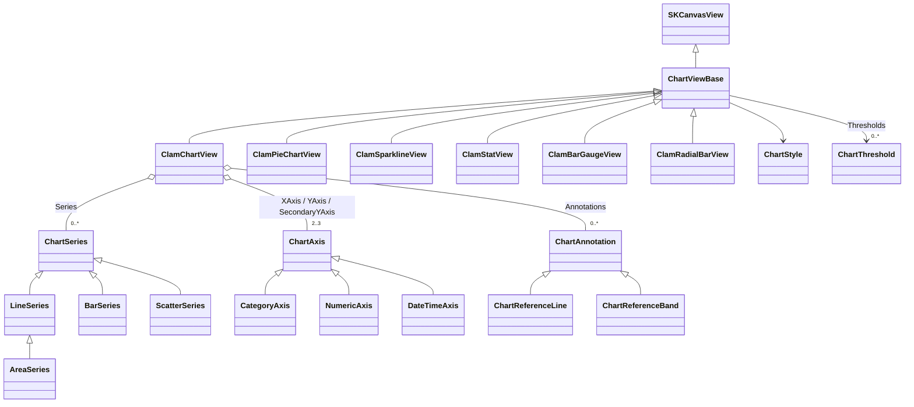
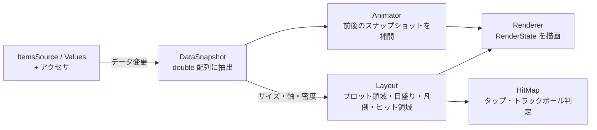

# ClamChart 仕様書（ドラフト）

| 項目 | 内容 |
|---|---|
| ステータス | ドラフト（レビュー用） |
| 対象 | ClamChart 0.x（初回リリースまでの設計） |
| 作成日 | 2026-10-19 |
| 前提 | .NET 10 / .NET MAUI 10.0.110 / SkiaSharp 4.153.1 / SkiaExtension 1.2.0、Android 優先（API 30 以上） |

本書は Clam シリーズ（ClamCalendar / ClamGrid / ClamGauge）の新ライブラリ **ClamChart** について、作成するチャート・プロパティ・アニメーション・インタラクション・差別化方針を定める仕様書である。  
API の命名・構成は既存の Clam シリーズに揃え、描画は template-maui の自前描画（GraphicsView / Drawing フレームワーク）ではなく **SkiaSharp の `SKCanvasView` を継承したコントロール**として実装する。Grafana 風のダッシュボード表現は template-avalonia-linux の実装も参考にする。  

## 目次

1. [概要](#1-概要)
2. [調査サマリと差別化](#2-調査サマリと差別化)
3. [チャートカタログと優先度](#3-チャートカタログと優先度)
4. [アーキテクチャ](#4-アーキテクチャ)
5. [データバインディングと MVVM](#5-データバインディングと-mvvm)
6. [スタイルとテーマ](#6-スタイルとテーマ)
7. [コントロール仕様](#7-コントロール仕様)
8. [アニメーション](#8-アニメーション)
9. [インタラクション（リアクション）](#9-インタラクションリアクション)
10. [エフェクト](#10-エフェクト)
11. [ウィジェット利用](#11-ウィジェット利用)
12. [パフォーマンスと品質](#12-パフォーマンスと品質)
13. [既存テンプレートからの流用](#13-既存テンプレートからの流用)
14. [プロジェクト構成・テスト・サンプル](#14-プロジェクト構成テストサンプル)
15. [ロードマップ](#15-ロードマップ)
16. [決定事項と未決事項](#16-決定事項と未決事項)
- [付録 A. 参考資料](#付録-a-参考資料)
- [付録 B. 補足](#付録-b-補足)

---

## 1. 概要

### 1.1 目的

スマートフォン向け .NET MAUI アプリで、**ダッシュボードや一覧画面に埋め込んで使える汎用チャート集**を提供する。  
フル画面のチャートだけでなく、カード・タイル・リストのセルといった小さな領域に「ウィジェット」として置いても破綻しないことを最重要の要件とする。  

### 1.2 コンセプト

> **「ダッシュボードとウィジェットのためのチャート」**  
> 1 枚の Skia キャンバスで描き、MVVM でつなぎ、どのサイズでも読める。

| # | 設計原則 | 内容 |
|---|---|---|
| P1 | 1 コントロール = 1 キャンバス | 各チャートは `SKCanvasView` 1 枚で描画し、子 View を持たない。リストに多数並べても軽い |
| P2 | MVVM ファースト | データ・選択・追跡位置はすべてバインド可能。コレクション変更は `INotifyCollectionChanged` / `INotifyPropertyChanged` で追従する |
| P3 | リフレクションなし | 値の取り出しは型付きデリゲート（アクセサ）で行い、`IsTrimmable` / `IsAotCompatible` を満たす |
| P4 | 小さくても読める | 描画領域のサイズに応じて軸・凡例・ラベルを自動で間引く「密度（Density）」を持つ |
| P5 | 意味のある動きだけ | アニメーションは状態の変化（登場・更新・選択）を伝えるものに限る。常時動くエフェクトはオプトイン |
| P6 | タッチは 2 種類 | 「タップ」と「長押しからのドラッグ（トラックボール）」のみ。ピンチズームやパンは採用しない |
| P7 | Clam シリーズと同じ作法 | `Format` / `Converter` / `Formatter` の 3 段フォーマット、イベント + Command の対、`XxxStyle` レコード、DIP 単位、不正値の即時例外 |
| P8 | 重ねても邪魔をしない | 背景は透明、空データ時は何も描かない、操作を有効にしない限りタッチを奪わない、アイドル時は再描画しない。画像・地図・カードの上に重ねて使える |
| P9 | 主張しないデザイン | 既定の見た目は細い線・淡い塗り・ヘアラインのグリッド・落ち着いたパレット。目立たせるのはデータだけで、影や光彩などの装飾は既定で無効 |

### 1.3 スコープ

| 対象 | 対象外 |
|---|---|
| 折れ線・面・棒（積み上げ・横棒）・円/ドーナツ・スパークライン・KPI・バーゲージ・ラジアルバー | 金融系（ローソク足・OHLC・出来高） |
| 時系列（日時軸）とカテゴリ軸、数値軸 | 3D チャート、等高線、ガントチャート |
| 閾値（Thresholds）・基準線・帯 | ズーム／パン、データ点のドラッグ編集 |
| 登場・更新・選択アニメーション | ドリルダウンの組み込み（Command で画面遷移はアプリ側） |
| オフスクリーン描画（PNG 出力） | ダッシュボードのレイアウトコンテナ（MAUI の `Grid` / `FlexLayout` を使う） |
| 他コントロールへの重ね合わせ（透明背景・タッチ透過） | 重ねた下のコントロールの制御（下の View への入力転送は OS の通常の配送に任せる） |
| ライト／ダークのスタイルプリセット | 円形ゲージ（既存の ClamGauge が担当） |

### 1.4 動作環境

| 項目 | 値 |
|---|---|
| TargetFrameworks | `net10.0;net10.0-android`（`net10.0` は単体テスト用） |
| 最小 Android | API 30（`SupportedOSPlatformVersion 30.0`） |
| 依存パッケージ | `Microsoft.Maui.Controls 10.0.110`、`SkiaSharp 4.153.1`、`SkiaSharp.Views.Maui.Controls 4.153.1`、`SkiaExtension 1.2.0` |
| ビルド特性 | `IsTrimmable=true`、`IsAotCompatible=true`、`Nullable enable`、`AnalysisMode All`、警告ゼロ |
| アプリ側の登録 | `UseSkiaSharp()` のみ（他の Clam と同じ） |

### 1.5 用語

| 用語 | 意味 |
|---|---|
| シリーズ（Series） | 1 本の線や 1 組の棒など、同じ見た目で描くデータ点の集まり |
| カテゴリ | X 方向の離散的な区分（月、曜日、店舗など） |
| 閾値（Threshold） | 値 → 色の対応表。Grafana の Thresholds と同じ考え方で、線・棒・KPI の色分けに共通で使う |
| 密度（Density） | 描画領域のサイズに応じた表示の詳細度。`Full` / `Compact` / `Minimal` |
| トラックボール | 長押し後のドラッグで、指の X 位置にある全シリーズの値を表示する機能 |
| ウィジェット | 他画面の一部（カード・タイル・リストのセル）として置かれる小型チャート |
| DIP | デバイス非依存ピクセル。サイズ指定はすべて DIP |

---

## 2. 調査サマリと差別化

### 2.1 既存ライブラリの傾向（調査結果の要約）

| 観点 | Syncfusion / Telerik | Syncfusion Toolkit（OSS） | LiveCharts2 | Microcharts | Grafana（参考） |
|---|---|---|---|---|---|
| 位置づけ | 商用・業務向けフルセット | MIT ライセンスの OSS 版。Cartesian / Circular / Polar / Funnel / Pyramid に加え、2025 年に Sparkline / Sunburst を追加 | OSS・高機能 | OSS・軽量 | Web ダッシュボードのベンチマーク |
| チャート種類 | 非常に多い（金融・多軸含む） | 多い | 多い（金融含む） | 少ない（散布図なし） | 時系列中心＋ Stat / Bar gauge / Heatmap / State timeline |
| データバインド | `ItemsSource` + `XBindingPath` / `YBindingPath`（文字列パス） | 同左 | Mapper / 型付きモデル | `ChartEntry` の配列を直接設定 | クエリ結果 |
| アニメーション | ロード時・更新時のイージング | 同左 | ストリーミング時の補間が強力 | ほぼなし | 控えめ |
| インタラクション | 選択・ツールチップ・トラックボール・ズーム・パン | 同左 | ツールチップ・ズーム・パン | ほぼなし | 共有クロスヘア・ドリルダウン |
| ダッシュボード語彙 | 部品単位（ゲージ等は別コントロール） | 同左 | 自前で組み立て | なし | 閾値による色分け・Stat・Bar gauge が標準 |

調査から読み取れる要点は次の 3 つである。  

- **商用・OSS 大手は「機能の網羅」で勝負している。** 同じ土俵（種類数・ズーム・多軸）で戦う意味は薄い。
- **バインドは文字列パス（`XBindingPath`）が主流**で、トリミングや AOT とは相性が悪い。Clam シリーズは型付きアクセサでこれを解決済み（ClamGrid の `GridValueAccessorCollection<T>`）。
- **ダッシュボード固有の表現（閾値の色分け、KPI タイル、バーゲージ、共有クロスヘア）は Grafana が最も洗練**されており、MAUI のチャートライブラリでは「自分で組み立てる」領域になっている。

### 2.2 ClamChart の立ち位置

> 種類の多さではなく、**「小さく置いても読める」「MVVM で素直につながる」「ダッシュボードの語彙を最初から持つ」**で差別化する。

| # | 差別化ポイント | 内容 | 競合の状況 |
|---|---|---|---|
| D1 | サイズ適応（Density） | 同じコントロールが、フル画面では軸・凡例付き、カードでは要点だけ、セルではスパークライン相当に自動で変わる | 多くは固定レイアウト。小さくすると軸ラベルが潰れる |
| D2 | ダッシュボード部品を同梱 | KPI タイル（`ClamStatView`）、バーゲージ（`ClamBarGaugeView`）、ラジアルバー（`ClamRadialBarView`）を同じスタイル体系で提供 | 個別に組み立てるか、別製品 |
| D3 | 閾値の共通化 | `ChartThreshold` を全コントロールで共有し、線の色分け・棒の色分け・KPI の背景色を同じ定義で切り替える | Grafana 以外ではシリーズ単位の手作業 |
| D4 | スクラブ表示を MVVM で | 長押しドラッグ中の位置を `TrackedIndex` / `TrackedItem` として ViewModel に返す。ヘッダーの数値を指の位置に追従させる（株価アプリ型）UI がバインドだけで作れる | ツールチップは描けても VM 側に位置を返す仕組みは弱い |
| D5 | AOT / トリミング安全 | 文字列パスを使わない型付きアクセサ。リフレクションなし | 文字列パスが主流 |
| D6 | View を使わない描画 API | スパークライン等を任意の `SKCanvas` に描ける静的 API と、PNG 出力（オフスクリーン描画）を提供。Android のホーム画面ウィジェットや共有画像に使える | 画像出力はあっても View 前提が多い |
| D7 | スクロールと共存するタッチ | トラックボールは長押しで開始するため、`ScrollView` や `CollectionView` 内に置いても縦スクロールを奪わない | 即時ドラッグ型はスクロールと競合しやすい |
| D8 | Clam ファミリーで統一 | フォーマット・イベント・スタイル・フォントフォールバック（`FallbackFonts`）の作法が ClamGrid / ClamCalendar / ClamGauge と同じ | — |
| D9 | 重ね合わせ前提 | 透明背景・タッチ透過（`TouchMode`）・端まで描く（`EdgeToEdge`）・オーバーレイ用スタイルプリセットにより、カードの背景や画像・地図の上に置ける（[11.3](#113-重ね合わせオーバーレイ)） | 背景や余白、タッチ処理が単独表示前提で、重ねると干渉しやすい |

### 2.3 Grafana パネルとの対応

Clam ファミリー全体で、Grafana の主要パネルをスマートフォン向けに揃える方針とする。  

| Grafana パネル | Clam での対応 | 備考 |
|---|---|---|
| Time series | `ClamChartView`（`LineSeries` / `AreaSeries` + `DateTimeAxis`） | 本ライブラリの中核。左右 2 軸にも対応 |
| Bar chart | `ClamChartView`（`BarSeries`） | 積み上げ・横棒を含む |
| Pie chart | `ClamPieChartView` | ドーナツ・半円を含む |
| Stat | `ClamStatView` | 値＋差分＋背景スパークライン |
| Bar gauge | `ClamBarGaugeView` | 複数項目の進捗・ランキング |
| Gauge | **ClamGauge**（既存） | 本ライブラリでは扱わない |
| Table | **ClamGrid**（既存） | セル内スパークラインは将来の連携候補（[11.6](#116-clamgrid-との連携将来)） |
| Heatmap | `ClamHeatmapView`（フェーズ 3） | 行列型とカレンダー型 |
| State timeline | 将来候補 | 睡眠ステージ・稼働状態など |

---

## 3. チャートカタログと優先度

### 3.1 提供コントロール

| コントロール | 描けるチャート | 主な用途 | フェーズ |
|---|---|---|:-:|
| `ClamChartView` | 折れ線、スプライン、ステップ、面（積み上げ・100%）、縦棒／横棒（集合・積み上げ・100%）、混在（棒＋線） | 推移・比較・時系列のメインチャート | 1 |
| `ClamPieChartView` | 円、ドーナツ、半円ドーナツ | 構成比 | 1 |
| `ClamSparklineView` | 線、面、棒、勝敗（Win/Loss） | リストのセル・カード内の小さな推移 | 1 |
| `ClamStatView` | KPI タイル（値・単位・差分・背景スパークライン・閾値色） | ダッシュボードの数値カード | 2 |
| `ClamBarGaugeView` | 横棒の進捗リスト、ブレット（目標線付き）、セグメント表示 | 達成率・使用率・ランキング | 2 |
| `ClamRadialBarView` | 同心円の進捗リング、ラジアルバー | アクティビティリング・目標達成 | 2 |
| `ClamChartView` の `ScatterSeries` | 散布図 | 相関 | 2 |
| `ClamRadarChartView` | レーダー（多角形・円） | 評価項目の比較 | 3 |
| `ClamHeatmapView` | 行列ヒートマップ、カレンダーヒートマップ | 曜日×時間帯、日別の活動量 | 3 |
| `ClamChartView` の `BubbleSeries` | バブル | 3 変数の比較 | 3 |

フェーズ 1 で「メインチャート（推移・比較・構成比）」と「最小ウィジェット（スパークライン）」を揃え、フェーズ 2 でダッシュボード部品を揃える。  
各フェーズの詳細は [15. ロードマップ](#15-ロードマップ) を参照。  

### 3.2 コントロール分割の方針

すべてを 1 つの汎用チャートに詰め込まず、**座標系と用途でコントロールを分ける**。  

| 方針 | 理由 |
|---|---|
| 直交座標系（X/Y 軸を持つもの）は `ClamChartView` 1 つにまとめ、シリーズの種類で描き分ける | 棒＋線の混在、積み上げ、共通の軸・トラックボールを 1 か所で実装できる |
| 円・リング系、ウィジェット系は専用コントロールにする | 軸がなく、プロパティ体系がまったく異なる。汎用チャートに入れると不要なプロパティが大半になる |
| すべて共通基底 `ChartViewBase` を継承する | スタイル・密度・アニメーション・空状態・スナップショットを共通化し、`ApplyToDerivedTypes` の暗黙スタイルで一括テーマ設定できるようにする |

### 3.3 採用しないもの

| 項目 | 理由 |
|---|---|
| 金融チャート（ローソク足・OHLC・出来高） | 要件外。汎用ダッシュボードでの需要が低い |
| ズーム・パン（ピンチ・ダブルタップ） | スマートフォンではスクロールと競合し、操作が複雑になる。表示範囲は ViewModel から軸の `Minimum` / `Maximum` を切り替える方式（1D / 1W / 1M ボタン等）で代替する |
| 3D・ベベル・反射などの装飾 | 可読性が下がり、描画コストが高い |
| データ点のドラッグ編集 | 用途が限定的 |
| ツールチップの `DataTemplate`（MAUI View の重ね合わせ） | 1 キャンバス方針（P1）に反する。代わりに追跡位置を VM に返し（D4）、アプリ側の任意の UI で表示できるようにする |
| 3 本以上の Y 軸 | 左右 2 本（主軸＋第 2 軸、[7.1.8](#718-第-2-y-軸)）までとする。それ以上はチャートを縦に並べ、トラックボールの同期（[9.4](#94-トラックボールの同期)）で読み合わせる |
| 漏斗・ピラミッド・サンバースト | 汎用ダッシュボードでの優先度が低い。必要になればフェーズ 3 以降で再検討 |
| ツリーマップ・State timeline | template-maui に実装例（`ColorTreeMapDrawing` / `KitSleepBand`）があり需要はあるため、フェーズ 3 以降の候補として残す |

---

## 4. アーキテクチャ

### 4.1 クラス構成



| 型 | 種別 | 役割 |
|---|---|---|
| `ChartViewBase` | `public abstract partial class : SKCanvasView, IDisposable` | スタイル・密度・アニメーション・タッチ・空状態・スナップショットの共通実装。暗黙スタイルの `TargetType` に使えるよう公開する |
| `ClamXxxView` | `public partial class : ChartViewBase` | 各チャート。Clam の命名（`ClamGaugeView` 等）に合わせる |
| `ChartSeries` / `ChartAxis` / `ChartAnnotation` | `public abstract class : Element` | XAML の子要素。チャートの論理子として追加し、`BindingContext` を継承させる（シリーズ内で `{Binding Sales}` が書ける） |
| `ChartStyle` | `public sealed record` | 見た目の枠（文字・軸・グリッド・凡例・ツールチップ・パレット）。ClamGrid の `GridStyle` と同じ扱い |
| `ChartThreshold` | `public sealed class` | 値 → 色の段階。ClamGauge の `GaugeRange` と同じく単純なクラス |
| `ChartAccessorCollection<T>` | `public sealed class` | キー → 型付きゲッターの対応表。ClamGrid の `GridValueAccessorCollection<T>` と同じ考え方 |

### 4.2 共通基底 `ChartViewBase`

全コントロールが持つプロパティ。各コントロール固有のプロパティは [7 章](#7-コントロール仕様) に記載する。  

| 名前 | 型 | 既定値 | Bindable | 説明 | フェーズ |
|---|---|---|:-:|---|:-:|
| `ChartStyle` | `ChartStyle` | `ChartStyles.Light` | ✓ | 見た目の枠。null は `ArgumentNullException` | 1 |
| `Palette` | `IReadOnlyList<Color>?` | `null` | ✓ | シリーズ色の上書き。`null` は `ChartStyle.Palette` | 1 |
| `Density` | `ChartDensity` | `Auto` | ✓ | `Auto` / `Full` / `Compact` / `Minimal`（[11.1](#111-密度density)） | 1 |
| `EffectiveDensity` | `ChartDensity` | | | `Auto` を解決した結果 | 1 |
| `ContentPadding` | `Thickness?` | `null` | ✓ | 描画内容の外側の余白。`null` は密度に応じた既定値（Full 8 / Compact 4 / Minimal 0） | 1 |
| `EdgeToEdge` | `bool` | `false` | ✓ | プロット領域を View の端まで広げる（カード背景用、[11.3](#113-重ね合わせオーバーレイ)） | 2 |
| `Culture` | `CultureInfo?` | `null` | ✓ | 数値・日付の書式。`null` は `CultureInfo.CurrentCulture` | 1 |
| `AnimationEnabled` | `bool` | `true` | ✓ | `false` で登場・更新・選択・常時のすべてのアニメーションを無効にし、常に最終状態を描く（[8.5](#85-無効化とモーション軽減)） | 1 |
| `AnimationDuration` | `int` | `450` | ✓ | アニメーションの長さ（ms）。`0` でも無効 | 1 |
| `AnimationEasing` | `Easing` | `Easing.CubicOut` | ✓ | イージング | 1 |
| `EntranceAnimation` | `ChartEntranceAnimation` | `Auto` | ✓ | 登場アニメーション（[8.2](#82-登場アニメーション)） | 1 |
| `UpdateAnimationEnabled` | `bool` | `true` | ✓ | データ更新時に値を補間する | 1 |
| `TouchMode` | `ChartTouchMode` | `Auto` | ✓ | タッチの扱い（[9.1](#91-タッチの基本方針)） | 1 |
| `IsBusy` | `bool` | `false` | ✓ | 読み込み中のスケルトン表示（[11.4](#114-状態表示読み込み中空データ)） | 2 |
| `EmptyText` | `string?` | `null` | ✓ | データがないときの文言。`null` は何も描かない | 1 |
| `ItemTappedCommand` | `ICommand?` | `null` | ✓ | `ItemTapped` の後に実行 | 1 |
| `ChartTappedCommand` | `ICommand?` | `null` | ✓ | `ChartTapped` の後に実行 | 1 |

| メソッド | 戻り値 | 説明 | フェーズ |
|---|---|---|:-:|
| `Invalidate()` | `void` | スタイルを再検証し、レンダラーを作り直して再描画する（Clam 共通） | 1 |
| `PlayEntranceAnimation()` | `void` | 登場アニメーションを再生し直す（タブ切り替えで見せ直す場合など） | 1 |
| `CompleteAnimations()` | `void` | 実行中のアニメーションを最終状態にして止める | 1 |
| `CancelInteraction()` | `void` | 長押し・トラックボールを取り消す（Clam 共通） | 1 |
| `RenderToImage(Size size, float scale)` | `SKImage` | オフスクリーン描画（[11.5](#115-view-を使わない描画とスナップショット)） | 2 |
| `SaveAsPngAsync(Stream stream, Size size, float scale)` | `Task` | PNG 出力 | 2 |

| イベント | EventArgs | 説明 | フェーズ |
|---|---|---|:-:|
| `ItemTapped` | `ChartItemEventArgs` | データ要素（点・棒・スライス・行）のタップ | 1 |
| `ChartTapped` | `ChartTappedEventArgs` | データ要素以外のタップ。`Minimal` 密度ではチャート全体が 1 つのボタンになる | 1 |
| `FrameRendered` | `ChartFrameEventArgs` | 描画時間・点数などの診断情報（ClamGrid の `FrameRendered` と同じ） | 1 |

### 4.3 描画パイプライン



| 段階 | 内容 | 再計算のきっかけ |
|---|---|---|
| DataSnapshot | 項目からアクセサで値を取り出し、`double[]`（X / Y / 積み上げ後の値）に詰める。描画中は項目に触れない | `ItemsSource` の差し替え、コレクション変更、項目の `PropertyChanged`、キーやアクセサの変更 |
| Layout | 軸範囲（Nice Scale）、目盛り、ラベルの間引き、凡例の配置、プロット領域、ヒット領域を計算する | サイズ変更、密度変更、軸・凡例・スタイルの変更、スナップショット更新 |
| Animator | 前回と今回のスナップショットを進捗 0〜1 で補間した「表示用スナップショット」を作る | アニメーションのフレーム |
| Renderer | `RenderState` を受け取り Skia で描く。`SKPaint` / `SKPath` は使い回す | 毎フレーム |
| HitMap | 描画済みの形からタッチ位置 → データ要素を引く。直交座標は X の二分探索、円は角度で判定 | Layout 更新時 |

プロパティ変更時のコールバックは ClamCalendar と同じく 4 種に分ける。  

| コールバック | 動作 |
|---|---|
| `OnDataInputChanged` | スナップショットを作り直し、更新アニメーションを開始する |
| `OnLayoutInputChanged` | レイアウトを無効化して再描画する |
| `OnRenderInputChanged` | `InvalidateSurface()` のみ |
| `OnStyleChanged` | レンダラーを破棄し、レイアウトを無効化して再描画する |

同じ UI ループ内で起きた複数の変更（`Add` と `RemoveAt(0)` の連続など）は 1 回の再計算にまとめる（`Dispatcher.Dispatch` で次のフレームに遅延し、フラグで重複を除く）。  

### 4.4 ファイル構成

```
ClamChart/
├── Assembly.cs                      CLSCompliant(false)、InternalsVisibleTo("ClamChart.Tests")
├── ChartViewBase.cs                 共通基底（.Animation.cs / .Input.cs / .Snapshot.cs / .android.cs に分割）
├── ClamChartView.cs                 直交座標チャート（.Axes.cs / .Series.cs / .Legend.cs / .Tracking.cs）
├── ClamPieChartView.cs
├── ClamSparklineView.cs
├── ClamStatView.cs
├── ClamBarGaugeView.cs
├── ClamRadialBarView.cs
├── ChartStyle.cs / ChartStyles.cs / ChartThreshold.cs / 列挙型 / *EventArgs
├── Series/        ChartSeries, LineSeries, AreaSeries, BarSeries, ScatterSeries
├── Axes/          ChartAxis, CategoryAxis, NumericAxis, DateTimeAxis
├── Annotations/   ChartAnnotation, ChartReferenceLine, ChartReferenceBand
├── Data/          ChartAccessorCollection<T>, ChartPoint, ChartEntry, DataSnapshot, ChartCollectionWatcher
├── Layout/        NiceScale, AxisRangeResolver, TickGenerator, LabelThinning, StackCalculator, PieLayout, DensityResolver, Downsampler, ChartRect, ChartHit
├── Input/         ChartGestureController, GestureAction, GestureResult
├── Animation/     ChartAnimator, SnapshotInterpolator
├── Rendering/     CartesianRenderer, PieRenderer, SparklineRenderer, … , ChartRenderState, ChartTextFormat, PaintCache
├── Drawing/       ChartDrawing（View を使わない公開描画 API）
└── Platform/      IChartPlatformBridge, ChartPlatformBridge.android.cs
```

- 1 ファイル 1 型、ビューは関心ごとに partial ファイルへ分割する（ClamGrid / ClamCalendar と同じ）。
- `Layout/` と `Input/` は MAUI に依存しない純粋なクラスにして、`net10.0` の単体テストで検証する。
- `*.android.cs` は Android ビルドだけでコンパイルする（既存 csproj の仕組みをそのまま使う）。

### 4.5 ライフサイクルとスレッド

| 項目 | 方針 |
|---|---|
| コレクション監視 | Handler が付いている間だけ購読する（ClamCalendar の `CalendarCollectionWatcher` と同じ）。寿命の長い ViewModel のコレクションがデタッチ済みの View を保持しない |
| アニメーション | Handler の切り離し、`Unloaded`、`IsVisible = false`、`Dispose` で停止し、最終状態に揃える |
| アイドル時 | アニメーションも変更もなければ再描画しない。常時アニメーション（ライブ表示・スケルトン）はオプトインで、非表示時は止める |
| スレッド | プロパティ・コレクションの変更は UI スレッドのみ。`Dispatcher.IsDispatchRequired` のときは `InvalidOperationException`（ClamGrid の `RequireUiThread()` と同じ）。バックグラウンドで集計した値は ViewModel で UI スレッドに戻してから渡す |
| 破棄 | `IDisposable`。破棄後の操作は `ObjectDisposedException` |

---

## 5. データバインディングと MVVM

### 5.1 データの渡し方

用途の難易度に合わせて 3 段階を用意する。どの方法もリフレクションを使わない。  

| 段階 | 渡し方 | 向いている場面 |
|---|---|---|
| ① 値の列 | `IEnumerable<double>`（`int` / `float` / `decimal` も可）。X は 0 からの連番 | スパークライン、単純な推移 |
| ② ライブラリのモデル | `ChartPoint`（X: `double`, Y: `double`）、`ChartTimePoint`（X: `DateTime`, Y: `double`）、`ChartEntry`（`Label`, `Value`, `Color?`） | 円・バーゲージ・ラジアルバー、ViewModel でデータを組み立てる場合 |
| ③ 任意の型＋アクセサ | `ItemsSource` に任意の項目、`ValueAccessors` に `ChartAccessorCollection<T>`、シリーズに `XKey` / `YKey` などのキー | 既存のモデル（DTO・エンティティ）をそのまま渡したい場合 |

`ChartPoint` / `ChartTimePoint` / `ChartEntry` は `sealed record`（参照型）とし、`TrackedItem` などで ViewModel の型付きプロパティへそのまま受け渡せるようにする。  

判定順は「キーが指定されていればアクセサ」→「`ChartEntry` / `ChartPoint` / `ChartTimePoint`」→「数値」とする。どれにも当てはまらない項目は `InvalidOperationException`（データ変更時に投げ、描画中には投げない）。  

`Y` が `null` または `NaN` の項目は欠損として扱い、`EmptyPointMode`（`Gap` / `Zero` / `Interpolate`、既定 `Gap`）に従う。  

### 5.2 型付きアクセサ

ClamGrid の `GridValueAccessorCollection<T>` と同じく、コレクション初期化子でキーとゲッターを登録する。  

```csharp
public sealed class MonthlySales
{
    public static ChartAccessorCollection<MonthlySales> Accessors { get; } = new()
    {
        { "month", static x => x.Month },
        { "sales", static x => x.Sales },
        { "target", static x => x.Target }
    };

    public required string Month { get; init; }

    public double Sales { get; set; }

    public double? Target { get; set; }
}
```

```xml
<clam:ClamChartView ValueAccessors="{x:Static models:MonthlySales.Accessors}"
                    XKey="month">
    <clam:ClamChartView.XAxis>
        <clam:CategoryAxis />
    </clam:ClamChartView.XAxis>
    <clam:BarSeries Title="売上" ItemsSource="{Binding Sales}" YKey="sales" />
    <clam:LineSeries Title="目標" ItemsSource="{Binding Sales}" YKey="target" DashPattern="4,4" />
</clam:ClamChartView>
```

| 項目 | 仕様 |
|---|---|
| 登録できる型 | `Func<T, double>`、`Func<T, double?>`（`null` は欠損）、`Func<T, DateTime>`、`Func<T, DateTimeOffset>`、`Func<T, string?>`、`Func<T, Color?>` |
| 置き場所 | `ClamChartView.ValueAccessors`（全シリーズ共通）と `ChartSeries.ValueAccessors`（シリーズ個別、優先）。単体コントロール（円・バーゲージ等）は自身の `ValueAccessors` |
| キー | `XKey`（チャート共通、シリーズで上書き可）、`YKey`、`LabelKey`、`ColorKey`、`SizeKey`（バブル、フェーズ 3） |
| 型の不一致 | キーの型が用途と合わない（`YKey` に `string` のゲッター等）場合は `InvalidOperationException` |
| X の型と軸 | `string` → `CategoryAxis`、`DateTime` / `DateTimeOffset` → `DateTimeAxis`、`double` → `NumericAxis`。軸が未指定なら X の型から自動で選ぶ |

コード側からはデリゲートを直接渡すこともできる（`ValueSelector`、`LabelSelector` などの非 Bindable プロパティ。ClamGauge の `LabelFormatter` と同じ扱い）。  

### 5.3 変更の追跡

| 変更 | 動作 |
|---|---|
| `ItemsSource` の差し替え | スナップショットを作り直す。点数が同じなら値を補間（モーフ）、違うなら登場アニメーションをやり直す |
| `INotifyCollectionChanged` の Add / Remove | 位置付きの差分として扱う。末尾追加は直前の点から伸びるように、先頭削除は左へ流れ出るように補間する（ストリーミング表示） |
| `INotifyCollectionChanged` の Replace / Move | 該当位置の値を補間する |
| `INotifyCollectionChanged` の Reset | 差し替えと同じ |
| 項目の `INotifyPropertyChanged` | `TrackItemChanges`（既定 `true`）のとき、その項目の値だけ取り直して補間する。ClamGrid と同じく参照等価の集合で購読を管理する |

ストリーミング（一定間隔で末尾に追加し先頭を削除）では、ViewModel が `ObservableCollection` の `Add` と `RemoveAt(0)` を続けて呼ぶだけでよい。2 つの変更は 1 フレームにまとまり、横に流れるアニメーションになる。  

### 5.4 双方向・ソース方向のプロパティ

| プロパティ | 既定の BindingMode | 内容 |
|---|---|---|
| `SelectedItem` | TwoWay | 選択中の項目。ViewModel から設定すると選択表示が切り替わる |
| `SelectedIndex` | TwoWay | 選択中の位置（`-1` は未選択） |
| `TrackedItem` / `TrackedIndex` | OneWayToSource | トラックボールが指している項目と位置。指を離すと `null` / `-1` |
| `ChartSeries.IsVisible` | TwoWay | 凡例タップで切り替えた表示状態を ViewModel に返す |

`TrackedItem` を使うと、チャートの上に置いた MAUI の `Label` が指の位置の値を表示する「スクラブ表示」がバインドだけで作れる（[9.3](#93-トラックボール)）。  

### 5.5 イベントと Command

Clam 共通の作法に従い、イベントを発行した後、同じ引数で対応する Command を実行する。`Handled = true` にすると Command と既定動作（選択の切り替えなど）を抑止する。  

| イベント | EventArgs | Command | 主なメンバー |
|---|---|---|---|
| `ItemTapped` | `ChartItemEventArgs` | `ItemTappedCommand` | `Series`, `SeriesIndex`, `Index`, `Item`, `X`, `Y`, `Position`, `Handled` |
| `ChartTapped` | `ChartTappedEventArgs` | `ChartTappedCommand` | `Position`, `Handled` |
| `SelectionChanged` | `ChartSelectionChangedEventArgs` | `SelectionChangedCommand` | `OldItem`, `NewItem`, `OldIndex`, `NewIndex` |
| `TrackingStarted` / `TrackingChanged` / `TrackingEnded` | `ChartTrackingEventArgs` | `TrackingChangedCommand` | `Index`, `X`, `Points`（各シリーズの値） |
| `LegendItemTapped` | `ChartLegendEventArgs` | `LegendItemTappedCommand` | `Series` または `Item`, `Handled`（`true` で表示切り替えを抑止） |
| `FrameRendered` | `ChartFrameEventArgs` | — | `ElapsedMilliseconds`, `PointCount`, `Animating` |

### 5.6 書式

数値・日付を文字にする箇所（軸ラベル、データラベル、ツールチップ、中央値、KPI の値）はすべて、ClamGauge と同じ 3 段の書式を持つ。  

| 優先度 | プロパティ | 型 | Bindable | 例 |
|:-:|---|---|:-:|---|
| 1 | `XxxFormatter` | `Func<double, string>?` | | コードからの任意変換 |
| 2 | `XxxConverter` | `IValueConverter?` | ✓ | 既存のコンバーターを再利用 |
| 3 | `XxxFormat` | `string` | ✓ | `{0:N0}円`（`{` を含むと複合書式）または `N0` |

既定の数値書式は「コンパクト表記」（`1,284` / `12.9K` / `4.2M`、カルチャに従う）とし、狭い領域でも桁があふれないようにする。日付軸の既定書式は表示範囲から自動で決める（[7.1.4](#714-軸)）。  

### 5.7 MVVM の利用例

Smart.Mvvm（`[ObservableProperty]`）を使った ViewModel の例。ライブラリ自体は特定の MVVM フレームワークに依存しない。  

```csharp
public sealed partial class DashboardViewModel : AppViewModelBase
{
    private double latest;

    public ObservableCollection<ChartTimePoint> Requests { get; } = [];

    // 指を置いた位置の値、離すと現在値
    [ObservableProperty]
    public partial double HeaderValue { get; set; }

    // チャートから OneWayToSource で設定される
    public ChartTimePoint? TrackedRequest
    {
        get;
        set
        {
            field = value;
            OnPropertyChanged();
            HeaderValue = value?.Y ?? latest;
        }
    }

    public IObserveCommand OpenDetailCommand { get; }

    public DashboardViewModel()
    {
        OpenDetailCommand = MakeDelegateCommand(static () => { /* 詳細画面へ遷移 */ });
    }

    // タイマーから UI スレッドで呼ばれる
    private void OnSample(double value)
    {
        Requests.Add(new ChartTimePoint(DateTime.Now, value));
        if (Requests.Count > 60)
        {
            Requests.RemoveAt(0);
        }

        latest = value;
        if (TrackedRequest is null)
        {
            HeaderValue = value;
        }
    }
}
```

```xml
<Grid RowDefinitions="Auto,*">
    <Label Text="{Binding HeaderValue, StringFormat='{0:N0} req/s'}" />
    <clam:ClamChartView Grid.Row="1"
                        TrackballMode="LongPress"
                        TrackedItem="{Binding TrackedRequest}"
                        ChartTappedCommand="{Binding OpenDetailCommand}">
        <clam:AreaSeries ItemsSource="{Binding Requests}" />
    </clam:ClamChartView>
</Grid>
```

---

## 6. スタイルとテーマ

### 6.1 方針

| 区分 | 置き場所 | 例 |
|---|---|---|
| 見た目の枠（データ以外） | `ChartStyle` レコード | フォント、文字色、グリッド、軸線、凡例、ツールチップ、トラック、パレット、状態色 |
| データの見た目の既定値 | `ChartStyle` レコード | 線の太さ、面の不透明度、棒の角丸・最大幅、マーカーの大きさ、要素間の隙間 |
| データの見た目（個別） | シリーズ・コントロールのプロパティ（`null` は `ChartStyle` の既定値） | シリーズ色、太さ、破線、マーカー、角丸 |

- `ChartStyle` は ClamGrid / ClamCalendar と同じく、割り当て後は不変として扱い、変更は `with` 式で新しいインスタンスを作る（その場で書き換えた場合は `Invalidate()`）。
- 1 つの `ChartStyle` をすべての ClamChart コントロールで共有できる。ダッシュボード全体のテーマを 1 か所で決められる。

### 6.2 デザイントーン（主張しない既定値）

重ね合わせても下のコントロールと喧嘩しないよう、既定の見た目は「データだけが目立つ」静かなものにする。  

| 要素 | 既定の見た目 |
|---|---|
| 背景 | 透明（`BackgroundColor` を設定しない限り塗らない）。プロット領域も塗らない |
| グリッド | 横線のみ、ヘアライン（`GridLineThickness = 0` は物理 1px）、背景から一段階だけ離れたグレー。縦線は既定で描かない |
| 軸線 | Y 軸線は描かない。X 軸は基線（値 0 または下端）のみ |
| 文字 | 11〜12 DIP、二次・弱いインク色。データの色を文字に使わない（凡例・ラベルは色付きのマーカーを横に置いて識別する） |
| 線 | 2 DIP、丸い結合・端点 |
| マーカー | 既定は非表示。最後の点・選択点のみ 8 DIP の点を、周囲を 2 DIP くり抜いて（ノックアウト）描く |
| 面 | シリーズ色の約 10% の淡い塗り。グラデーションは上から下へ消えるのみ |
| 棒 | 最大幅 24 DIP（スロットを埋め尽くさない）、データ側の端だけ 4 DIP の角丸、基線側は角を立てる |
| 隣接要素 | 積み上げの段・円のスライスの間に 2 DIP の隙間を幾何学的に空ける（線で縁取らない） |
| 選択 | 選択要素を強調色で塗るのではなく、他の要素を薄く（不透明度 0.35）する |
| 影・光彩 | 既定で無効（[10 章](#10-エフェクト) でオプトイン） |
| 動き | 1 回だけ、450 ms 前後で静かに終わる。繰り返す動きは既定で無効 |

マーカーの周囲の「くり抜き」と要素間の隙間は、背景色で塗るのではなく**実際に透明にする**（`SKBlendMode.Clear` と幾何学的な隙間）。背景が画像や地図でも、そこに背景色の輪が浮かない。  

### 6.3 `ChartStyle` の項目

| 名前 | 型 | 既定値（Light） | 説明 |
|---|---|---|---|
| `FontFamily` | `string` | `sans-serif` | すべての文字のフォント。SkiaExtension の `FallbackFonts` で 1 文字ずつ代替する |
| `PrimaryTextColor`, `SecondaryTextColor`, `MutedTextColor` | `Color` | `#0B0B0B`, `#52514E`, `#898781` | 値・ラベル・軸目盛りの文字色 |
| `TextHaloColor`, `TextHaloWidth` | `Color`, `double` | `Transparent`, `0` | 文字の縁取り。オーバーレイ用プリセットで使う |
| `AxisLabelFontSize`, `AxisTitleFontSize` | `double` | `11`, `11` | 軸の文字 |
| `AxisLineColor` | `Color` | `#C3C2B7` | 基線・軸線 |
| `GridLineColor`, `GridLineThickness` | `Color`, `double` | `#E1E0D9`, `0` | グリッド。`0` はヘアライン |
| `LegendFontSize`, `LegendMarkerSize` | `double` | `12`, `8` | 凡例 |
| `DataLabelFontSize` | `double` | `11` | データラベル |
| `TooltipBackground`, `TooltipTextColor`, `TooltipBorderColor` | `Color` | `#F0FCFCFB`, `#0B0B0B`, `#1A0B0B0B` | ツールチップ（半透明の面＋ヘアラインの縁） |
| `TooltipFontSize`, `TooltipCornerRadius` | `double` | `12`, `6` | ツールチップ |
| `TrackballLineColor` | `Color` | `#898781` | トラックボールの縦線 |
| `TrackColor` | `Color?` | `null` | バーゲージ・ラジアルバーの未到達部分。`null` は要素の色を不透明度 18% にした同系色（template-avalonia-linux の `RingGauge` と同じく、色相を揃えて状態が全体で読めるようにする） |
| `DimmedOpacity` | `double` | `0.35` | 選択時に他要素へ掛ける不透明度 |
| `PressedOverlayColor` | `Color` | `#0F000000` | タップ中の押下表示 |
| `SkeletonColor`, `SkeletonHighlightColor` | `Color` | `#ECEBE6`, `#F6F5F2` | 読み込み中のスケルトン |
| `Palette` | `IReadOnlyList<Color>` | [6.4](#64-パレット) | シリーズ色（固定順） |
| `OtherColor` | `Color` | `#B5B3AA` | 「その他」にまとめた要素、パレットを超えたシリーズ |
| `GoodColor`, `WarningColor`, `SeriousColor`, `CriticalColor` | `Color` | `#0CA30C`, `#FAB219`, `#EC835A`, `#D03B3B` | 状態色（閾値の既定色）。シリーズ色には使わない |
| `PositiveTextColor`, `NegativeTextColor` | `Color` | `#006300`, `#D03B3B` | KPI の差分の文字色 |
| `LineThickness` | `double` | `2` | 線の太さの既定値 |
| `AreaFillOpacity` | `double` | `0.10` | 面の不透明度の既定値 |
| `BarCornerRadius`, `MaxBarWidth` | `double` | `4`, `24` | 棒の既定値 |
| `MarkerSize`, `MarkerKnockout` | `double` | `8`, `2` | マーカーと周囲のくり抜き |
| `SegmentGap` | `double` | `2` | 積み上げの段・スライス・セグメントの隙間 |
| `CompactSize`, `MinimalSize` | `Size` | `320, 200`, `160, 96` | 密度 `Auto` の切り替え境界（幅か高さのどちらかが下回ると切り替える） |

検証は ClamGrid と同じく、`null` は `ArgumentNullException`、有限でない値や負のサイズは `ArgumentException` とする。  

### 6.4 パレット

既定パレットは色覚多様性に配慮して**順序を固定**した 8 色とし、ライトとダークで別の段階を選ぶ（自動反転ではない）。  

| 順 | 色相 | Light | Dark |
|:-:|---|---|---|
| 1 | 青 | `#2A78D6` | `#3987E5` |
| 2 | 橙 | `#EB6834` | `#D95926` |
| 3 | 水色 | `#1BAF7A` | `#199E70` |
| 4 | 黄 | `#EDA100` | `#C98500` |
| 5 | 桃 | `#E87BA4` | `#D55181` |
| 6 | 緑 | `#008300` | `#008300` |
| 7 | 紫 | `#6250D6` | `#9085E9` |
| 8 | 赤 | `#E34948` | `#E66767` |

この順序は、隣り合う色同士が色覚シミュレーション下でも区別できる（OKLab ΔE×100 ≥ 8）ことを検証済みの並びである。パレットを差し替える場合も同様に検証する。  

| 規則 | 内容 |
|---|---|
| 色は要素に付く | シリーズ色は `Series` コレクション内の位置で決め、表示中の順位では決めない。凡例で 1 本を隠しても残りの色は変わらない。円のスライスもデータの並び順（`ColorKey` があればその色）で決め、大きさ順の並べ替えで色を変えない |
| 循環させない | 9 本目以降のシリーズは `OtherColor` で描き、デバッグ出力に警告を出す。円は `MaxSlices`（既定 8）を超える分を「その他」にまとめる |
| 散布図は 3 色まで | 点が混在する散布図・バブルは、全組み合わせで区別できる先頭 3 色までを推奨とし、超える場合は「その他」にまとめる |
| 文字にデータ色を使わない | 凡例・ラベル・値の文字はインク色。識別は横に置く色付きマーカーで行う |
| 状態色は別枠 | 閾値の既定色は状態色（Good / Warning / Serious / Critical）を使い、シリーズ色と混ぜない |

用途に応じて、既定パレット以外も用意する。  

| パレット | 内容 | 向いている場面 |
|---|---|---|
| `ChartPalettes.Default` | 上表の 8 色（検証済み） | 既定。種類の異なるシリーズの識別 |
| `ChartPalettes.Grafana` | Grafana のクラシックパレットに近い 6 色相（緑 `#73BF69`、黄 `#FADE2A`、青 `#5794F2`、橙 `#FF9830`、赤 `#F2495C`、紫 `#B877D9`）。template-avalonia-linux の `ChartColors.axaml` と同じ | ダークテーマのキオスク・監視ダッシュボード |
| `ChartPalettes.Shades(ChartHue hue, int count)` | 1 つの色相の明→暗の段階を `count` 色ぶん作る（足りなければ段階を補間し、循環させない） | 同種のシリーズの集まり（CPU コアごとの使用率、センサーごとの温度など）。個々の識別は凡例の表（[7.1.5](#715-凡例データラベルツールチップ)）で行う |

`Grafana` と `Shades` は色覚多様性の検証を前提としないため、凡例の表やラベルと組み合わせて使う。  

### 6.5 プリセット

| プリセット | 用途 | 主な違い |
|---|---|---|
| `ChartStyles.Light` | 明るい画面（既定） | 6.3 の既定値 |
| `ChartStyles.Dark` | ダークテーマ | 文字 `#F0EFEC` / `#C3C2B7`、グリッド `#2C2C2A`、軸線 `#383835`、ダーク用パレット、`PositiveTextColor` `#0CA30C` |
| `ChartStyles.OverlayLight` | 明るい写真・カードの上に重ねる | グリッドと軸線なし、文字に白の縁取り、面の不透明度 0.06 |
| `ChartStyles.OverlayDark` | 地図・暗い写真・映像の上に重ねる | グリッドと軸線なし、明るい線と文字に黒の縁取り、面の不透明度 0.08 |

ライブラリは OS のテーマを自動では判定しない（既存の Clam と同じ）。テーマの切り替えはアプリ側で `AppThemeBinding` を使う。  

```xml
<Style TargetType="clam:ChartViewBase" ApplyToDerivedTypes="True">
    <Setter Property="ChartStyle" Value="{AppThemeBinding Light={x:Static clam:ChartStyles.Light}, Dark={x:Static clam:ChartStyles.Dark}}" />
</Style>
```

基底クラスに対する暗黙スタイル 1 つで、すべての ClamChart コントロールにテーマが適用される。  

### 6.6 閾値（Thresholds）

閾値は Grafana と同じ「基準色＋段階」の考え方で、全コントロール共通の `ChartThreshold` を使う。  

| メンバー | 型 | 既定値 | 説明 |
|---|---|---|---|
| `Value` | `double` | `Double.NegativeInfinity` | この値以上で `Color` を使う。先頭は基準色として `NegativeInfinity` のままにする |
| `Color` | `Color?` | `null` | 色。`null` は `Level` に対応する状態色 |
| `Level` | `ChartThresholdLevel` | `None` | `None` / `Good` / `Warning` / `Serious` / `Critical`。KPI のアイコン表示にも使う |
| `Label` | `string?` | `null` | 閾値線のラベル |

```xml
<clam:ClamStatView.Thresholds>
    <clam:ChartThreshold Level="Good" />
    <clam:ChartThreshold Value="70" Level="Warning" />
    <clam:ChartThreshold Value="90" Level="Critical" Label="上限" />
</clam:ClamStatView.Thresholds>
```

閾値をどう見せるか（線・帯・色分け）は各コントロールの `ThresholdsMode` で決める（[7 章](#7-コントロール仕様)）。状態を色だけで伝えないよう、KPI では状態アイコン（`Level`）を併用する。

## 7. コントロール仕様

表の「P」列はフェーズ（1 / 2 / 3）を表す。既定値の「style」は `ChartStyle` の同名の既定値に従うことを表す。  

### 7.1 `ClamChartView`（直交座標チャート）

#### 7.1.1 概要

X/Y 軸を持つチャートを 1 つのコントロールで描く。シリーズの種類を混在でき（棒＋線）、積み上げ・横棒・時系列に対応する。  

```xml
<clam:ClamChartView HeightRequest="220"
                    XKey="month"
                    ValueAccessors="{x:Static models:MonthlySales.Accessors}"
                    SelectionMode="Item"
                    SelectedItem="{Binding SelectedSales}">
    <clam:BarSeries Title="店舗" ItemsSource="{Binding Sales}" YKey="store" StackGroup="total" />
    <clam:BarSeries Title="EC" ItemsSource="{Binding Sales}" YKey="online" StackGroup="total" />
    <clam:LineSeries Title="目標" ItemsSource="{Binding Sales}" YKey="target" DashPattern="4,3" />
</clam:ClamChartView>
```

#### 7.1.2 チャートのプロパティ

| 名前 | 型 | 既定値 | Bindable | 説明 | P |
|---|---|---|:-:|---|:-:|
| `Series` | `IList<ChartSeries>` | 空の `ObservableCollection` | ✓ | シリーズ（XAML の内容プロパティ）。描画順は並び順 | 1 |
| `XAxis`, `YAxis` | `ChartAxis?` | `null` | ✓ | 軸。`null` は X の型から自動選択（Y は `NumericAxis`） | 1 |
| `SecondaryYAxis` | `NumericAxis?` | `null` | ✓ | 第 2 Y 軸（右側）。`YAxis = Secondary` のシリーズがあり、これが `null` なら自動で作る（[7.1.8](#718-第-2-y-軸)） | 1 |
| `Orientation` | `ChartOrientation` | `Vertical` | ✓ | `Horizontal` で X と Y を入れ替える（横棒・ランキング） | 1 |
| `ValueAccessors` | `IChartAccessorProvider?` | `null` | ✓ | 全シリーズ共通のアクセサ | 1 |
| `XKey` | `string?` | `null` | ✓ | 全シリーズ共通の X のキー | 1 |
| `StackMode` | `ChartStackMode` | `Normal` | ✓ | `Normal` / `Percent`（100% 積み上げ）。`StackGroup` が同じシリーズに適用 | 1 |
| `LegendVisible` | `bool?` | `null` | ✓ | `null` はシリーズが 2 本以上かつ密度 `Full` のとき表示（1 本なら凡例は不要） | 1 |
| `LegendPosition` | `ChartLegendPosition` | `Bottom` | ✓ | `Top` / `Bottom` / `Left` / `Right` | 1 |
| `LegendMode` | `ChartLegendMode` | `List` | ✓ | `List`（マーカー＋名前を並べる） / `Table`（名前と集計値の表、Grafana の凡例の表） | 2 |
| `LegendValues` | `ChartLegendValues` | `None` | ✓ | `Table` の列。フラグ: `Last` / `Min` / `Max` / `Mean` | 2 |
| `LegendWidth` | `double` | `180` | ✓ | `Left` / `Right` に置いたときの幅。プロット領域がこの 2 倍より狭くなる場合は凡例を隠す | 2 |
| `LegendToggleEnabled` | `bool` | `false` | ✓ | 凡例タップでシリーズの表示を切り替える | 1 |
| `DataLabelsMode` | `ChartDataLabelsMode` | `None` | ✓ | `None` / `Last` / `MinMax` / `All`。全点へのラベルは非推奨 | 1 |
| `SelectionMode` | `ChartSelectionMode` | `None` | ✓ | `None` / `Item`（1 つの点・棒） / `Category`（同じ X の全シリーズ） | 1 |
| `SelectedItem`, `SelectedIndex` | `object?`, `int` | `null`, `-1` | ✓ TwoWay | 選択中の項目と位置 | 1 |
| `SelectedSeries` | `ChartSeries?` | `null` | ✓ TwoWay | `Item` 選択のときのシリーズ | 1 |
| `TrackballMode` | `ChartTrackballMode` | `None` | ✓ | `None` / `LongPress` / `Touch`（[9.3](#93-トラックボール)） | 1 |
| `TooltipVisible` | `bool` | `true` | ✓ | トラックボール中にキャンバス内のツールチップを描く。`false` なら縦線とマーカーのみ（値は `TrackedItem` でアプリ側に表示） | 1 |
| `TooltipFormatter` | `Func<ChartTrackingInfo, string>?` | `null` | | ツールチップの各行の文字列 | 1 |
| `TrackedItem`, `TrackedIndex` | `object?`, `int` | `null`, `-1` | ✓ OneWayToSource | トラックボールの位置 | 1 |
| `TrackingGroup` | `string?` | `null` | ✓ | 同じ名前のチャート間でトラックボールを同期（[9.4](#94-トラックボールの同期)） | 2 |
| `Thresholds` | `IList<ChartThreshold>` | 空 | ✓ | 閾値 | 2 |
| `ThresholdsMode` | `ChartThresholdsMode` | `None` | ✓ | フラグ: `Lines`（破線） / `Bands`（淡い帯） / `ColorSeries`（線・棒を閾値の色で塗り分け） | 2 |
| `Annotations` | `IList<ChartAnnotation>` | 空 | ✓ | 基準線・帯（[7.1.6](#716-注釈)） | 2 |
| `Downsampling` | `ChartDownsampling` | `Auto` | ✓ | `None` / `Auto`。点数が描画幅の 2 倍を超えると LTTB で間引いて描く（データは変えない） | 2 |

#### 7.1.3 シリーズ

全シリーズ共通（`ChartSeries`）:  

| 名前 | 型 | 既定値 | Bindable | 説明 | P |
|---|---|---|:-:|---|:-:|
| `Title` | `string?` | `null` | ✓ | 凡例・ツールチップの名前 | 1 |
| `ItemsSource` | `IEnumerable?` | `null` | ✓ | データ（[5.1](#51-データの渡し方)） | 1 |
| `ValueAccessors` | `IChartAccessorProvider?` | `null` | ✓ | シリーズ個別のアクセサ（チャートより優先） | 1 |
| `XKey`, `YKey` | `string?` | `null` | ✓ | 値のキー。`XKey` の `null` はチャートの `XKey` | 1 |
| `YAxis` | `ChartAxisTarget` | `Primary` | ✓ | `Primary`（左の主軸） / `Secondary`（右の第 2 軸） | 1 |
| `ValueSelector` | `Func<object, double?>?` | `null` | | コードから Y を渡す場合 | 1 |
| `Color` | `Color?` | `null` | ✓ | `null` はパレットの「シリーズの位置」番目の色 | 1 |
| `IsVisible` | `bool` | `true` | ✓ TwoWay | 表示。非表示でも色の割り当ては変えない | 1 |
| `LegendVisible` | `bool` | `true` | ✓ | 凡例に載せるか | 1 |
| `ValueFormat`, `ValueConverter`, `ValueFormatter` | | `null` | ✓ / ✓ / | データラベル・ツールチップの書式（`null` は Y 軸の書式） | 1 |
| `EmptyPointMode` | `ChartEmptyPointMode` | `Gap` | ✓ | 欠損の扱い: `Gap` / `Zero` / `Interpolate` | 1 |
| `TrackItemChanges` | `bool` | `true` | ✓ | 項目の `PropertyChanged` を追跡する | 1 |

`LineSeries`:  

| 名前 | 型 | 既定値 | Bindable | 説明 | P |
|---|---|---|:-:|---|:-:|
| `Thickness` | `double?` | style（2） | ✓ | 線の太さ | 1 |
| `Interpolation` | `ChartLineInterpolation` | `Linear` | ✓ | `Linear` / `Smooth`（単調 3 次補間。データの範囲を超えて膨らまない） / `Step` | 1 |
| `DashPattern` | `DoubleCollection?` | `null` | ✓ | 破線（`4,3`）。目標・前期比較など副次的な線に使う | 1 |
| `MarkerMode` | `ChartMarkerMode` | `Auto` | ✓ | `Auto`（最後の点と選択点のみ） / `None` / `All` | 1 |
| `MarkerSize` | `double?` | style（8） | ✓ | マーカーの直径 | 1 |
| `MarkerShape` | `ChartMarkerShape` | `Circle` | ✓ | `Circle` / `Square` / `Diamond` | 2 |

`AreaSeries`（`LineSeries` を継承）:  

| 名前 | 型 | 既定値 | Bindable | 説明 | P |
|---|---|---|:-:|---|:-:|
| `FillOpacity` | `double?` | style（0.10） | ✓ | 塗りの不透明度 | 1 |
| `FillMode` | `ChartFillMode` | `Solid` | ✓ | `Solid` / `Gradient`（上端が `FillOpacity`、基線で透明） | 1 |
| `BaselineValue` | `double?` | `null` | ✓ | 塗りの基線。`null` は 0（Y の範囲外なら下端） | 1 |
| `StackGroup` | `string?` | `null` | ✓ | 同じ名前のシリーズを積み上げる | 1 |

`BarSeries`:  

| 名前 | 型 | 既定値 | Bindable | 説明 | P |
|---|---|---|:-:|---|:-:|
| `CornerRadius` | `double?` | style（4） | ✓ | データ側の端の角丸。基線側は常に角を立てる。積み上げは最上段のみ | 1 |
| `MaxBarWidth` | `double?` | style（24） | ✓ | 棒の最大の太さ | 1 |
| `BarWidthRatio` | `double` | `0.6` | ✓ | カテゴリ幅に対する棒（集合なら群）の割合 | 1 |
| `StackGroup` | `string?` | `null` | ✓ | 同じ名前のシリーズを積み上げる。段の間には `SegmentGap` の隙間を空ける | 1 |
| `NegativeColor` | `Color?` | `null` | ✓ | 負の値の色。`null` はシリーズ色 | 1 |
| `TrackVisible` | `bool` | `false` | ✓ | 軸の最大値までの淡いトラックを棒の背後に描く（進捗風の見た目） | 2 |
| `FillMode` | `ChartFillMode` | `Solid` | ✓ | `Gradient` で基線側を淡くする | 2 |

`ScatterSeries`（フェーズ 2）: `MarkerSize`、`MarkerShape`、`Opacity`（既定 0.8）。X は数値または日時。  

棒の Y 軸は常に 0 を含める（`NumericAxis.IncludeZero` の既定値が棒のあるチャートでは `true`）。棒の長さで値を比べる以上、基線を 0 以外にしない。  

#### 7.1.4 軸

全軸共通（`ChartAxis`）:  

| 名前 | 型 | 既定値 | Bindable | 説明 | P |
|---|---|---|:-:|---|:-:|
| `IsVisible` | `bool?` | `null` | ✓ | `null` は密度に従う（`Minimal` で非表示） | 1 |
| `Title` | `string?` | `null` | ✓ | 軸タイトル（`Full` のみ表示） | 1 |
| `LabelsVisible` | `bool` | `true` | ✓ | 目盛りラベル | 1 |
| `LabelFormat`, `LabelConverter`, `LabelFormatter` | | 軸の種類による | ✓ / ✓ / | ラベルの書式 | 1 |
| `MaxLabelCount` | `int?` | `null` | ✓ | `null` は長さから自動（X は約 64 DIP、Y は約 40 DIP に 1 つ）。重なるラベルは間引く | 1 |
| `GridLinesVisible` | `bool?` | `null` | ✓ | `null` は Y のみ表示、X は非表示 | 1 |
| `Position` | `ChartAxisPosition` | `Auto` | ✓ | `Auto`（Y は左、X は下） / `Opposite` | 1 |
| `IsInversed` | `bool` | `false` | ✓ | 反転 | 1 |

| 軸 | 固有のプロパティ | 説明 | P |
|---|---|---|:-:|
| `NumericAxis` | `Minimum`, `Maximum`、`SoftMinimum`, `SoftMaximum`、`Interval`、`IncludeZero`、`NiceRange`、`TickAlignment`（下表） | 範囲・間隔の `null` は Nice Scale（1・2・2.5・5 の倍数）で自動決定。既定の書式はコンパクト表記 | 1 |
| `DateTimeAxis` | `Minimum`, `Maximum`（`DateTime?`）、`IntervalType`（`Auto` / `Seconds` / `Minutes` / `Hours` / `Days` / `Weeks` / `Months` / `Years`）、`Interval`（`double?`） | `Auto` の間隔は、ラベルの幅が収まる最小の段階を 1・2・5・10・15・30 秒、1・2・5・10・15・30 分、1・3・6・12 時間、1 日… から選ぶ（template-avalonia-linux の `ChartHelper` と同じ考え方）。既定の書式は間隔から自動（1 分未満 `HH:mm:ss`、1 日未満 `HH:mm`、2 か月未満 `M/d`、それ以上 `yyyy/M`）。日付が変わる目盛りだけ日付を添える（P2） | 1 |
| `DateTimeAxis`（ライブ表示） | `WindowSize`（`TimeSpan?`）、`EndTime`（`DateTime?`） | 直近の一定時間を表示する時間窓。`EndTime` の `null` は最新の点の時刻。データが窓に満たないうちは右寄せで描き、左側は空ける（Grafana・template-avalonia-linux の `SeriesChart` と同じ見え方） | 2 |
| `CategoryAxis` | `LabelPlacement`（`BetweenTicks` / `OnTicks`）、`CategoryWidth`（`double?`） | カテゴリは全シリーズの X を出現順に統合する。`CategoryWidth` を指定すると幅が「カテゴリ数 × 幅」になり、横 `ScrollView` に入れて時間別の天気のように横に長いチャートを作れる（P2） | 1 |

`NumericAxis` の範囲・目盛りのプロパティ（主軸・第 2 軸とも共通）:  

| 名前 | 型 | 既定値 | Bindable | 説明 | P |
|---|---|---|:-:|---|:-:|
| `Minimum`, `Maximum` | `double?` | `null` | ✓ | 下限・上限を明示して固定する。範囲外のデータはプロット領域の端でクリップする。片方だけの指定も可（もう片方は自動） | 1 |
| `SoftMinimum`, `SoftMaximum` | `double?` | `null` | ✓ | 少なくともこの範囲は表示し、データがはみ出したときだけ広げる（Grafana の Soft min / Soft max）。例: 湿度を基本 0〜100 で見せる、値が小さくても 0 を下端に保つ | 1 |
| `Interval` | `double?` | `null` | ✓ | 目盛りの間隔を明示する | 1 |
| `IncludeZero` | `bool?` | `null` | ✓ | 0 を範囲に含める。`null` は棒・面があるとき `true`、線だけなら `false` | 1 |
| `NiceRange` | `bool` | `true` | ✓ | 自動で決めた端を目盛りの切りの良い値まで広げる。`Minimum` / `Maximum` を明示した端は広げない | 1 |
| `TickAlignment` | `ChartTickAlignment` | `AlignToPrimary` | ✓ | 第 2 軸の目盛りの決め方: `AlignToPrimary`（主軸に合わせる） / `Independent`（独立）。主軸では無視する（[7.1.8](#718-第-2-y-軸)） | 1 |

範囲は次の優先順で決める。  

1. `Minimum` / `Maximum` を明示した端はその値で固定する。
2. 明示していない端は、表示中のシリーズのデータ範囲と `SoftMinimum` / `SoftMaximum` を合わせた範囲から決める。
3. `IncludeZero` が `true` なら 0 を含める。
4. `NiceRange` が `true` なら、明示していない端を `Interval`（`null` なら自動の間隔）の倍数まで広げる。

`Minimum` と `Maximum` を両方指定して `Maximum <= Minimum` になった場合は、その軸を自動範囲として扱い、デバッグ出力に警告を出す（バインドの更新順で一時的に逆転しても描画が消えないようにする）。値はいずれも有限であること（`NaN` / 無限大は `ArgumentOutOfRangeException`）。  

表示範囲の切り替え（1 日 / 1 週 / 1 か月など）は、ViewModel から `Minimum` / `Maximum` をバインドで変える。範囲の変化は軸ごと補間して滑らかに切り替える。  

#### 7.1.5 凡例・データラベル・ツールチップ

| 要素 | 仕様 |
|---|---|
| 凡例（`List`） | 色付きの小さな丸（線シリーズは短い線）＋インク色の文字。幅が足りなければ折り返し、2 行を超える分は「+N」に省略 |
| 凡例（`Table`） | 見出し行（`Name`、`Last` など）＋シリーズごとの行。名前は省略記号で切り詰め、値は右揃え。収まらない行は「+N」に省略。多数の同種シリーズ（CPU コア 8 本など）を `Shades` パレットと組み合わせて識別する |
| データラベル | `DataLabelsMode` で選んだ点のみ。棒は端、線は終点に置く。収まらないラベルは描かない（切り詰めない） |
| ツールチップ | 指の上側に表示し、画面端では反対側へ回り込む。X のラベル＋シリーズごとに「● 名前 値」。指で隠れないよう、指から 48 DIP 以上離す |

#### 7.1.6 注釈

| 型 | プロパティ | 説明 | P |
|---|---|---|:-:|
| `ChartReferenceLine` | `Value`（`double`）、`Axis`（`X` / `Y`）、`Label`、`Color?`、`DashPattern` | 目標値・平均値などの基準線。`Value` はバインド可（注釈は `Element` なので `BindingContext` を継承） | 2 |
| `ChartReferenceBand` | `Start`、`End`、`Axis`、`Label`、`Color?` | 正常範囲・営業時間などの淡い帯 | 2 |

#### 7.1.7 密度による変化

| 要素 | `Full` | `Compact` | `Minimal` |
|---|---|---|---|
| 軸ラベル | 自動で間引いて表示 | Y は 3 本まで、X は両端のみ | なし |
| 軸タイトル | 表示 | なし | なし |
| グリッド | 横のヘアライン | 横のヘアライン（本数を減らす） | なし |
| 凡例 | 自動（2 本以上） | なし（`LegendVisible = true` なら 1 行） | なし |
| データラベル | `DataLabelsMode` | `Last` まで | なし |
| マーカー | `MarkerMode` | 最後の点のみ | 最後の点のみ |
| タッチ | 選択・トラックボール | 選択・トラックボール | チャート全体のタップのみ（`ChartTapped`） |

#### 7.1.8 第 2 Y 軸

温度（°C）と湿度（%）のように単位・尺度の異なる 2 つの指標を、同じ時間軸で 1 枚に重ねる（Grafana の右軸と同じ）。シリーズごとに `YAxis = Secondary` を指定すると右側の第 2 軸に対応付ける。面と線の組み合わせ（湿度を面、温度を線）にも対応する。フェーズ 1 で、軸の基盤と同時に実装する。  

```xml
<clam:ClamChartView HeightRequest="220"
                    XKey="time"
                    ValueAccessors="{x:Static models:WeatherSample.Accessors}">
    <clam:ClamChartView.YAxis>
        <!-- 基本は 0〜35°C、はみ出したときだけ広げる -->
        <clam:NumericAxis Title="気温" SoftMinimum="0" SoftMaximum="35" LabelFormat="{}{0:0}°C" />
    </clam:ClamChartView.YAxis>
    <clam:ClamChartView.SecondaryYAxis>
        <!-- 0〜100% に固定し、目盛りは主軸と独立に 0・25・50・75・100 -->
        <clam:NumericAxis Title="湿度" Minimum="0" Maximum="100" Interval="25"
                          TickAlignment="Independent" LabelFormat="{}{0:0}%" />
    </clam:ClamChartView.SecondaryYAxis>
    <!-- 背面: 湿度を面で右軸に -->
    <clam:AreaSeries Title="湿度" ItemsSource="{Binding Samples}" YKey="humidity" YAxis="Secondary" />
    <!-- 前面: 気温を線で左軸に -->
    <clam:LineSeries Title="気温" ItemsSource="{Binding Samples}" YKey="temperature" />
</clam:ClamChartView>
```

2 軸は読み違えやすいため、次の規則で「どの線がどちらの軸か」を常に分かるようにする。  

| 規則 | 内容 |
|---|---|
| 軸は左右 2 本まで | 主軸（左）と第 2 軸（右）。`Orientation = Horizontal` では下と上 |
| 軸と系列の対応表示 | 軸タイトルの横に、その軸に属するシリーズの色付きマーカーを置く。凡例・ツールチップにも単位付きの値を表示する |
| 単位の明示 | 2 軸のときは各軸の `LabelFormat` に単位を含めることを推奨（例: `{0:0}°C`、`{0:0}%`） |
| グリッドは主軸だけ | 横のグリッド線は主軸の目盛りから引く。第 2 軸の目盛りの決め方は `TickAlignment` で選ぶ（下表） |
| 描画順 | シリーズの並び順。面を先（背面）、線を後（前面）に置くのが基本 |
| 積み上げ | 同じ軸のシリーズどうしのみ |
| 密度 | `Compact` では第 2 軸のラベルを 3 本まで、`Minimal` では両軸とも非表示（データのみ） |
| トラックボール | 縦線上に両軸のシリーズのマーカーを表示し、ツールチップは各シリーズの単位で値を出す |

第 2 軸の目盛りの決め方（`TickAlignment`）:  

| 値 | 目盛り | グリッド線 | 範囲の扱い | 向いている場面 |
|---|---|---|---|---|
| `AlignToPrimary`（既定） | 主軸と同じ本数・同じ高さに置く | 主軸と共通の 1 組 | 自動の範囲は、主軸と同じ分割数で切りの良い間隔（1・2・2.5・5 の倍数）になるよう広げる。`Minimum` / `Maximum` を明示した場合はその範囲を主軸と同じ数に等分する（間隔が割り切れないとラベルが端数になるため、その場合は `Independent` を推奨） | 2 本の線の上下関係を目で追いたいとき |
| `Independent` | 第 2 軸だけの Nice Scale（`Interval` の明示も可）で決める（Grafana と同じ） | 主軸のものだけ。第 2 軸は右端に短い目盛り線とラベルのみ描く | `Minimum` / `Maximum` / `SoftMinimum` / `SoftMaximum` / `Interval` をそのまま使う | 湿度 0〜100% のように、範囲と目盛りを固定したいとき |

どちらの方式でも、主軸・第 2 軸それぞれに `Minimum` / `Maximum`（固定）と `SoftMinimum` / `SoftMaximum`（最低限の範囲）を明示できる（[7.1.4](#714-軸)）。  

### 7.2 `ClamPieChartView`（円・ドーナツ）

#### 7.2.1 概要

構成比を表す。既定はドーナツ（中央に合計や選択値を表示できるため）で、`InnerRadius = 0` で円、`SweepAngle = 180` で半円ドーナツになる。  

```xml
<clam:ClamPieChartView HeightRequest="200"
                       ItemsSource="{Binding Categories}"
                       ValueAccessors="{x:Static models:CategoryShare.Accessors}"
                       ValueKey="amount"
                       LabelKey="name"
                       CenterLabel="合計"
                       SelectionMode="Item"
                       SelectedItem="{Binding SelectedCategory}" />
```

#### 7.2.2 プロパティ

| 名前 | 型 | 既定値 | Bindable | 説明 | P |
|---|---|---|:-:|---|:-:|
| `ItemsSource` | `IEnumerable?` | `null` | ✓ | データ。`ChartEntry` ならキー不要 | 1 |
| `ValueAccessors` | `IChartAccessorProvider?` | `null` | ✓ | アクセサ | 1 |
| `ValueKey`, `LabelKey`, `ColorKey` | `string?` | `null` | ✓ | 値・名前・色のキー | 1 |
| `InnerRadius` | `double` | `0.6` | ✓ | 内径（半径に対する割合、0〜0.95） | 1 |
| `StartAngle`, `SweepAngle` | `double` | `0`, `360` | ✓ | 12 時の方向から時計回りの角度（ClamGauge と同じ） | 1 |
| `SliceGap` | `double?` | style（2） | ✓ | スライス間の隙間（DIP）。縁取り線は描かない | 1 |
| `SliceCornerRadius` | `double` | `0` | ✓ | スライスの角丸（ドーナツ向け） | 2 |
| `SortMode` | `ChartSortMode` | `None` | ✓ | `None` / `Descending`。並べ替えても色はデータの並び順で決める | 1 |
| `MaxSlices` | `int` | `8` | ✓ | 超える分は小さい順に「その他」へまとめる | 1 |
| `OthersThreshold` | `double` | `0` | ✓ | 全体に対する割合がこれ未満のスライスを「その他」へまとめる | 1 |
| `OthersLabel` | `string` | `Other` | ✓ | 「その他」の名前 | 1 |
| `LabelsMode` | `ChartPieLabelsMode` | `None` | ✓ | `None` / `Inside`（収まる場合のみ） / `Outside`（引き出し線、P2） | 1 |
| `LabelContent` | `ChartPieLabelContent` | `Percent` | ✓ | `Percent` / `Value` / `Label` / `LabelAndPercent` | 1 |
| `LegendVisible` | `bool?` | `null` | ✓ | `null` は密度 `Full` で表示 | 1 |
| `LegendPosition` | `ChartLegendPosition` | `Bottom` | ✓ | `Bottom` / `Right` | 1 |
| `LegendValueMode` | `ChartLegendValueMode` | `None` | ✓ | 凡例に `Value` / `Percent` を添える | 1 |
| `CenterValueMode` | `ChartCenterValueMode` | `Auto` | ✓ | `Auto`（選択中はそのスライス、未選択は合計） / `Total` / `Selected` / `None` | 1 |
| `CenterValue` | `double?` | `null` | ✓ | 中央に表示する値を直接指定（合計以外を出したい場合） | 1 |
| `CenterLabel` | `string?` | `null` | ✓ | 中央の値の下の小さな文字（「合計」「完了率」など） | 1 |
| `CenterValueFormat`, `CenterValueConverter`, `CenterValueFormatter` | | コンパクト表記 | ✓ / ✓ / | 中央の値の書式。文字は内径に収まるよう自動で縮小 | 1 |
| `SelectionMode` | `ChartSelectionMode` | `None` | ✓ | `None` / `Item` | 1 |
| `SelectedItem`, `SelectedIndex` | `object?`, `int` | `null`, `-1` | ✓ TwoWay | 選択中のスライス | 1 |
| `ExplodeOffset` | `double` | `6` | ✓ | 選択スライスを外側へずらす距離（DIP） | 1 |

中央のタップ、またはスライス以外のタップで選択を解除する（`ChartTapped`）。  

### 7.3 `ClamSparklineView`（スパークライン）

#### 7.3.1 概要

軸・凡例を持たない最小のチャート。リストのセル、KPI の下、文章の横に置く。`CollectionView` の行で再利用されることを前提に、1 回の描画で割り当てを行わない実装にする。  

```xml
<CollectionView ItemsSource="{Binding Products}">
    <CollectionView.ItemTemplate>
        <DataTemplate x:DataType="vm:ProductRow">
            <Grid ColumnDefinitions="*,96,Auto" Padding="12,8">
                <Label Text="{Binding Name}" />
                <clam:ClamSparklineView Grid.Column="1"
                                        HeightRequest="28"
                                        Values="{Binding Last30Days}"
                                        Minimum="{Binding ScaleMinimum}"
                                        Maximum="{Binding ScaleMaximum}" />
                <Label Grid.Column="2" Text="{Binding Total, StringFormat='{0:N0}'}" />
            </Grid>
        </DataTemplate>
    </CollectionView.ItemTemplate>
</CollectionView>
```

#### 7.3.2 プロパティ

| 名前 | 型 | 既定値 | Bindable | 説明 | P |
|---|---|---|:-:|---|:-:|
| `Values` | `IEnumerable<double>?` | `null` | ✓ | 値の列（最速の経路）。`IReadOnlyList<double>` / `double[]` はコピーせず参照する | 1 |
| `ItemsSource`, `ValueAccessors`, `ValueKey` | | `null` | ✓ | 任意の型から取り出す場合 | 1 |
| `Kind` | `ChartSparklineKind` | `Line` | ✓ | `Line` / `Area` / `Bar` / `WinLoss` | 1 |
| `Color` | `Color?` | `null` | ✓ | `null` はパレットの 1 色目 | 1 |
| `NegativeColor` | `Color?` | `null` | ✓ | 棒・勝敗の負の値。`null` は `CriticalColor` | 1 |
| `Thickness` | `double?` | style（2）。高さ 24 DIP 未満は 1.5 | ✓ | 線の太さ | 1 |
| `Smooth` | `bool` | `false` | ✓ | 単調 3 次補間 | 1 |
| `Markers` | `ChartSparklineMarkers` | `Last` | ✓ | フラグ: `First` / `Last` / `High` / `Low` | 1 |
| `Minimum`, `Maximum` | `double?` | `null` | ✓ | `null` は自動。リストの行どうしを同じ尺度で比べる場合は ViewModel から同じ値を渡す | 1 |
| `ReferenceValue` | `double?` | `null` | ✓ | 目標・前期平均などの基準線（ヘアラインの破線） | 1 |
| `NormalRangeMinimum`, `NormalRangeMaximum` | `double?` | `null` | ✓ | 正常範囲の淡い帯 | 2 |
| `EmphasisMode` | `ChartSparklineEmphasis` | `None` | ✓ | `Last` で最後の区間だけシリーズ色、それ以外を弱い色で描く（「今」を目立たせる） | 2 |
| `Thresholds`, `ThresholdsMode` | | 空, `None` | ✓ | `ColorSeries` で線を閾値の色で塗り分け | 2 |

スパークラインの既定値は一覧での利用に合わせ、`EntranceAnimation = None`（行の再利用のたびに動かない）、`Density = Minimal`（固定）とする。値の更新アニメーションは有効のままにする。  

### 7.4 `ClamStatView`（KPI タイル、フェーズ 2）

#### 7.4.1 概要

ダッシュボードの「数値カード」を 1 キャンバスで描く。Grafana の Stat パネルに相当し、ラベル・値・単位・差分・傾向（スパークライン）・状態を持つ。値の文字は領域に合わせて自動で縮小するため、タイルの大きさが変わってもレイアウトが崩れない。  

```
┌────────────────────────────┐
│ 今月の売上                  │  ← Title（二次インク、文頭のみ大文字、コロンなし）
│ 12.9M 円                    │  ← Value + Unit（一次インク、自動縮小、1 画面に 1 つの主役）
│ ▲ 8.2% 前月比               │  ← Delta（方向 × 増加が良いか で色）+ DeltaCaption
│ ▁▂▃▂▅▄▆▅▇█                  │  ← Trend（弱い色、最後の区間のみシリーズ色）
└────────────────────────────┘
```

#### 7.4.2 プロパティ

| 名前 | 型 | 既定値 | Bindable | 説明 |
|---|---|---|:-:|---|
| `Title` | `string?` | `null` | ✓ | ラベル |
| `Value` | `double` | `0` | ✓ | 値。更新時は旧値から数え上げる（カウントアップ） |
| `ValueFormat`, `ValueConverter`, `ValueFormatter` | | コンパクト表記 | ✓ / ✓ / | 値の書式 |
| `Unit` | `string?` | `null` | ✓ | 単位（値の右、小さめ） |
| `ValueFontSize`, `MinValueFontSize` | `double` | `32`, `16` | ✓ | 値の最大・最小の文字サイズ。幅に収まるまで縮小 |
| `PreviousValue` | `double?` | `null` | ✓ | 比較対象。指定すると差分を自動計算 |
| `Delta` | `double?` | `null` | ✓ | 差分を直接指定（`PreviousValue` より優先） |
| `DeltaMode` | `ChartDeltaMode` | `Percent` | ✓ | `Percent` / `Absolute` |
| `DeltaFormat` | `string?` | `null` | ✓ | 差分の書式。`null` は符号付き（`+8.2%`） |
| `DeltaCaption` | `string?` | `null` | ✓ | 比較期間の説明（「前月比」） |
| `IncreaseIsGood` | `bool` | `true` | ✓ | 増加を良い（緑）とするか。コスト・エラー数などは `false` |
| `TrendValues` | `IEnumerable<double>?` | `null` | ✓ | 傾向のスパークライン |
| `TrendKind` | `ChartSparklineKind` | `Area` | ✓ | `Line` / `Area` / `Bar` |
| `TrendPlacement` | `ChartTrendPlacement` | `Bottom` | ✓ | `Bottom`（下部に帯状） / `Background`（タイル全体の背景に淡く、端まで） / `Right` |
| `Thresholds` | `IList<ChartThreshold>` | 空 | ✓ | 状態の判定 |
| `ColorMode` | `ChartStatColorMode` | `None` | ✓ | `None` / `Indicator`（状態アイコン＋左端の細い帯） / `Background`（背景を状態色で淡く塗る） / `BackgroundGradient`（Grafana 風の鮮やかなグラデーション背景、下記） |
| `Fill` | `Color?` | `null` | ✓ | `BackgroundGradient` の基準色。`null` は閾値の色、閾値もなければパレットの 1 色目 |
| `Layout` | `ChartStatLayout` | `Auto` | ✓ | `Auto`（縦長・横長で切り替え） / `Vertical` / `Horizontal`（横長のタイル向け。タイトルを左上、値を右上に置き、傾向線を下 60% に敷く） |

`ColorMode = BackgroundGradient` は template-avalonia-linux の `StatTile`（Grafana の Stat パネルの「背景グラデーション＋面グラフ」表示）と同じ見た目にする。基準色から色相を ±8°、明度を −0.15 / −0.05 ずらした左上→右下のグラデーションで背景を塗り、文字と傾向線を白で描く。監視画面・キオスクのように数値カードを主役にする画面向けで、主張が強いため既定にはしない。  

値の文字にはデータ色・状態色を使わない（インク色のまま）。状態は `ColorMode` のアイコン・帯・背景で伝え、アイコンはフォントに頼らずベクターで描く（✓・▲・●）。  

### 7.5 `ClamBarGaugeView`（バーゲージ、フェーズ 2）

#### 7.5.1 概要

複数項目の「値 / 上限」を横棒で並べる。ストレージ使用率、店舗別の目標達成率、ランキングなど。目標線（ブレット）とセグメント表示（template-maui の `SegmentBar` 相当）に対応する。  

```
売上目標  東京       ████████████████░░░░  82%
         大阪       ███████████░░░░░│░░░  58%   ← │ は Target
         名古屋     ██████░░░░░░░░░░░░░░  31%
```

#### 7.5.2 プロパティ

| 名前 | 型 | 既定値 | Bindable | 説明 |
|---|---|---|:-:|---|
| `ItemsSource`, `ValueAccessors` | | `null` | ✓ | データ。`ChartEntry`（`Label`, `Value`, `Maximum?`, `Target?`, `Color?`）ならキー不要 |
| `LabelKey`, `ValueKey`, `MaximumKey`, `TargetKey`, `ColorKey` | `string?` | `null` | ✓ | キー |
| `Minimum`, `Maximum` | `double` | `0`, `100` | ✓ | 全項目共通の範囲（項目の `Maximum` が優先） |
| `Orientation` | `ChartOrientation` | `Horizontal` | ✓ | `Horizontal`（行） / `Vertical`（列） |
| `DisplayMode` | `ChartBarGaugeMode` | `Basic` | ✓ | `Basic` / `Gradient`（トラック全体に閾値のグラデーション） / `Segmented`（区切り表示。Grafana の Bar gauge の LCD 表示） |
| `SegmentCount` | `int` | `10` | ✓ | `Segmented` の区切り数。区切りの間は `SegmentGap` |
| `BarThickness` | `double` | `8` | ✓ | 棒の太さ（DIP） |
| `ItemSpacing` | `double` | `12` | ✓ | 項目の間隔 |
| `LabelPosition` | `ChartBarGaugeLabelPosition` | `Top` | ✓ | `Top`（棒の上に名前、右端に値。狭い画面向け） / `Left` / `None` |
| `ValueVisible`, `ValueMode` | `bool`, `ChartBarGaugeValueMode` | `true`, `Percent` | ✓ | `Value` / `Percent` / `ValueOfMaximum`（`72 / 100`） |
| `ValueFormat`, `ValueConverter`, `ValueFormatter` | | `null` | ✓ / ✓ / | 値の書式 |
| `TrackVisible` | `bool` | `true` | ✓ | 未到達部分のトラック（`TrackColor`） |
| `TargetVisible` | `bool` | `true` | ✓ | 目標がある項目に目標線を描く（一次インクの細線） |
| `Thresholds` | `IList<ChartThreshold>` | 空 | ✓ | 指定すると棒の色を値（上限に対する割合）で切り替える |
| `Color` | `Color?` | `null` | ✓ | 全項目共通の色。`null` はパレットの 1 色目。同じ指標の比較なので項目ごとに色を変えない |
| `SortMode` | `ChartSortMode` | `None` | ✓ | `None` / `Descending` / `Ascending` |
| `MaxItems` | `int?` | `null` | ✓ | 上位 N 件のみ表示 |
| `AutoHeight` | `bool` | `true` | ✓ | 項目数から高さを計測する（`StackLayout` に置いたとき行数に合わせて伸びる） |

`Segmented` は template-avalonia-linux の `SegmentGauge` と同じく、各セルを「そのセルの位置の値」に対応する閾値の色で塗り、値に届いていないセルは同じ色を不透明度 25% で描く。閾値を超えた部分だけ色が変わるため、残量や危険域が一目で分かる。セル数は `SegmentCount`、セル幅は棒の長さから決める。  

### 7.6 `ClamRadialBarView`（ラジアルバー、フェーズ 2）

#### 7.6.1 概要

同心円のリングで複数の進捗を表す（アクティビティリング）。目盛りや針を持たない点で ClamGauge と役割を分ける。正方形の小さなタイルに収まるため、ウィジェット向き。  

| ClamGauge | ClamRadialBarView |
|---|---|
| 1 つの値を目盛り・針・範囲色で精密に読む計器 | 複数の進捗を一目で比べる |
| ベゼル・目盛り・ラベルを持つ | リングと中央のテキストのみ |

#### 7.6.2 プロパティ

| 名前 | 型 | 既定値 | Bindable | 説明 |
|---|---|---|:-:|---|
| `ItemsSource`, `ValueAccessors` | | `null` | ✓ | データ（`ChartEntry` 可）。先頭が外側のリング |
| `LabelKey`, `ValueKey`, `MaximumKey`, `ColorKey` | `string?` | `null` | ✓ | キー |
| `Minimum`, `Maximum` | `double` | `0`, `100` | ✓ | 全項目共通の範囲 |
| `StartAngle`, `SweepAngle` | `double` | `0`, `360` | ✓ | `SweepAngle = 270` で下が開いたリング |
| `InnerRadius` | `double` | `0.4` | ✓ | 最も内側のリングの内径（半径に対する割合） |
| `RingThickness` | `double?` | `null` | ✓ | `null` は項目数と内径から自動 |
| `RingSpacing` | `double` | `4` | ✓ | リングの間隔 |
| `CapStyle` | `ChartCapStyle` | `Round` | ✓ | `Round` / `Flat` |
| `TrackVisible` | `bool` | `true` | ✓ | 未到達部分のトラック。色は既定でリングと同じ色相の淡い色（`TrackColor`） |
| `SegmentCount` | `int` | `0` | ✓ | `0` は連続、1 以上で区切り表示（template-maui の `ActivityDrawing` 相当） |
| `OverflowMode` | `ChartOverflowMode` | `Clamp` | ✓ | 上限超過: `Clamp` / `Wrap`（2 周目を重ねる） |
| `CenterText`, `CenterLabel` | `string?` | `null` | ✓ | 中央の主テキストと補足 |
| `CenterValueMode` | `ChartCenterValueMode` | `None` | ✓ | `Selected` / `Total` などで中央に値を出す |
| `LegendVisible`, `LegendPosition` | `bool?`, `ChartLegendPosition` | `null`, `Right` | ✓ | `null` は密度 `Full` で表示 |
| `SelectionMode`, `SelectedItem`, `SelectedIndex` | | `None`, `null`, `-1` | ✓ | リングの選択（他のリングを薄くする） |

### 7.7 将来候補（フェーズ 3 以降）

| コントロール / シリーズ | 概要 | 主なプロパティ案 | 根拠 |
|---|---|---|---|
| `ClamRadarChartView` | レーダー（多角形・円グリッド） | `Series`（`RadarSeries`: `ItemsSource`, `ValueKey`, `FillOpacity`）、`CategoryKey`、`Minimum` / `Maximum`、`GridShape`（`Polygon` / `Circle`）、`LevelCount` | 調査で LiveCharts2・Syncfusion が対応。評価項目の比較 |
| `ClamHeatmapView` | 行列ヒートマップ / カレンダーヒートマップ | `ItemsSource`、`RowKey` / `ColumnKey` / `ValueKey`、`Layout`（`Matrix` / `Calendar`）、`ColorScale`（単色の濃淡、`Minimum` / `Maximum`）、`CellGap` | template-maui の `ChartDrawing`（Heat）。曜日×時間帯、日別活動量。色は単一色相の明→暗 |
| `BubbleSeries` | バブル | `SizeKey`、`MinBubbleSize` / `MaxBubbleSize` | 散布図の拡張 |
| `RangeBarSeries` | 最小〜最大の浮いた棒 | `LowKey` / `HighKey` | template-maui の `RangeBar`（天気の最低・最高気温） |
| `ClamStateTimelineView` | 状態の時間帯表示 | `ItemsSource`（開始・終了・状態）、`StateColors` | template-maui の `KitSleepBand`（睡眠ステージ）、稼働状態 |
| `ClamTreemapView` | ツリーマップ（squarified） | `ItemsSource`、`ValueKey`、`LabelKey`、`ColorKey` | template-maui の `ColorTreeMapDrawing` |

## 8. アニメーション

### 8.1 方針

アニメーションは「何が変わったか」を伝えるためだけに使う。1 回で終わり、繰り返す動きは明示的に有効にした場合だけとする。  
表示時のアニメーションは既定で有効だが、コントロール単位でもアプリ全体でも**完全に無効化できる**（[8.5](#85-無効化とモーション軽減)）。  

| 種類 | 採用 | 既定 | 内容 |
|---|:-:|---|---|
| 登場 | ✓ | 有効（スパークラインは無効） | データが初めて表示されるとき |
| 更新（モーフ） | ✓ | 有効 | 値・点数・軸範囲の変化を補間 |
| ストリーミング | ✓ | 有効 | 末尾追加・先頭削除で横に流れる |
| 選択・強調 | ✓ | 選択有効時 | 他要素を薄くする、スライスを外へずらす |
| 表示切り替え | ✓ | 有効 | 凡例タップでのシリーズの出し入れ |
| カウントアップ | ✓ | 有効 | KPI・中央値の数字 |
| ライブ表示（脈動） | ✓ | 無効（オプトイン） | 最後の点に波紋（[10 章](#10-エフェクト)） |
| スケルトン | ✓ | `IsBusy` のときのみ | 読み込み中のきらめき |
| 警告の脈動 | ✓ | 無効（オプトイン） | 閾値 Critical 時の控えめな脈動 |
| バネ・バウンド | — | — | `AnimationEasing` に `Easing.SpringOut` 等を指定すれば可能だが、既定にはしない |
| 装飾的な常時アニメーション | ✗ | — | 背景のうねり・パーティクルなどは採用しない |

### 8.2 登場アニメーション

`EntranceAnimation`（`ChartEntranceAnimation`）: `Auto` / `None` / `Fade` / `Grow` / `Reveal`。`Auto` はコントロールごとに次の動きを選ぶ。  

| 対象 | `Auto` の動き |
|---|---|
| 線・面 | `Reveal`: 左から右へ描き出す（クリップ幅を広げる）。面の塗りは少し遅れてフェードイン |
| 棒 | `Grow`: 基線から伸びる。カテゴリ順に少しずつずらす（ずらしの合計は全体の 30% 以内） |
| 散布図 | `Fade`: 不透明度と大きさ（0.6 → 1.0） |
| 円・ドーナツ | `Grow`: `StartAngle` から時計回りに広がる |
| ラジアルバー・バーゲージ | `Grow`: 0 から値まで。項目ごとに 40 ms ずらす |
| KPI | 値のカウントアップ＋傾向線の `Reveal` |
| スパークライン | なし（一覧で行が再利用されるたびに動かないため） |

| 項目 | 仕様 |
|---|---|
| 再生のタイミング | Handler が付き、表示中で、データが初めて空でなくなったとき |
| 再生し直し | `ItemsSource` の差し替えで点数が変わった場合と、`PlayEntranceAnimation()` を呼んだ場合 |
| 長さ | `AnimationDuration`（既定 450 ms）、`AnimationEasing`（既定 `CubicOut`） |

### 8.3 更新アニメーション

| 変化 | 動き |
|---|---|
| 値の変化（点数が同じ） | 各点を旧値から新値へ補間。軸範囲も同時に補間するので、目盛りごと滑らかに伸び縮みする |
| 末尾への追加 | 新しい点は直前の点の位置から現れ、X 方向に全体が流れる |
| 先頭の削除 | 左端からプロット領域の外へ流れ出る |
| 途中の追加・削除 | 追加は隣の点の補間位置から、削除は隣へ吸収されるように縮む。棒は高さ 0 から / 0 へ |
| シリーズの表示切り替え | 線はフェード、積み上げの段は高さ 0 へ縮み、他の段が詰める |
| 割合（100% 積み上げ・円） | 割合を補間（角度の合計は常に 360°） |

アニメーションの途中で次の変更が来た場合は、**その時点の表示状態から**次の目標へ補間する（一度最終状態へ飛ばさない）。template-maui の `ChartDrawing` と同じ考え方。  

### 8.4 選択・強調

| 動き | 長さ |
|---|---|
| 選択以外の要素を `DimmedOpacity` まで薄くする | 150 ms 固定 |
| 選択スライスを `ExplodeOffset` だけ外へずらす | 150 ms 固定 |
| 選択点のマーカーを表示する（0.6 → 1.0 倍） | 150 ms 固定 |
| トラックボールの縦線を隣の点へ移す | 移動なし（指に即追従。遅れると指とずれて見えるため） |

### 8.5 無効化とモーション軽減

| 単位 | 設定 | 効果 |
|---|---|---|
| コントロール | `AnimationEnabled = false`（または `AnimationDuration = 0`） | そのコントロールのアニメーションをすべて無効にする |
| 種類ごと | `EntranceAnimation = None`、`UpdateAnimationEnabled = false` | 登場だけ・更新だけを止める |
| アプリ全体 | `ClamChartSettings.AnimationEnabled = false`（`bool`、既定 `true`） | 全 ClamChart コントロールのアニメーションを無効にする。キオスク端末・低スペック端末・スクリーンショットの自動取得向け |
| アプリ全体（速さ） | `ClamChartSettings.AnimationScale`（`double`、既定 `1`） | すべての長さに掛ける |
| OS 設定 | `ClamChartSettings.RespectSystemAnimationScale`（`bool`、既定 `true`） | Android の「アニメーション再生時間スケール」（`Settings.Global.ANIMATOR_DURATION_SCALE`）を読み、`0` なら無効、それ以外は長さに掛ける（`.android.cs`） |

無効化したときの描き方:  

| 対象 | 無効時 |
|---|---|
| 登場・更新・ストリーミング | 補間せず、最初から最終状態を描く |
| 選択・強調・凡例の切り替え | 即座に切り替える |
| カウントアップ | 最終値をそのまま表示 |
| ライブ表示の波紋・警告の脈動 | 動かない静的な表示（最後の点の丸、状態の帯）にする |
| スケルトン | きらめかない静的なプレースホルダーにする |

無効時は `Animate` を一切呼ばず、常時再描画も行わない（アイドル時の再描画 0 回を保証する）。  

### 8.6 実装方針

| 項目 | 方針 |
|---|---|
| 駆動 | MAUI の `this.Animate(name, …)` を View ごとに 1 本（`ClamChartViewData` などの名前定数）。ClamGauge / ClamCalendar と同じ。`System.Timers.Timer` や独自スレッドは使わない |
| 補間 | 進捗 0〜1 を受け取り、前後のスナップショット（`double[]`）を線形補間した表示用スナップショットを作る。配列は使い回す |
| ずらし | 要素ごとの進捗 `ElementProgress(t, index, count)`（template-maui の `ChartDrawing` から移植） |
| 常時アニメーション | `repeat` 付きの `Animate`。`IsVisible = false`、`Unloaded`、Window の `Stopped`（バックグラウンド）で止め、復帰で再開 |
| 終了処理 | Handler の切り離し・破棄で `AbortAnimation` し、表示状態を最終状態に揃える |

---

## 9. インタラクション（リアクション）

### 9.1 タッチの基本方針

スマートフォンの操作として迷わないよう、**タップ**と**長押し→ドラッグ**の 2 つに絞る。既定ではどちらも無効で、プロパティを設定したものだけが反応する。  

`TouchMode`（`ChartTouchMode`）でタッチの受け方を決める。  

| 値 | 動作 |
|---|---|
| `Auto`（既定） | 設定内容から自動で決める（下表） |
| `Interactive` | 領域内のタッチをすべて受ける |
| `HitOnly` | データ要素・凡例の上で始まったタッチだけ受け、それ以外は下のコントロールへ通す |
| `PassThrough` | タッチをまったく受けない（下のコントロールへ通す） |

| `Auto` の判定 | 結果 |
|---|---|
| `TrackballMode` が `None` 以外、または `ChartTapped` / `ChartTappedCommand` が設定されている | `Interactive` |
| `SelectionMode` が `None` 以外、`ItemTapped` / `ItemTappedCommand`、`LegendToggleEnabled` のいずれか | `HitOnly` |
| どれもない | `PassThrough` |

何も設定しなければチャートはタッチを一切奪わない。カードの背景や画像の上に重ねても、下のコントロールのタップやスクロールがそのまま動く（P8）。  

### 9.2 タップ

| 項目 | 仕様 |
|---|---|
| ヒット領域 | 見た目より広く取る。線の点は X 方向にカテゴリ幅の半分、棒はカテゴリの縦一列、マーカーは半径 22 DIP、スライスは隙間を含む扇形 |
| 結果 | `ItemTapped`（要素）または `ChartTapped`（それ以外）。`SelectionMode` が有効なら選択を切り替え、同じ要素の再タップで解除 |
| 押下の表示 | `ChartTapped` でチャート全体がボタンになる場合（`Minimal` 密度のウィジェットなど）だけ、押している間 `PressedOverlayColor` を薄く重ねる |
| 触覚 | `HapticFeedbackEnabled`（既定 `false`、P2）で選択時に軽い振動 |
| 判定 | 押してから 6 DIP 以上動いたらタップではない（スクロールとして親へ渡す） |

### 9.3 トラックボール

指の X 位置にある値を読むための操作。`TrackballMode` で開始方法を選ぶ。  

| 値 | 開始 | 向いている場所 |
|---|---|---|
| `None` | — | 既定 |
| `LongPress` | 500 ms 押し続ける（その間 8 DIP 以内）。開始時に親のスクロールを止める | `ScrollView` / `CollectionView` の中。縦スクロールを奪わない |
| `Touch` | 押した直後。最初の動きが縦向き（縦横比 1.25 以上）なら親のスクロールへ譲る | チャート主体の画面 |

| 項目 | 仕様 |
|---|---|
| 表示 | 縦のヘアライン＋各シリーズの点にマーカー＋（`TooltipVisible` なら）ツールチップ |
| 吸着 | 最も近い X に吸着する。棒はカテゴリの中央 |
| ViewModel への通知 | `TrackedItem` / `TrackedIndex`（OneWayToSource）、`TrackingStarted` / `TrackingChanged` / `TrackingEnded` |
| 終了 | 指を離す、2 本目の指が触れる、画面外へ出る、`CancelInteraction()` |
| 触覚 | `HapticFeedbackEnabled` のとき、吸着先が変わるたびに軽い「カチッ」（P2） |

ツールチップを描かずに `TrackedItem` だけを使えば、値の表示はアプリ側の任意の UI（チャート上部の大きな数字など）に任せられる。株価アプリでよくある「なぞると上の数字が変わる」表示がこれで作れる。  

### 9.4 トラックボールの同期

`TrackingGroup` に同じ名前を付けたチャートは、1 つでトラックボールを動かすと他のチャートにも同じ位置の縦線とマーカーを表示する（Grafana の共有クロスヘア、P2）。  

| 項目 | 仕様 |
|---|---|
| 位置の合わせ方 | 数値・日時軸は X の値、カテゴリ軸はカテゴリの名前 |
| 範囲 | 同じ Window 内のみ。登録は弱参照で、破棄された View を保持しない |
| 用途 | 3 つ以上の指標や、同じ時間軸の別パネル（CPU・メモリ・ネットワークなど）を縦に並べて読み合わせる。2 つの指標なら第 2 Y 軸（[7.1.8](#718-第-2-y-軸)）で 1 枚にまとめることもできる |

### 9.5 凡例

`LegendToggleEnabled` のとき、凡例タップでシリーズの表示を切り替える（フェードで出し入れ）。最後の 1 本は隠せない。`LegendItemTapped` で `Handled = true` にすれば、切り替えずにアプリ側で処理できる。  

### 9.6 採用しない操作

| 操作 | 理由・代替 |
|---|---|
| ピンチズーム・パン | スクロールと競合する。表示範囲は軸の `Minimum` / `Maximum` をバインドで切り替える |
| ダブルタップ | タップの反応が遅れる |
| 範囲選択のドラッグ | 用途が限られる |
| 円の回転 | 読み取りに寄与しない |
| ホバー | タッチ端末にない |
| マルチタッチ | 2 本目の指が触れたら操作を取り消す（Clam 共通） |

### 9.7 親コントロールとの共存

| 置き場所 | 推奨 |
|---|---|
| 縦の `ScrollView` / `CollectionView` | `TrackballMode = LongPress`。タップ以外は親のスクロールが優先される |
| 横の `ScrollView`（`CategoryWidth` で横長にした場合） | `LongPress`。`Touch` は横スクロールと競合するため使わない |
| `CarouselView` / スワイプで切り替わるページ | `LongPress`、または操作なし（`PassThrough`） |
| 画像・地図の上 | 操作なし（`PassThrough`）、または `HitOnly` |

親のスクロールの停止・再開は ClamGrid / ClamCalendar と同じプラットフォームブリッジ（`RequestDisallowInterceptTouchEvent`）で行う。  

### 9.8 アクセシビリティ

| 項目 | 仕様 | P |
|---|---|:-:|
| 自動の説明文 | `SemanticProperties.Description` が未設定なら要約を自動生成する（例: 「売上、12 か月、最大 120（3 月）、最小 40（8 月）」）。`AutomationSummaryFormatter` で差し替え可能 | 2 |
| 装飾として重ねる場合 | `AutomationProperties.IsInAccessibleTree = false` を推奨（説明は前景のラベルが持つ） | 1 |
| 色だけに頼らない | 凡例（2 本以上）、状態アイコン、破線などを併用する | 1 |

---

## 10. エフェクト

既定で有効なのは、可読性を上げる控えめなものだけとする。目を引くための装飾はオプトインで、密度 `Minimal` や点数が多い場合は自動で無効にする。  

| エフェクト | 既定 | 有効にするプロパティ | 描画コスト | P | 備考 |
|---|---|---|:-:|:-:|---|
| 棒の角丸（データ側のみ） | 有効 | `CornerRadius` | 低 | 1 | 4 DIP |
| 要素間の隙間・マーカーのくり抜き | 有効 | `SegmentGap`, `MarkerKnockout` | 低 | 1 | 背景色で塗らず実際に透明にする |
| 面の淡い塗り | 有効（面のみ） | `FillOpacity` | 低 | 1 | 10% |
| 面のグラデーション | 無効 | `FillMode = Gradient` | 低 | 1 | 上から下へ透明に |
| スムーズな線 | 無効 | `Interpolation = Smooth` | 低 | 1 | 単調補間でデータを超えて膨らまない |
| 選択時の減光 | 選択有効時 | `SelectionMode` | 低 | 1 | 強調色で塗らない |
| スライスの切り離し | 選択有効時 | `ExplodeOffset` | 低 | 1 | 6 DIP |
| 閾値による塗り分け | 無効 | `ThresholdsMode = ColorSeries` | 低 | 2 | 閾値の位置に「硬い」色の境目を持つ線形グラデーションのシェーダーで線を塗る。線を分割しないので安い |
| 線の光彩（グロー） | 無効 | `LineSeries.GlowRadius` | 中〜高 | 2 | ぼかしフィルター。template-maui の `GlowRing` 相当。`Minimal` と 500 点超では無効 |
| ライブ表示の波紋 | 無効 | `LiveIndicatorVisible` | 低（常時再描画） | 2 | 最後の点から波紋（1800 ms 周期）。template-maui の `PulseRingDrawing` 相当 |
| スケルトンのきらめき | `IsBusy` 時 | `IsBusy` | 低（常時再描画） | 2 | チャートの形（線・棒・リング）を模した淡いプレースホルダー |
| 警告の脈動 | 無効 | `AlertAnimationEnabled` | 低（常時再描画） | 2 | 閾値 Critical のとき、状態帯の不透明度をゆっくり上下。template-maui の `TimerDial` の警告表示相当 |
| 端のフェード | `TrendPlacement = Background` 時 | — | 低 | 2 | 背景に敷いた傾向線が文字側で消えるようにマスクする |

| 採用しないエフェクト | 理由 |
|---|---|
| 3D・ベベル・反射・光沢 | 可読性を下げ、主張が強い |
| 棒や円の強いドロップシャドウ | 重ねたときに下のコントロールと干渉する |
| パーティクル・紙吹雪 | ダッシュボードの用途に合わない（template-maui の `WheelDrawing` のような演出は対象外） |
| 動くグラデーション・ネオン | 常時再描画で電池を消費し、主張が強い |

---

## 11. ウィジェット利用

チャート主体の画面だけでなく、他の画面の一部として「ウィジェット」的に置けることを ClamChart の独自性とする。そのために、サイズ適応・一覧での軽さ・重ね合わせ・状態表示・View を使わない描画の仕組みを用意する。  

### 11.1 密度（Density）

`Density = Auto` のとき、View のサイズから表示の詳細度を決める。  

| 密度 | 条件（既定） | 表示 |
|---|---|---|
| `Full` | 幅 320 DIP 以上かつ高さ 200 DIP 以上 | 軸・凡例・データラベル・トラックボールのすべて |
| `Compact` | 幅 160〜320 または高さ 96〜200 DIP | 軸ラベルを最小限に、凡例なし（[7.1.7](#717-密度による変化)） |
| `Minimal` | 幅 160 DIP 未満または高さ 96 DIP 未満 | 軸・凡例なし。データだけを描き、チャート全体が 1 つのタップ対象 |

境界は `ChartStyle.CompactSize` / `MinimalSize` で変えられる。目安となるダッシュボードのタイルサイズと見え方:  

| タイル | おおよそのサイズ | `ClamChartView` | `ClamPieChartView` | `ClamRadialBarView` |
|---|---|---|---|---|
| S（1×1） | 160 × 96 | `Minimal`: 線だけ（スパークライン相当） | 中央値のみ | リングのみ |
| M（2×1） | 340 × 160 | `Compact`: Y 軸 3 本、X は両端 | ドーナツ＋中央値 | リング＋中央値 |
| L（2×2） | 340 × 340 | `Full` | ドーナツ＋凡例 | リング＋凡例 |

### 11.2 リスト・グリッドの中で使う

| 項目 | 方針 |
|---|---|
| 1 行あたりの重さ | `SKCanvasView` 1 つのみ。子 View・ジェスチャー認識器を作らない |
| 描画時の割り当て | スパークラインは描画 1 回あたりの割り当てゼロ（`SKPath` / `SKPaint` を使い回し、値は `IReadOnlyList<double>` を直接読む） |
| 行の再利用 | 登場アニメーションなし（スパークラインの既定）。`BindingContext` が変わっても動かない |
| 尺度の統一 | 行どうしを比べる場合は `Minimum` / `Maximum` に同じ値を渡す |
| タッチ | 既定で `PassThrough`。行のタップは `CollectionView` の選択がそのまま動く |

### 11.3 重ね合わせ（オーバーレイ）

ダッシュボードでは、チャートを**他のコントロールの背景や上に重ねて**使う場面がある。ClamChart は次の「邪魔をしない」約束を守る。  

| 約束 | 仕組み |
|---|---|
| 背景を塗らない | `BackgroundColor` 未設定なら透明。プロット領域も塗らない |
| 境界の外に描かない | 描画は View の境界でクリップする。端のマーカーは外へはみ出さず内側に寄せる |
| 空のときは何も描かない | `EmptyText` の既定は `null` |
| サイズを主張しない | 内容から大きさを要求しない（`HeightRequest` / レイアウトに従う）。例外は `ClamBarGaugeView.AutoHeight` と `CategoryWidth` のみで、いずれも明示的な機能 |
| タッチを奪わない | `TouchMode = Auto` は操作を設定しない限り `PassThrough`。`HitOnly` ならデータ要素以外のタッチは下へ通す |
| 静かにしている | アイドル時は再描画しない。常時アニメーションは既定で無効 |
| 前景の文字を避ける | `ContentPadding` で前景のラベルがある側を空ける（例: 上半分を値の表示に空け、下半分にだけ描く） |
| 色を抑える | オーバーレイ用プリセット（`OverlayLight` / `OverlayDark`）はグリッド・軸線を消し、塗りをさらに淡くし、文字に縁取りを付ける |
| 端まで描ける | `EdgeToEdge = true` でプロット領域を View の端まで広げ、カードの角まで塗りが届くようにする |
| 読み上げを邪魔しない | 装飾として重ねる場合は `AutomationProperties.IsInAccessibleTree = false` |

**パターン A: カードの背景に傾向を敷く**  

```xml
<Border StrokeShape="RoundRectangle 12" HeightRequest="120">
    <Border.GestureRecognizers>
        <TapGestureRecognizer Command="{Binding OpenSalesCommand}" />
    </Border.GestureRecognizers>
    <Grid>
        <!-- 背景: 端まで、下半分だけ、タッチは下の Border へ通す -->
        <clam:ClamSparklineView Kind="Area"
                                Values="{Binding SalesTrend}"
                                EdgeToEdge="True"
                                ContentPadding="0,56,0,0"
                                ChartStyle="{x:Static clam:ChartStyles.OverlayLight}"
                                AutomationProperties.IsInAccessibleTree="False" />
        <!-- 前景: MAUI のラベル -->
        <VerticalStackLayout Padding="16,12">
            <Label Text="今月の売上" Style="{StaticResource CaptionLabel}" />
            <Label Text="{Binding SalesText}" Style="{StaticResource HeroLabel}" />
        </VerticalStackLayout>
    </Grid>
</Border>
```

**パターン B: 地図・カメラ映像・写真の上に重ねる**  

| 設定 | 理由 |
|---|---|
| `ChartStyle = OverlayDark`（暗い背景） / `OverlayLight`（明るい背景） | 背景の明るさに対して線と文字の視認性を確保 |
| `TouchMode = PassThrough`（または未設定） | 地図のパン・ピンチを妨げない |
| `ContentPadding` | 地図の操作ボタン・ステータスバーなど、下のコントロールの UI を避ける |
| `Opacity` | MAUI の `Opacity` でさらに控えめにできる |

**パターン C: 他の Clam コントロールと重ねる**  

ClamGauge の中央の値の下にスパークラインを重ねるなど、他の Clam コントロールの上に置いても、上記の約束により下のコントロールの描画・操作を妨げない。  

### 11.4 状態表示（読み込み中・空データ）

| 状態 | 表示 | P |
|---|---|:-:|
| 読み込み中（`IsBusy = true`） | チャートの形を模したスケルトン（線・棒・リング）を淡く描き、ゆっくりきらめかせる | 2 |
| 空データ | `EmptyText` を設定した場合のみ中央に表示。既定は何も描かない | 1 |
| エラー | ライブラリでは扱わない。`EmptyText` にエラー文言をバインドするか、アプリ側の UI で表示する | — |

### 11.5 View を使わない描画とスナップショット

| API | 用途 | スレッド | P |
|---|---|---|:-:|
| `ChartDrawing.DrawSparkline(SKCanvas canvas, SKRect bounds, ReadOnlySpan<double> values, in SparklineDrawOptions options)` | 任意の Skia キャンバス（自前の `SKCanvasView`、ClamGrid のセルなど）にスパークラインを描く | 任意（MAUI のオブジェクトに触れない） | 2 |
| `ChartDrawing.DrawRadialBar(…)` / `DrawBarGauge(…)` | 同上 | 任意 | 3 |
| `ChartViewBase.RenderToImage(Size size, float scale)` | View と同じ見た目を `SKImage` に描く。Handler がなくてもよい | UI スレッド | 2 |
| `ChartViewBase.SaveAsPngAsync(Stream stream, Size size, float scale)` | PNG 出力（共有・レポート） | UI スレッド | 2 |

想定する用途:  

- Android のホーム画面ウィジェット（`RemoteViews` の `ImageView` に画像として渡す）。`ChartDrawing` は MAUI に依存しないため、`WorkManager` などのバックグラウンド更新からも描ける。
- 通知の大きな画像、共有シートに渡す画像、PDF レポートへの貼り付け。

### 11.6 ClamGrid との連携（将来）

ClamGrid の列にセル描画のフック（例: `GridColumn.CellPainter`）が追加されれば、`ChartDrawing.DrawSparkline` を呼ぶだけで「スパークライン列」を View なしで実現できる。ClamGrid 側の変更が必要なため、フェーズ 3 で別途検討する。  

### 11.7 ダッシュボードの構成例

```xml
<ScrollView>
    <Grid ColumnDefinitions="*,*" RowDefinitions="120,120,240,Auto" ColumnSpacing="12" RowSpacing="12" Padding="16">
        <clam:ClamStatView Title="売上" Value="{Binding Sales}" Unit="円"
                           PreviousValue="{Binding LastMonthSales}" DeltaCaption="前月比"
                           TrendValues="{Binding SalesTrend}"
                           ChartTappedCommand="{Binding OpenSalesCommand}" />
        <clam:ClamStatView Grid.Column="1" Title="エラー率" Value="{Binding ErrorRate}" Unit="%"
                           IncreaseIsGood="False" ColorMode="Indicator"
                           Thresholds="{Binding ErrorThresholds}" />
        <clam:ClamRadialBarView Grid.Row="1" ItemsSource="{Binding Goals}" CenterText="{Binding GoalText}" />
        <clam:ClamPieChartView Grid.Row="1" Grid.Column="1" ItemsSource="{Binding Channels}" CenterLabel="合計" />
        <clam:ClamChartView Grid.Row="2" Grid.ColumnSpan="2" TrackballMode="LongPress" TrackingGroup="ops">
            <clam:AreaSeries Title="リクエスト" ItemsSource="{Binding Requests}" />
        </clam:ClamChartView>
        <clam:ClamBarGaugeView Grid.Row="3" Grid.ColumnSpan="2" ItemsSource="{Binding Storage}" ValueMode="ValueOfMaximum" />
    </Grid>
</ScrollView>
```

上から「KPI（2 枚）→ 進捗と構成比 → 推移 → 内訳」の順に、要約から詳細へ並べる。タイルの大きさに応じて各チャートが密度を自動で選ぶ。  

## 12. パフォーマンスと品質

### 12.1 目標値

中位の Android 端末（Pixel 6a 相当）、Release ビルドでの目標とする。  

| シナリオ | 目標 |
|---|---|
| 線 3 本 × 1,000 点のアニメーション中 | 1 フレームの描画 8 ms 以内（60 fps） |
| 10,000 点（`Downsampling = Auto`） | 1 フレームの描画 8 ms 以内 |
| `CollectionView` 100 行にスパークライン | スクロールでフレーム落ちなし、描画 1 回あたりの割り当てゼロ |
| ストリーミング（1 秒ごとに追加・削除、60 点） | 補間しながら 60 fps |
| アイドル | 再描画 0 回 |
| ダッシュボード（6 コントロール）の初回表示 | 登場アニメーションを含め 60 fps |

### 12.2 実装の工夫

| 項目 | 方法 |
|---|---|
| パス・ペイント | `SKPath.Rewind()` と `SKPaint` の使い回し（`PaintCache`）。描画ごとに作らない |
| 文字 | SkiaExtension の `FontResolver` の計測キャッシュ。目盛りラベルの文字列は値・書式・カルチャをキーにキャッシュ |
| 配列 | スナップショット・補間用の `double[]` は `ArrayPool<double>` から借りて使い回す |
| 間引き | 点数が描画幅の 2 倍を超えたら LTTB（Largest-Triangle-Three-Buckets）で描画用に間引く |
| ヘアライン | `StrokeWidth = 0`（物理 1px）と座標のピクセル吸着でにじみを防ぐ |
| レイヤー | `SaveLayer` はくり抜き・グローなど必要な箇所に限る |
| 診断 | `FrameRendered` で描画時間と点数を取得できる |

### 12.3 品質基準

| 項目 | 基準 |
|---|---|
| ビルド | 警告ゼロ（`AnalysisMode All`、StyleCop、`Nullable` の警告はエラー） |
| トリミング / AOT | トリミングを有効にした Example の発行でトリミング・AOT 警告ゼロ |
| 単体テスト | `Layout/` / `Input/` / `Data/` / `Animation/` の純粋なロジックを網羅する |
| 描画テスト | `SKSurface` へのスモーク描画とピクセル検査（背景が透明であること、くり抜きが透明であること、閾値の色の境目など） |
| 例外 | 不正なプロパティ値は代入時に `ArgumentOutOfRangeException` 等（Clam 共通）。描画中は例外を投げない |

---

## 13. 既存テンプレートからの流用

2 つのテンプレートの自前描画を参考にする。  

- **template-maui**: Microsoft.Maui.Graphics（`GraphicsView` / `IDrawable`、`DrawingControl` / `DrawingObject`）と SkiaSharp が混在している。ClamChart では**ロジックとデザインの知見を流用し、描画は `SKCanvasView` に、データの受け渡しは命令的 API から Bindable プロパティに置き換える**。
- **template-avalonia-linux**: Avalonia の `Control.Render` で Grafana 風のダッシュボード（Performance 画面）を描いている。表現とレイアウトの規則を取り入れる（[13.4](#134-template-avalonia-linuxgrafana-風の描画から取り入れるもの)）。

### 13.1 template-maui から流用するもの

| template-maui | 流用する内容 | ClamChart での行き先 |
|---|---|---|
| `Graphics/Drawing/ChartDrawing`（Line / Bar / Donut / Stacked / Scatter / Heat） | Nice Scale の軸計算、ラベルの自動間引き、タップのヒット判定とツールチップ、非選択の減光、同種・同点数のときのモーフ、要素ごとのずらし（`ElementProgress`） | `Layout/NiceScale`、`Layout/LabelThinning`、`Animation/SnapshotInterpolator`、`ClamChartView` / `ClamPieChartView` |
| `Controls/StatControl` ＋ `StatDataSet` | ヘッダー（ラベル・値）＋流れるスパークラインのカード、追加間隔に合わせた流れのアニメーション | `ClamStatView`、ストリーミングの更新アニメーション |
| `Shell/DiagnosticPanel` の `MemorySparkline` | 面＋線の小型推移 | `ClamSparklineView` |
| `Controls/GlowRing` | ぼかしによる光彩の描き方（`DrawGlowArc`） | `ClamRadialBarView` の光彩、`LineSeries.GlowRadius` |
| `Graphics/Drawing/ActivityDrawing` | 区切り表示の進捗リング | `ClamRadialBarView.SegmentCount` |
| `Controls/WeatherControls` の `SegmentBar` | 区切り表示の棒 | `ClamBarGaugeView.DisplayMode = Segmented` |
| `Controls/RangeBar` | 最小〜最大のグラデーション棒＋マーカー | `RangeBarSeries`（P3） |
| `Graphics/Drawing/LoadDrawing` | リングバッファの棒の流れ、値に応じた縦グラデーション | `BarSeries` のストリーミング、閾値の塗り分け |
| `Graphics/Drawing/PulseRingDrawing`、`SeriesSegmentView` の波紋 | 広がって消える輪 | ライブ表示の波紋 |
| `Controls/TimerDial` の警告表示 | `repeat` 付き `Animate` による脈動 | 警告の脈動 |
| `Controls/SocialControls` のカウントアップ | 数字のカウントアップ、`Loaded` / `Unloaded` での開始・停止 | `ClamStatView`、中央値 |
| `Controls/KitControls` の `KitSleepBand` | 状態の帯表示 | `ClamStateTimelineView`（将来候補） |
| `Graphics/Drawing/ColorTreeMapDrawing` | ツリーマップの配置 | `ClamTreemapView`（将来候補） |
| `DrawingObject.ExportPng()` | 画像出力 | `RenderToImage` / `SaveAsPngAsync` |
| `DrawingControl.android.cs` | ドラッグ中の `RequestDisallowInterceptTouchEvent` | Clam 共通のプラットフォームブリッジに統一 |

### 13.2 置き換えるもの

| template-maui の方式 | ClamChart の方式 | 理由 |
|---|---|---|
| `GraphicsView` + `IDrawable` | `SKCanvasView` を継承 | Clam シリーズとの統一、SkiaExtension のフォントフォールバック、シェーダー・フィルターの利用 |
| `ShowLine(…)` などの命令的 API、ViewModel が描画オブジェクトを保持 | Bindable プロパティ＋`ItemsSource` | MVVM で ViewModel が描画を知らなくてよい |
| CLR プロパティ・定数の色 | Bindable プロパティ＋`ChartStyle` | スタイル・テーマ・ダークモードの切り替え |
| `System.Timers.Timer` / `PeriodicTimer` によるアニメーション | MAUI の `Animate` | UI スレッドで完結し、スレッド間の競合がない |
| 1 項目 1 View（`SeriesSegmentView`） | 1 キャンバス＋`CategoryWidth` | View 数を増やさない |

### 13.3 template-maui の画面での置き換え候補

ClamChart の完成後、template-maui の次の画面は ClamChart に置き換えられる。置き換えはサンプルの充実と API の検証を兼ねる。  

| 画面 | 現在 | 置き換え |
|---|---|---|
| View / Chart | `ChartDrawing`（Line, Bar, Donut, Stacked, Scatter, Heat） | `ClamChartView`、`ClamPieChartView`、`ClamHeatmapView`（Candle は対象外） |
| View / Sf Chart | Syncfusion Toolkit | 比較用として残す |
| UI / Kit | `ChartDrawing`（歩数の棒、心拍の線）、`GlowRing` | `ClamChartView`、`ClamRadialBarView` |
| UI / Money | `ChartDrawing`（残高の線、週の棒） | `ClamChartView`、`ClamStatView` |
| UI / Habit | `GlowRing` | `ClamRadialBarView` |
| Network / Realtime | `StatControl` × 3 | `ClamStatView` |
| UI / Weather | `SeriesSegmentView`、`SegmentBar`、`RangeBar` | `ClamChartView`（`CategoryWidth`）、`ClamBarGaugeView`、`RangeBarSeries` |

### 13.4 template-avalonia-linux（Grafana 風の描画）から取り入れるもの

Performance 画面（Stat タイル 12 枚、CPU・温度・クロック・ディスク・ネットワークの時系列、カーネル統計の棒グラフ）と Dashboard 画面（リングゲージ）の実装から、次の表現を取り入れる。  

| template-avalonia-linux | 内容 | ClamChart での行き先 |
|---|---|---|
| `Controls/SeriesChart` | 固定長（`Capacity`）の時間窓に右寄せで描く時系列、末尾の時刻（`Time`）と間隔（`Interval`）から時間軸を作る、欠損（NaN）で線を切る | `DateTimeAxis.WindowSize` / `EndTime`（[7.1.4](#714-軸)）、`EmptyPointMode = Gap` |
| `SeriesChart` の凡例 | 右側に「Name / Last」の表を置き、名前は省略記号で切り詰め、狭いときは凡例ごと隠す | `LegendMode = Table`、`LegendValues`、`LegendWidth`（[7.1.2](#712-チャートのプロパティ)） |
| `Controls/ChartHelper` | 1・2・2.5・5 の Nice Scale、`k` / `M` のコンパクト表記、ラベル幅から選ぶ時間軸の間隔、端からはみ出すラベルの省略、ピクセルに揃えたグリッド線 | `Layout/NiceScale`、`Layout/TickGenerator`、既定の数値書式（[5.6](#56-書式)） |
| `Controls/StatTile` | 基準色から色相・明度をずらしたグラデーション背景、下 60% に敷いた面グラフ、左上のタイトルと右上の値、高さに比例する値の文字サイズ | `ClamStatView` の `ColorMode = BackgroundGradient`、`Layout = Horizontal`、`TrendPlacement = Background`（[7.4](#74-clamstatviewkpi-タイルフェーズ-2)） |
| `Controls/BarChart` | 時間窓の棒グラフ（Run queue、Interrupts など） | `BarSeries` ＋ `DateTimeAxis.WindowSize` |
| `Controls/SegmentGauge` | セルごとに閾値の色、届いていないセルは同色の低不透明度（LCD 表示） | `ClamBarGaugeView.DisplayMode = Segmented`（[7.5](#75-clambargaugeviewバーゲージフェーズ-2)） |
| `Controls/RingGauge` | 270° のリング、トラックは同じ色相の暗い色、中央に値、下にラベル | `ClamRadialBarView`（`SweepAngle = 270`、`TrackColor` の既定値） |
| `Assets/Styles/ChartColors.axaml` | Grafana のクラシックな 6 色相 × 5 段階（SuperLight〜Dark）、色相ごとの段階パレット（`ChartRedShades` 等） | `ChartPalettes.Grafana`、`ChartPalettes.Shades`（[6.4](#64-パレット)） |
| `Views/Example/PerformanceView` | パネル見出しの左にタイトル、右に現在値。同じ時間窓・間隔をスタイルで全チャートに配る | パネルの構成例（[11.7](#117-ダッシュボードの構成例)）、`TrackingGroup` による時間軸の読み合わせ |

いずれも Avalonia の `DrawingContext` による描画のため、コードは移植せず、計算規則と見た目の規則を Skia の実装に置き換えて取り込む。  

---

## 14. プロジェクト構成・テスト・サンプル

### 14.1 リポジトリ構成

既存の Clam リポジトリと同じ構成にする。  

| パス | 内容 |
|---|---|
| `ClamChart/` | ライブラリ（[4.4](#44-ファイル構成)） |
| `ClamChart.Tests/` | 単体テスト（`net10.0`、xUnit v3、Microsoft Testing Platform） |
| `Example/` | サンプルアプリ（`net10.0-android`） |
| `Document/` | `SPEC.md`（本書）、`API.md`、スクリーンショット |
| `ClamChart.slnx` / `ClamChart.ExcludeExample.slnx` | ソリューション（Example / Library / Tests / Solution Items） |

ライブラリの csproj は ClamGauge と同じ設定（`net10.0;net10.0-android`、`IsTrimmable`、`IsAotCompatible`、`*.android.cs` の条件付きコンパイル）とし、パッケージ情報は次のとおり。  

| 項目 | 値 |
|---|---|
| `PackageId` / `Title` | `ClamChart` |
| `Description` | `MAUI charts for dashboards and widgets rendered with SkiaSharp` |
| `PackageTags` | `maui chart graph sparkline dashboard skiasharp android` |

### 14.2 単体テスト

| 対象 | 主な観点 |
|---|---|
| `NiceScale` / `TickGenerator` | 1・2・5 の倍数、負の値、0 を含める、極小・極大、日時の間隔の自動選択（分〜年） |
| `AxisRangeResolver` | `Minimum` / `Maximum` の固定（片側のみを含む）、`SoftMinimum` / `SoftMaximum` の拡張、`IncludeZero`、`NiceRange`、上下限の逆転時の自動範囲へのフォールバック、第 2 軸の `AlignToPrimary` / `Independent` |
| `LabelThinning` | 重なりの検出と間引き、両端の保持 |
| `StackCalculator` | 通常・100% 積み上げ、正負の混在、非表示シリーズ |
| `PieLayout` | 角度の合計、`MaxSlices` / `OthersThreshold` による「その他」、隙間、並べ替えと色の対応 |
| `DensityResolver` | 境界値での切り替え |
| `Downsampler` | LTTB の端点保持、点数、極値の保持 |
| `SnapshotInterpolator` | 値の補間、末尾追加・先頭削除、途中からの再補間 |
| `ChartGestureController` | タップ、長押し、縦方向の譲渡、2 本目の指での取り消し（時刻を明示して駆動） |
| `ChartAccessorCollection<T>` | 型ごとの登録と取得、型の不一致の例外 |
| 閾値 | 値 → 色・レベルの解決、`NegativeInfinity` の基準色 |
| ヒット判定 | 点・棒・スライス・凡例、拡張されたヒット領域 |
| 描画 | スモーク描画、透明背景、くり抜きの透明、閾値の境目の色 |

### 14.3 サンプルアプリ

既存の Example と同じ骨格（Smart.Mvvm、Smart.Navigation、BunnyTail.DependencyInjection、`ViewId` によるメニュー、F1〜F4 のファンクションボタン）とする。  

| `ViewId` | 内容 |
|---|---|
| `ChartMenu` | メニュー |
| `ChartLine` | 線・面・スムーズ・ステップ、トラックボールとスクラブ表示 |
| `ChartBar` | 集合・積み上げ・100%・横棒ランキング、選択 |
| `ChartTimeSeries` | 日時軸、表示範囲の切り替え（1D / 1W / 1M） |
| `ChartDualAxis` | 第 2 Y 軸（湿度を面で右軸、気温を線で左軸） |
| `ChartLive` | ストリーミング、ライブ表示の波紋 |
| `ChartPie` | 円・ドーナツ・半円、選択と中央値 |
| `ChartSparkline` | `CollectionView` の行にスパークライン |
| `ChartDashboard` | KPI・ラジアルバー・バーゲージ・推移を並べたダッシュボード、ライト／ダーク切り替え |
| `ChartOverlay` | カード背景への敷き込み、画像の上への重ね合わせ、タッチ透過の確認 |
| `ChartDensity` | サイズを変えたときの密度の変化 |

---

## 15. ロードマップ

| フェーズ | バージョン | 内容 | 完了条件 |
|---|---|---|---|
| 1 | 0.1 | 基盤（`ChartViewBase`、スナップショット・レイアウト・アニメーター（無効化の設定を含む）・ジェスチャー）、`ClamChartView`（線・面・棒、積み上げ・横棒、3 種の軸、第 2 Y 軸、軸範囲の明示（固定・Soft）、凡例、データラベル、選択、トラックボール、密度）、`ClamPieChartView`、`ClamSparklineView`、`ChartStyles.Light` / `Dark`、`TouchMode`、Example（Line / Bar / TimeSeries / DualAxis / Pie / Sparkline / Density） | 12 章の目標値（ダッシュボード以外）を満たす、API.md と README を整備 |
| 2 | 0.2 | `ClamStatView`、`ClamBarGaugeView`、`ClamRadialBarView`、`ScatterSeries`、凡例の表・時間窓・Grafana / 段階パレット、閾値の表示・塗り分け、注釈、`TrackingGroup`、`EdgeToEdge`・オーバーレイ用プリセット、`IsBusy`、`RenderToImage` / `ChartDrawing.DrawSparkline`、`Downsampling`、`CategoryWidth`、触覚、アクセシビリティの自動説明、ライブ表示・警告の脈動・光彩、Example（Live / Dashboard / Overlay） | ダッシュボードの目標値を満たす、template-maui の Kit / Money / Realtime 画面を置き換えて検証 |
| 3 | 0.3〜 | `ClamRadarChartView`、`ClamHeatmapView`、`BubbleSeries`、`RangeBarSeries`、State timeline・ツリーマップの検討、ClamGrid のスパークライン列 | 個別に決定 |

---

## 16. 決定事項と未決事項

### 16.1 決定事項

| # | 論点 | 決定 |
|:-:|---|---|
| 1 | 直交座標チャートの名前 | `ClamChartView` |
| 2 | 円チャート | `ClamPieChartView` 1 つで円とドーナツの両方を描く（`InnerRadius = 0` で円、`0` より大きければドーナツ）。既定値は `0.6`（ドーナツ）とする |
| 3 | パッケージ | `ClamChart` 1 つ |
| 4 | 表示時のアニメーション | 既定で有効。コントロール単位（`AnimationEnabled`）・アプリ全体（`ClamChartSettings.AnimationEnabled`）で完全に無効化できる（[8.5](#85-無効化とモーション軽減)） |
| 5 | 第 2 Y 軸 | 採用し、フェーズ 1 で軸の基盤と同時に実装する（後付けより軸レイアウトの手戻りが少ないため）。左右 2 本まで、面と線の組み合わせ（湿度を面・温度を線）に対応する。目盛りは「主軸に合わせる」（既定）と「独立」を `TickAlignment` で選べる（[7.1.8](#718-第-2-y-軸)） |
| 6 | 軸範囲の明示 | 主軸・第 2 軸とも `Minimum` / `Maximum`（固定）と `SoftMinimum` / `SoftMaximum`（最低限の範囲、はみ出せば広げる）、`Interval` を明示できる（[7.1.4](#714-軸)） |
| 7 | Grafana 風の表現 | template-avalonia-linux の描画を参考に、凡例の表・時間窓・LCD 表示・グラデーション背景の Stat・Grafana / 段階パレットを取り入れる（[13.4](#134-template-avalonia-linuxgrafana-風の描画から取り入れるもの)） |

### 16.2 未決事項

判断が必要な点と、本書での推奨案。  

| # | 論点 | 選択肢 | 推奨 |
|:-:|---|---|---|
| 1 | シリーズ・軸の基底 | ① `Element`（論理子、`BindingContext` 継承、`x:Name` 可） ② `BindableObject` | ①。シリーズ内でのバインドが自然に書ける |
| 2 | タッチ透過（`HitOnly` / `PassThrough`）の実現方法 | ① `Touch` の `Pressed` で `Handled = false` を返し、Android の通常の配送で下の View に渡す ② 状況に応じて `InputTransparent` を切り替える | ①を試作で検証し、MAUI のラッパー View（ジェスチャー認識器付き）でも下へ届くか確認する。届かない場合は ②。`PassThrough` は常に `InputTransparent` 相当で確実に実現できる |
| 3 | `ChartStyle` の共有範囲 | ① ClamChart 内のみ ② 色トークンを Clam ファミリー共通にする | まずは ①。ClamGauge は平坦なプロパティ方式のため、共通化は別途検討 |
| 4 | `ClamStatView` の置き場所 | ① ClamChart ② 別ライブラリ | ①。傾向線・閾値・スタイルを共有するため |
| 5 | 直線型の単一ゲージ（温度計型など） | ① ClamGauge の拡張 ② ClamChart の `ClamBarGaugeView` で代用 | ①。1 つの値を精密に読む計器は ClamGauge の役割 |
| 6 | バージョン番号 | ① 0.x から開始 ② ファミリーに合わせ 2.x から | ①。API が固まるまで 0.x とする |
| 7 | iOS 対応 | ① Android のみ（既存と同じ） ② iOS も対象 | ①。描画は Skia なので、タッチのブリッジとモーション軽減の読み取りを追加すれば対応できる設計にしておく |

---

## 付録 A. 参考資料

| 資料 | 内容 |
|---|---|
| 添付の調査メモ（chart.md） | Grafana / Syncfusion / Telerik / Microcharts / LiveCharts2 の対応状況、プロパティ・イベント・アニメーションの傾向 |
| [Syncfusion Toolkit for .NET MAUI のオープンソース化](https://visualstudiomagazine.com/articles/2024/10/23/syncfusion-open-sources-14-controls-for-net-maui.aspx?p=1) | MIT ライセンスの OSS 版（Cartesian / Circular / Polar / Funnel / Pyramid） |
| [Syncfusion の 2025 年 9 月の発表](https://www.globenewswire.com/news-release/2025/09/16/3151035/0/en/syncfusion-introduces-premium-net-maui-controls-upgrade-new-open-source-controls-and-live-webinar.html) | OSS 版への Sparkline / Sunburst の追加 |
| [Microcharts.Maui（NuGet）](https://packages.nuget.org/packages/Microcharts.Maui) | 最新は 1.0.0。コントリビューター募集中の記載あり |
| usausa/clam-gauge、clam-grid、clam-calendar | API・構成・命名の規約（本書の P7） |
| usausa/template-maui | 自前描画の実装（13 章） |
| usausa/template-avalonia-linux | Grafana 風のダッシュボード描画（13.4） |

---

## 付録 B. 補足

### B.1 template-maui の `NoiseGauge` の不具合（調査中に発見）

ClamChart の対象ではないが、template-maui の自前描画を調べる中で見つけた不具合を記録しておく。  

| 項目 | 内容 |
|---|---|
| 対象 | template-maui の `Template.MobileApp/Controls/NoiseGauge.cs` |
| 症状 | 値が変わったとき、針が滑らかに動かず新しい値へ飛ぶ |
| 原因 | 60 Hz の `System.Timers.Timer` で `animatedValue` を `Value` に近づける平滑化を計算しているが（`animatedValue += diff * EasingRate`）、描画側は `Math.Clamp(Value, min, max)` と平滑化前の `Value` を使っており、計算結果が表示に反映されていない |
| 修正案 | 描画で `animatedValue` を使う。あわせて、`animatedValue` をスレッドプールのタイマーで書き換え、UI スレッドの描画で読む構造になっているため、更新をディスパッチ先（UI スレッド）で行うようにする |
| ClamChart への教訓 | アニメーションは MAUI の `Animate` で UI スレッドに閉じ、描画は必ず「表示用の値（補間後の値）」を読む（[8.6](#86-実装方針)）。単体テストで「補間中の描画状態が最終値と異なること」を確認する |
