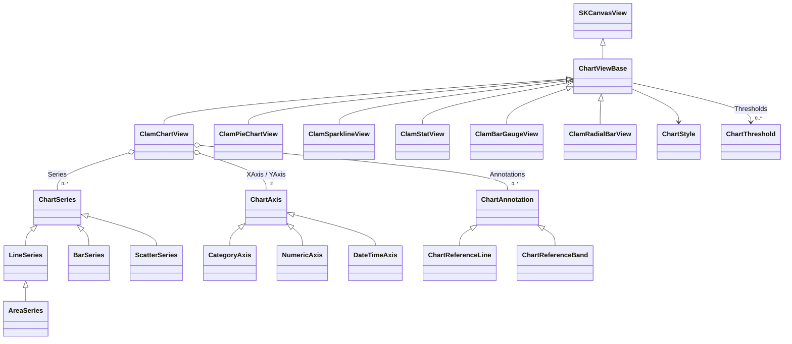
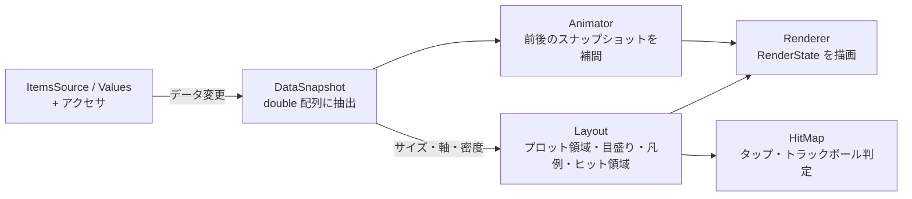

# ClamChart 仕様書（ドラフト）

| 項目 | 内容 |
|---|---|
| ステータス | ドラフト（レビュー用） |
| 対象 | ClamChart 0.x（初回リリースまでの設計） |
| 作成日 | 2026-10-19 |
| 前提 | .NET 10 / .NET MAUI 10.0.110 / SkiaSharp 4.153.1 / SkiaExtension 1.2.0、Android 優先（API 30 以上） |

本書は Clam シリーズ（ClamCalendar / ClamGrid / ClamGauge）の新ライブラリ **ClamChart** について、作成するチャート・プロパティ・アニメーション・インタラクション・差別化方針を定める仕様書である。  
API の命名・構成は既存の Clam シリーズに揃え、描画は template-maui の自前描画（GraphicsView / Drawing フレームワーク）ではなく **SkiaSharp の `SKCanvasView` を継承したコントロール**として実装する。  

## 目次

1. [概要](#1-概要)
2. [調査サマリと差別化](#2-調査サマリと差別化)
3. [チャートカタログと優先度](#3-チャートカタログと優先度)
4. [アーキテクチャ](#4-アーキテクチャ)
5. [データバインディングと MVVM](#5-データバインディングと-mvvm)
6. [スタイルとテーマ](#6-スタイルとテーマ)
7. [コントロール仕様](#7-コントロール仕様)
8. [アニメーション](#8-アニメーション)
9. [インタラクション（リアクション）](#9-インタラクションリアクション)
10. [エフェクト](#10-エフェクト)
11. [ウィジェット利用](#11-ウィジェット利用)
12. [パフォーマンスと品質](#12-パフォーマンスと品質)
13. [template-maui からの流用](#13-template-maui-からの流用)
14. [プロジェクト構成・テスト・サンプル](#14-プロジェクト構成テストサンプル)
15. [ロードマップ](#15-ロードマップ)
16. [未決事項](#16-未決事項)

---

## 1. 概要

### 1.1 目的

スマートフォン向け .NET MAUI アプリで、**ダッシュボードや一覧画面に埋め込んで使える汎用チャート集**を提供する。  
フル画面のチャートだけでなく、カード・タイル・リストのセルといった小さな領域に「ウィジェット」として置いても破綻しないことを最重要の要件とする。  

### 1.2 コンセプト

> **「ダッシュボードとウィジェットのためのチャート」**  
> 1 枚の Skia キャンバスで描き、MVVM でつなぎ、どのサイズでも読める。

| # | 設計原則 | 内容 |
|---|---|---|
| P1 | 1 コントロール = 1 キャンバス | 各チャートは `SKCanvasView` 1 枚で描画し、子 View を持たない。リストに多数並べても軽い |
| P2 | MVVM ファースト | データ・選択・追跡位置はすべてバインド可能。コレクション変更は `INotifyCollectionChanged` / `INotifyPropertyChanged` で追従する |
| P3 | リフレクションなし | 値の取り出しは型付きデリゲート（アクセサ）で行い、`IsTrimmable` / `IsAotCompatible` を満たす |
| P4 | 小さくても読める | 描画領域のサイズに応じて軸・凡例・ラベルを自動で間引く「密度（Density）」を持つ |
| P5 | 意味のある動きだけ | アニメーションは状態の変化（登場・更新・選択）を伝えるものに限る。常時動くエフェクトはオプトイン |
| P6 | タッチは 2 種類 | 「タップ」と「長押しからのドラッグ（トラックボール）」のみ。ピンチズームやパンは採用しない |
| P7 | Clam シリーズと同じ作法 | `Format` / `Converter` / `Formatter` の 3 段フォーマット、イベント + Command の対、`XxxStyle` レコード、DIP 単位、不正値の即時例外 |
| P8 | 重ねても邪魔をしない | 背景は透明、空データ時は何も描かない、操作を有効にしない限りタッチを奪わない、アイドル時は再描画しない。画像・地図・カードの上に重ねて使える |
| P9 | 主張しないデザイン | 既定の見た目は細い線・淡い塗り・ヘアラインのグリッド・落ち着いたパレット。目立たせるのはデータだけで、影や光彩などの装飾は既定で無効 |

### 1.3 スコープ

| 対象 | 対象外 |
|---|---|
| 折れ線・面・棒（積み上げ・横棒）・円/ドーナツ・スパークライン・KPI・バーゲージ・ラジアルバー | 金融系（ローソク足・OHLC・出来高） |
| 時系列（日時軸）とカテゴリ軸、数値軸 | 3D チャート、等高線、ガントチャート |
| 閾値（Thresholds）・基準線・帯 | ズーム／パン、データ点のドラッグ編集 |
| 登場・更新・選択アニメーション | ドリルダウンの組み込み（Command で画面遷移はアプリ側） |
| オフスクリーン描画（PNG 出力） | ダッシュボードのレイアウトコンテナ（MAUI の `Grid` / `FlexLayout` を使う） |
| 他コントロールへの重ね合わせ（透明背景・タッチ透過） | 重ねた下のコントロールの制御（下の View への入力転送は OS の通常の配送に任せる） |
| ライト／ダークのスタイルプリセット | 円形ゲージ（既存の ClamGauge が担当） |

### 1.4 動作環境

| 項目 | 値 |
|---|---|
| TargetFrameworks | `net10.0;net10.0-android`（`net10.0` は単体テスト用） |
| 最小 Android | API 30（`SupportedOSPlatformVersion 30.0`） |
| 依存パッケージ | `Microsoft.Maui.Controls 10.0.110`、`SkiaSharp 4.153.1`、`SkiaSharp.Views.Maui.Controls 4.153.1`、`SkiaExtension 1.2.0` |
| ビルド特性 | `IsTrimmable=true`、`IsAotCompatible=true`、`Nullable enable`、`AnalysisMode All`、警告ゼロ |
| アプリ側の登録 | `UseSkiaSharp()` のみ（他の Clam と同じ） |

### 1.5 用語

| 用語 | 意味 |
|---|---|
| シリーズ（Series） | 1 本の線や 1 組の棒など、同じ見た目で描くデータ点の集まり |
| カテゴリ | X 方向の離散的な区分（月、曜日、店舗など） |
| 閾値（Threshold） | 値 → 色の対応表。Grafana の Thresholds と同じ考え方で、線・棒・KPI の色分けに共通で使う |
| 密度（Density） | 描画領域のサイズに応じた表示の詳細度。`Full` / `Compact` / `Minimal` |
| トラックボール | 長押し後のドラッグで、指の X 位置にある全シリーズの値を表示する機能 |
| ウィジェット | 他画面の一部（カード・タイル・リストのセル）として置かれる小型チャート |
| DIP | デバイス非依存ピクセル。サイズ指定はすべて DIP |

---

## 2. 調査サマリと差別化

### 2.1 既存ライブラリの傾向（調査結果の要約）

| 観点 | Syncfusion / Telerik | Syncfusion Toolkit（OSS） | LiveCharts2 | Microcharts | Grafana（参考） |
|---|---|---|---|---|---|
| 位置づけ | 商用・業務向けフルセット | MIT ライセンスの OSS 版。Cartesian / Circular / Polar / Funnel / Pyramid に加え、2025 年に Sparkline / Sunburst を追加 | OSS・高機能 | OSS・軽量 | Web ダッシュボードのベンチマーク |
| チャート種類 | 非常に多い（金融・多軸含む） | 多い | 多い（金融含む） | 少ない（散布図なし） | 時系列中心＋ Stat / Bar gauge / Heatmap / State timeline |
| データバインド | `ItemsSource` + `XBindingPath` / `YBindingPath`（文字列パス） | 同左 | Mapper / 型付きモデル | `ChartEntry` の配列を直接設定 | クエリ結果 |
| アニメーション | ロード時・更新時のイージング | 同左 | ストリーミング時の補間が強力 | ほぼなし | 控えめ |
| インタラクション | 選択・ツールチップ・トラックボール・ズーム・パン | 同左 | ツールチップ・ズーム・パン | ほぼなし | 共有クロスヘア・ドリルダウン |
| ダッシュボード語彙 | 部品単位（ゲージ等は別コントロール） | 同左 | 自前で組み立て | なし | 閾値による色分け・Stat・Bar gauge が標準 |

調査から読み取れる要点は次の 3 つである。  

- **商用・OSS 大手は「機能の網羅」で勝負している。** 同じ土俵（種類数・ズーム・多軸）で戦う意味は薄い。
- **バインドは文字列パス（`XBindingPath`）が主流**で、トリミングや AOT とは相性が悪い。Clam シリーズは型付きアクセサでこれを解決済み（ClamGrid の `GridValueAccessorCollection<T>`）。
- **ダッシュボード固有の表現（閾値の色分け、KPI タイル、バーゲージ、共有クロスヘア）は Grafana が最も洗練**されており、MAUI のチャートライブラリでは「自分で組み立てる」領域になっている。

### 2.2 ClamChart の立ち位置

> 種類の多さではなく、**「小さく置いても読める」「MVVM で素直につながる」「ダッシュボードの語彙を最初から持つ」**で差別化する。

| # | 差別化ポイント | 内容 | 競合の状況 |
|---|---|---|---|
| D1 | サイズ適応（Density） | 同じコントロールが、フル画面では軸・凡例付き、カードでは要点だけ、セルではスパークライン相当に自動で変わる | 多くは固定レイアウト。小さくすると軸ラベルが潰れる |
| D2 | ダッシュボード部品を同梱 | KPI タイル（`ClamStatView`）、バーゲージ（`ClamBarGaugeView`）、ラジアルバー（`ClamRadialBarView`）を同じスタイル体系で提供 | 個別に組み立てるか、別製品 |
| D3 | 閾値の共通化 | `ChartThreshold` を全コントロールで共有し、線の色分け・棒の色分け・KPI の背景色を同じ定義で切り替える | Grafana 以外ではシリーズ単位の手作業 |
| D4 | スクラブ表示を MVVM で | 長押しドラッグ中の位置を `TrackedIndex` / `TrackedItem` として ViewModel に返す。ヘッダーの数値を指の位置に追従させる（株価アプリ型）UI がバインドだけで作れる | ツールチップは描けても VM 側に位置を返す仕組みは弱い |
| D5 | AOT / トリミング安全 | 文字列パスを使わない型付きアクセサ。リフレクションなし | 文字列パスが主流 |
| D6 | View を使わない描画 API | スパークライン等を任意の `SKCanvas` に描ける静的 API と、PNG 出力（オフスクリーン描画）を提供。Android のホーム画面ウィジェットや共有画像に使える | 画像出力はあっても View 前提が多い |
| D7 | スクロールと共存するタッチ | トラックボールは長押しで開始するため、`ScrollView` や `CollectionView` 内に置いても縦スクロールを奪わない | 即時ドラッグ型はスクロールと競合しやすい |
| D8 | Clam ファミリーで統一 | フォーマット・イベント・スタイル・フォントフォールバック（`FallbackFonts`）の作法が ClamGrid / ClamCalendar / ClamGauge と同じ | — |
| D9 | 重ね合わせ前提 | 透明背景・タッチ透過（`TouchMode`）・端まで描く（`EdgeToEdge`）・オーバーレイ用スタイルプリセットにより、カードの背景や画像・地図の上に置ける（[11.3](#113-重ね合わせオーバーレイ)） | 背景や余白、タッチ処理が単独表示前提で、重ねると干渉しやすい |

### 2.3 Grafana パネルとの対応

Clam ファミリー全体で、Grafana の主要パネルをスマートフォン向けに揃える方針とする。  

| Grafana パネル | Clam での対応 | 備考 |
|---|---|---|
| Time series | `ClamChartView`（`LineSeries` / `AreaSeries` + `DateTimeAxis`） | 本ライブラリの中核 |
| Bar chart | `ClamChartView`（`BarSeries`） | 積み上げ・横棒を含む |
| Pie chart | `ClamPieChartView` | ドーナツ・半円を含む |
| Stat | `ClamStatView` | 値＋差分＋背景スパークライン |
| Bar gauge | `ClamBarGaugeView` | 複数項目の進捗・ランキング |
| Gauge | **ClamGauge**（既存） | 本ライブラリでは扱わない |
| Table | **ClamGrid**（既存） | セル内スパークラインは将来の連携候補（[11.6](#116-clamgrid-との連携将来)） |
| Heatmap | `ClamHeatmapView`（フェーズ 3） | 行列型とカレンダー型 |
| State timeline | 将来候補 | 睡眠ステージ・稼働状態など |

---

## 3. チャートカタログと優先度

### 3.1 提供コントロール

| コントロール | 描けるチャート | 主な用途 | フェーズ |
|---|---|---|:-:|
| `ClamChartView` | 折れ線、スプライン、ステップ、面（積み上げ・100%）、縦棒／横棒（集合・積み上げ・100%）、混在（棒＋線） | 推移・比較・時系列のメインチャート | 1 |
| `ClamPieChartView` | 円、ドーナツ、半円ドーナツ | 構成比 | 1 |
| `ClamSparklineView` | 線、面、棒、勝敗（Win/Loss） | リストのセル・カード内の小さな推移 | 1 |
| `ClamStatView` | KPI タイル（値・単位・差分・背景スパークライン・閾値色） | ダッシュボードの数値カード | 2 |
| `ClamBarGaugeView` | 横棒の進捗リスト、ブレット（目標線付き）、セグメント表示 | 達成率・使用率・ランキング | 2 |
| `ClamRadialBarView` | 同心円の進捗リング、ラジアルバー | アクティビティリング・目標達成 | 2 |
| `ClamChartView` の `ScatterSeries` | 散布図 | 相関 | 2 |
| `ClamRadarChartView` | レーダー（多角形・円） | 評価項目の比較 | 3 |
| `ClamHeatmapView` | 行列ヒートマップ、カレンダーヒートマップ | 曜日×時間帯、日別の活動量 | 3 |
| `ClamChartView` の `BubbleSeries` | バブル | 3 変数の比較 | 3 |

フェーズ 1 で「メインチャート（推移・比較・構成比）」と「最小ウィジェット（スパークライン）」を揃え、フェーズ 2 でダッシュボード部品を揃える。  
各フェーズの詳細は [15. ロードマップ](#15-ロードマップ) を参照。  

### 3.2 コントロール分割の方針

すべてを 1 つの汎用チャートに詰め込まず、**座標系と用途でコントロールを分ける**。  

| 方針 | 理由 |
|---|---|
| 直交座標系（X/Y 軸を持つもの）は `ClamChartView` 1 つにまとめ、シリーズの種類で描き分ける | 棒＋線の混在、積み上げ、共通の軸・トラックボールを 1 か所で実装できる |
| 円・リング系、ウィジェット系は専用コントロールにする | 軸がなく、プロパティ体系がまったく異なる。汎用チャートに入れると不要なプロパティが大半になる |
| すべて共通基底 `ChartViewBase` を継承する | スタイル・密度・アニメーション・空状態・スナップショットを共通化し、`ApplyToDerivedTypes` の暗黙スタイルで一括テーマ設定できるようにする |

### 3.3 採用しないもの

| 項目 | 理由 |
|---|---|
| 金融チャート（ローソク足・OHLC・出来高） | 要件外。汎用ダッシュボードでの需要が低い |
| ズーム・パン（ピンチ・ダブルタップ） | スマートフォンではスクロールと競合し、操作が複雑になる。表示範囲は ViewModel から軸の `Minimum` / `Maximum` を切り替える方式（1D / 1W / 1M ボタン等）で代替する |
| 3D・ベベル・反射などの装飾 | 可読性が下がり、描画コストが高い |
| データ点のドラッグ編集 | 用途が限定的 |
| ツールチップの `DataTemplate`（MAUI View の重ね合わせ） | 1 キャンバス方針（P1）に反する。代わりに追跡位置を VM に返し（D4）、アプリ側の任意の UI で表示できるようにする |
| 第 2 Y 軸（2 軸チャート） | 尺度の異なる値を 1 枚に重ねると誤読を招く。尺度の異なる指標は小さなチャートを縦に並べ、トラックボールの同期（[9.4](#94-トラックボールの同期)）で読み合わせる |
| 漏斗・ピラミッド・サンバースト | 汎用ダッシュボードでの優先度が低い。必要になればフェーズ 3 以降で再検討 |
| ツリーマップ・State timeline | template-maui に実装例（`ColorTreeMapDrawing` / `KitSleepBand`）があり需要はあるため、フェーズ 3 以降の候補として残す |

---

## 4. アーキテクチャ

### 4.1 クラス構成



| 型 | 種別 | 役割 |
|---|---|---|
| `ChartViewBase` | `public abstract partial class : SKCanvasView, IDisposable` | スタイル・密度・アニメーション・タッチ・空状態・スナップショットの共通実装。暗黙スタイルの `TargetType` に使えるよう公開する |
| `ClamXxxView` | `public partial class : ChartViewBase` | 各チャート。Clam の命名（`ClamGaugeView` 等）に合わせる |
| `ChartSeries` / `ChartAxis` / `ChartAnnotation` | `public abstract class : Element` | XAML の子要素。チャートの論理子として追加し、`BindingContext` を継承させる（シリーズ内で `{Binding Sales}` が書ける） |
| `ChartStyle` | `public sealed record` | 見た目の枠（文字・軸・グリッド・凡例・ツールチップ・パレット）。ClamGrid の `GridStyle` と同じ扱い |
| `ChartThreshold` | `public sealed class` | 値 → 色の段階。ClamGauge の `GaugeRange` と同じく単純なクラス |
| `ChartAccessorCollection<T>` | `public sealed class` | キー → 型付きゲッターの対応表。ClamGrid の `GridValueAccessorCollection<T>` と同じ考え方 |

### 4.2 共通基底 `ChartViewBase`

全コントロールが持つプロパティ。各コントロール固有のプロパティは [7 章](#7-コントロール仕様) に記載する。  

| 名前 | 型 | 既定値 | Bindable | 説明 | フェーズ |
|---|---|---|:-:|---|:-:|
| `ChartStyle` | `ChartStyle` | `ChartStyles.Light` | ✓ | 見た目の枠。null は `ArgumentNullException` | 1 |
| `Palette` | `IReadOnlyList<Color>?` | `null` | ✓ | シリーズ色の上書き。`null` は `ChartStyle.Palette` | 1 |
| `Density` | `ChartDensity` | `Auto` | ✓ | `Auto` / `Full` / `Compact` / `Minimal`（[11.1](#111-密度density)） | 1 |
| `EffectiveDensity` | `ChartDensity` | | | `Auto` を解決した結果 | 1 |
| `ContentPadding` | `Thickness?` | `null` | ✓ | 描画内容の外側の余白。`null` は密度に応じた既定値（Full 8 / Compact 4 / Minimal 0） | 1 |
| `EdgeToEdge` | `bool` | `false` | ✓ | プロット領域を View の端まで広げる（カード背景用、[11.3](#113-重ね合わせオーバーレイ)） | 2 |
| `Culture` | `CultureInfo?` | `null` | ✓ | 数値・日付の書式。`null` は `CultureInfo.CurrentCulture` | 1 |
| `AnimationDuration` | `int` | `450` | ✓ | アニメーションの長さ（ms）。`0` で無効 | 1 |
| `AnimationEasing` | `Easing` | `Easing.CubicOut` | ✓ | イージング | 1 |
| `EntranceAnimation` | `ChartEntranceAnimation` | `Auto` | ✓ | 登場アニメーション（[8.2](#82-登場アニメーション)） | 1 |
| `UpdateAnimationEnabled` | `bool` | `true` | ✓ | データ更新時に値を補間する | 1 |
| `TouchMode` | `ChartTouchMode` | `Auto` | ✓ | タッチの扱い（[9.1](#91-タッチの基本方針)） | 1 |
| `IsBusy` | `bool` | `false` | ✓ | 読み込み中のスケルトン表示（[11.4](#114-状態表示読み込み中空データ)） | 2 |
| `EmptyText` | `string?` | `null` | ✓ | データがないときの文言。`null` は何も描かない | 1 |
| `ItemTappedCommand` | `ICommand?` | `null` | ✓ | `ItemTapped` の後に実行 | 1 |
| `ChartTappedCommand` | `ICommand?` | `null` | ✓ | `ChartTapped` の後に実行 | 1 |

| メソッド | 戻り値 | 説明 | フェーズ |
|---|---|---|:-:|
| `Invalidate()` | `void` | スタイルを再検証し、レンダラーを作り直して再描画する（Clam 共通） | 1 |
| `PlayEntranceAnimation()` | `void` | 登場アニメーションを再生し直す（タブ切り替えで見せ直す場合など） | 1 |
| `CompleteAnimations()` | `void` | 実行中のアニメーションを最終状態にして止める | 1 |
| `CancelInteraction()` | `void` | 長押し・トラックボールを取り消す（Clam 共通） | 1 |
| `RenderToImage(Size size, float scale)` | `SKImage` | オフスクリーン描画（[11.5](#115-view-を使わない描画とスナップショット)） | 2 |
| `SaveAsPngAsync(Stream stream, Size size, float scale)` | `Task` | PNG 出力 | 2 |

| イベント | EventArgs | 説明 | フェーズ |
|---|---|---|:-:|
| `ItemTapped` | `ChartItemEventArgs` | データ要素（点・棒・スライス・行）のタップ | 1 |
| `ChartTapped` | `ChartTappedEventArgs` | データ要素以外のタップ。`Minimal` 密度ではチャート全体が 1 つのボタンになる | 1 |
| `FrameRendered` | `ChartFrameEventArgs` | 描画時間・点数などの診断情報（ClamGrid の `FrameRendered` と同じ） | 1 |

### 4.3 描画パイプライン



| 段階 | 内容 | 再計算のきっかけ |
|---|---|---|
| DataSnapshot | 項目からアクセサで値を取り出し、`double[]`（X / Y / 積み上げ後の値）に詰める。描画中は項目に触れない | `ItemsSource` の差し替え、コレクション変更、項目の `PropertyChanged`、キーやアクセサの変更 |
| Layout | 軸範囲（Nice Scale）、目盛り、ラベルの間引き、凡例の配置、プロット領域、ヒット領域を計算する | サイズ変更、密度変更、軸・凡例・スタイルの変更、スナップショット更新 |
| Animator | 前回と今回のスナップショットを進捗 0〜1 で補間した「表示用スナップショット」を作る | アニメーションのフレーム |
| Renderer | `RenderState` を受け取り Skia で描く。`SKPaint` / `SKPath` は使い回す | 毎フレーム |
| HitMap | 描画済みの形からタッチ位置 → データ要素を引く。直交座標は X の二分探索、円は角度で判定 | Layout 更新時 |

プロパティ変更時のコールバックは ClamCalendar と同じく 4 種に分ける。  

| コールバック | 動作 |
|---|---|
| `OnDataInputChanged` | スナップショットを作り直し、更新アニメーションを開始する |
| `OnLayoutInputChanged` | レイアウトを無効化して再描画する |
| `OnRenderInputChanged` | `InvalidateSurface()` のみ |
| `OnStyleChanged` | レンダラーを破棄し、レイアウトを無効化して再描画する |

同じ UI ループ内で起きた複数の変更（`Add` と `RemoveAt(0)` の連続など）は 1 回の再計算にまとめる（`Dispatcher.Dispatch` で次のフレームに遅延し、フラグで重複を除く）。  

### 4.4 ファイル構成

```
ClamChart/
├── Assembly.cs                      CLSCompliant(false)、InternalsVisibleTo("ClamChart.Tests")
├── ChartViewBase.cs                 共通基底（.Animation.cs / .Input.cs / .Snapshot.cs / .android.cs に分割）
├── ClamChartView.cs                 直交座標チャート（.Axes.cs / .Series.cs / .Legend.cs / .Tracking.cs）
├── ClamPieChartView.cs
├── ClamSparklineView.cs
├── ClamStatView.cs
├── ClamBarGaugeView.cs
├── ClamRadialBarView.cs
├── ChartStyle.cs / ChartStyles.cs / ChartThreshold.cs / 列挙型 / *EventArgs
├── Series/        ChartSeries, LineSeries, AreaSeries, BarSeries, ScatterSeries
├── Axes/          ChartAxis, CategoryAxis, NumericAxis, DateTimeAxis
├── Annotations/   ChartAnnotation, ChartReferenceLine, ChartReferenceBand
├── Data/          ChartAccessorCollection<T>, ChartPoint, ChartEntry, DataSnapshot, ChartCollectionWatcher
├── Layout/        NiceScale, TickGenerator, LabelThinning, StackCalculator, PieLayout, DensityResolver, Downsampler, ChartRect, ChartHit
├── Input/         ChartGestureController, GestureAction, GestureResult
├── Animation/     ChartAnimator, SnapshotInterpolator
├── Rendering/     CartesianRenderer, PieRenderer, SparklineRenderer, … , ChartRenderState, ChartTextFormat, PaintCache
├── Drawing/       ChartDrawing（View を使わない公開描画 API）
└── Platform/      IChartPlatformBridge, ChartPlatformBridge.android.cs
```

- 1 ファイル 1 型、ビューは関心ごとに partial ファイルへ分割する（ClamGrid / ClamCalendar と同じ）。
- `Layout/` と `Input/` は MAUI に依存しない純粋なクラスにして、`net10.0` の単体テストで検証する。
- `*.android.cs` は Android ビルドだけでコンパイルする（既存 csproj の仕組みをそのまま使う）。

### 4.5 ライフサイクルとスレッド

| 項目 | 方針 |
|---|---|
| コレクション監視 | Handler が付いている間だけ購読する（ClamCalendar の `CalendarCollectionWatcher` と同じ）。寿命の長い ViewModel のコレクションがデタッチ済みの View を保持しない |
| アニメーション | Handler の切り離し、`Unloaded`、`IsVisible = false`、`Dispose` で停止し、最終状態に揃える |
| アイドル時 | アニメーションも変更もなければ再描画しない。常時アニメーション（ライブ表示・スケルトン）はオプトインで、非表示時は止める |
| スレッド | プロパティ・コレクションの変更は UI スレッドのみ。`Dispatcher.IsDispatchRequired` のときは `InvalidOperationException`（ClamGrid の `RequireUiThread()` と同じ）。バックグラウンドで集計した値は ViewModel で UI スレッドに戻してから渡す |
| 破棄 | `IDisposable`。破棄後の操作は `ObjectDisposedException` |

---

## 5. データバインディングと MVVM

### 5.1 データの渡し方

用途の難易度に合わせて 3 段階を用意する。どの方法もリフレクションを使わない。  

| 段階 | 渡し方 | 向いている場面 |
|---|---|---|
| ① 値の列 | `IEnumerable<double>`（`int` / `float` / `decimal` も可）。X は 0 からの連番 | スパークライン、単純な推移 |
| ② ライブラリのモデル | `ChartPoint`（X: `double`, Y: `double`）、`ChartTimePoint`（X: `DateTime`, Y: `double`）、`ChartEntry`（`Label`, `Value`, `Color?`） | 円・バーゲージ・ラジアルバー、ViewModel でデータを組み立てる場合 |
| ③ 任意の型＋アクセサ | `ItemsSource` に任意の項目、`ValueAccessors` に `ChartAccessorCollection<T>`、シリーズに `XKey` / `YKey` などのキー | 既存のモデル（DTO・エンティティ）をそのまま渡したい場合 |

`ChartPoint` / `ChartTimePoint` / `ChartEntry` は `sealed record`（参照型）とし、`TrackedItem` などで ViewModel の型付きプロパティへそのまま受け渡せるようにする。  

判定順は「キーが指定されていればアクセサ」→「`ChartEntry` / `ChartPoint` / `ChartTimePoint`」→「数値」とする。どれにも当てはまらない項目は `InvalidOperationException`（データ変更時に投げ、描画中には投げない）。  

`Y` が `null` または `NaN` の項目は欠損として扱い、`EmptyPointMode`（`Gap` / `Zero` / `Interpolate`、既定 `Gap`）に従う。  

### 5.2 型付きアクセサ

ClamGrid の `GridValueAccessorCollection<T>` と同じく、コレクション初期化子でキーとゲッターを登録する。  

```csharp
public sealed class MonthlySales
{
    public static ChartAccessorCollection<MonthlySales> Accessors { get; } = new()
    {
        { "month", static x => x.Month },
        { "sales", static x => x.Sales },
        { "target", static x => x.Target }
    };

    public required string Month { get; init; }

    public double Sales { get; set; }

    public double? Target { get; set; }
}
```

```xml
<clam:ClamChartView ValueAccessors="{x:Static models:MonthlySales.Accessors}"
                    XKey="month">
    <clam:ClamChartView.XAxis>
        <clam:CategoryAxis />
    </clam:ClamChartView.XAxis>
    <clam:BarSeries Title="売上" ItemsSource="{Binding Sales}" YKey="sales" />
    <clam:LineSeries Title="目標" ItemsSource="{Binding Sales}" YKey="target" DashPattern="4,4" />
</clam:ClamChartView>
```

| 項目 | 仕様 |
|---|---|
| 登録できる型 | `Func<T, double>`、`Func<T, double?>`（`null` は欠損）、`Func<T, DateTime>`、`Func<T, DateTimeOffset>`、`Func<T, string?>`、`Func<T, Color?>` |
| 置き場所 | `ClamChartView.ValueAccessors`（全シリーズ共通）と `ChartSeries.ValueAccessors`（シリーズ個別、優先）。単体コントロール（円・バーゲージ等）は自身の `ValueAccessors` |
| キー | `XKey`（チャート共通、シリーズで上書き可）、`YKey`、`LabelKey`、`ColorKey`、`SizeKey`（バブル、フェーズ 3） |
| 型の不一致 | キーの型が用途と合わない（`YKey` に `string` のゲッター等）場合は `InvalidOperationException` |
| X の型と軸 | `string` → `CategoryAxis`、`DateTime` / `DateTimeOffset` → `DateTimeAxis`、`double` → `NumericAxis`。軸が未指定なら X の型から自動で選ぶ |

コード側からはデリゲートを直接渡すこともできる（`ValueSelector`、`LabelSelector` などの非 Bindable プロパティ。ClamGauge の `LabelFormatter` と同じ扱い）。  

### 5.3 変更の追跡

| 変更 | 動作 |
|---|---|
| `ItemsSource` の差し替え | スナップショットを作り直す。点数が同じなら値を補間（モーフ）、違うなら登場アニメーションをやり直す |
| `INotifyCollectionChanged` の Add / Remove | 位置付きの差分として扱う。末尾追加は直前の点から伸びるように、先頭削除は左へ流れ出るように補間する（ストリーミング表示） |
| `INotifyCollectionChanged` の Replace / Move | 該当位置の値を補間する |
| `INotifyCollectionChanged` の Reset | 差し替えと同じ |
| 項目の `INotifyPropertyChanged` | `TrackItemChanges`（既定 `true`）のとき、その項目の値だけ取り直して補間する。ClamGrid と同じく参照等価の集合で購読を管理する |

ストリーミング（一定間隔で末尾に追加し先頭を削除）では、ViewModel が `ObservableCollection` の `Add` と `RemoveAt(0)` を続けて呼ぶだけでよい。2 つの変更は 1 フレームにまとまり、横に流れるアニメーションになる。  

### 5.4 双方向・ソース方向のプロパティ

| プロパティ | 既定の BindingMode | 内容 |
|---|---|---|
| `SelectedItem` | TwoWay | 選択中の項目。ViewModel から設定すると選択表示が切り替わる |
| `SelectedIndex` | TwoWay | 選択中の位置（`-1` は未選択） |
| `TrackedItem` / `TrackedIndex` | OneWayToSource | トラックボールが指している項目と位置。指を離すと `null` / `-1` |
| `ChartSeries.IsVisible` | TwoWay | 凡例タップで切り替えた表示状態を ViewModel に返す |

`TrackedItem` を使うと、チャートの上に置いた MAUI の `Label` が指の位置の値を表示する「スクラブ表示」がバインドだけで作れる（[9.3](#93-トラックボール)）。  

### 5.5 イベントと Command

Clam 共通の作法に従い、イベントを発行した後、同じ引数で対応する Command を実行する。`Handled = true` にすると Command と既定動作（選択の切り替えなど）を抑止する。  

| イベント | EventArgs | Command | 主なメンバー |
|---|---|---|---|
| `ItemTapped` | `ChartItemEventArgs` | `ItemTappedCommand` | `Series`, `SeriesIndex`, `Index`, `Item`, `X`, `Y`, `Position`, `Handled` |
| `ChartTapped` | `ChartTappedEventArgs` | `ChartTappedCommand` | `Position`, `Handled` |
| `SelectionChanged` | `ChartSelectionChangedEventArgs` | `SelectionChangedCommand` | `OldItem`, `NewItem`, `OldIndex`, `NewIndex` |
| `TrackingStarted` / `TrackingChanged` / `TrackingEnded` | `ChartTrackingEventArgs` | `TrackingChangedCommand` | `Index`, `X`, `Points`（各シリーズの値） |
| `LegendItemTapped` | `ChartLegendEventArgs` | `LegendItemTappedCommand` | `Series` または `Item`, `Handled`（`true` で表示切り替えを抑止） |
| `FrameRendered` | `ChartFrameEventArgs` | — | `ElapsedMilliseconds`, `PointCount`, `Animating` |

### 5.6 書式

数値・日付を文字にする箇所（軸ラベル、データラベル、ツールチップ、中央値、KPI の値）はすべて、ClamGauge と同じ 3 段の書式を持つ。  

| 優先度 | プロパティ | 型 | Bindable | 例 |
|:-:|---|---|:-:|---|
| 1 | `XxxFormatter` | `Func<double, string>?` | | コードからの任意変換 |
| 2 | `XxxConverter` | `IValueConverter?` | ✓ | 既存のコンバーターを再利用 |
| 3 | `XxxFormat` | `string` | ✓ | `{0:N0}円`（`{` を含むと複合書式）または `N0` |

既定の数値書式は「コンパクト表記」（`1,284` / `12.9K` / `4.2M`、カルチャに従う）とし、狭い領域でも桁があふれないようにする。日付軸の既定書式は表示範囲から自動で決める（[7.1.4](#714-軸)）。  

### 5.7 MVVM の利用例

Smart.Mvvm（`[ObservableProperty]`）を使った ViewModel の例。ライブラリ自体は特定の MVVM フレームワークに依存しない。  

```csharp
public sealed partial class DashboardViewModel : AppViewModelBase
{
    private double latest;

    public ObservableCollection<ChartTimePoint> Requests { get; } = [];

    // 指を置いた位置の値、離すと現在値
    [ObservableProperty]
    public partial double HeaderValue { get; set; }

    // チャートから OneWayToSource で設定される
    public ChartTimePoint? TrackedRequest
    {
        get;
        set
        {
            field = value;
            OnPropertyChanged();
            HeaderValue = value?.Y ?? latest;
        }
    }

    public IObserveCommand OpenDetailCommand { get; }

    public DashboardViewModel()
    {
        OpenDetailCommand = MakeDelegateCommand(static () => { /* 詳細画面へ遷移 */ });
    }

    // タイマーから UI スレッドで呼ばれる
    private void OnSample(double value)
    {
        Requests.Add(new ChartTimePoint(DateTime.Now, value));
        if (Requests.Count > 60)
        {
            Requests.RemoveAt(0);
        }

        latest = value;
        if (TrackedRequest is null)
        {
            HeaderValue = value;
        }
    }
}
```

```xml
<Grid RowDefinitions="Auto,*">
    <Label Text="{Binding HeaderValue, StringFormat='{0:N0} req/s'}" />
    <clam:ClamChartView Grid.Row="1"
                        TrackballMode="LongPress"
                        TrackedItem="{Binding TrackedRequest}"
                        ChartTappedCommand="{Binding OpenDetailCommand}">
        <clam:AreaSeries ItemsSource="{Binding Requests}" />
    </clam:ClamChartView>
</Grid>
```

---

## 6. スタイルとテーマ

### 6.1 方針

| 区分 | 置き場所 | 例 |
|---|---|---|
| 見た目の枠（データ以外） | `ChartStyle` レコード | フォント、文字色、グリッド、軸線、凡例、ツールチップ、トラック、パレット、状態色 |
| データの見た目の既定値 | `ChartStyle` レコード | 線の太さ、面の不透明度、棒の角丸・最大幅、マーカーの大きさ、要素間の隙間 |
| データの見た目（個別） | シリーズ・コントロールのプロパティ（`null` は `ChartStyle` の既定値） | シリーズ色、太さ、破線、マーカー、角丸 |

- `ChartStyle` は ClamGrid / ClamCalendar と同じく、割り当て後は不変として扱い、変更は `with` 式で新しいインスタンスを作る（その場で書き換えた場合は `Invalidate()`）。
- 1 つの `ChartStyle` をすべての ClamChart コントロールで共有できる。ダッシュボード全体のテーマを 1 か所で決められる。

### 6.2 デザイントーン（主張しない既定値）

重ね合わせても下のコントロールと喧嘩しないよう、既定の見た目は「データだけが目立つ」静かなものにする。  

| 要素 | 既定の見た目 |
|---|---|
| 背景 | 透明（`BackgroundColor` を設定しない限り塗らない）。プロット領域も塗らない |
| グリッド | 横線のみ、ヘアライン（`GridLineThickness = 0` は物理 1px）、背景から一段階だけ離れたグレー。縦線は既定で描かない |
| 軸線 | Y 軸線は描かない。X 軸は基線（値 0 または下端）のみ |
| 文字 | 11〜12 DIP、二次・弱いインク色。データの色を文字に使わない（凡例・ラベルは色付きのマーカーを横に置いて識別する） |
| 線 | 2 DIP、丸い結合・端点 |
| マーカー | 既定は非表示。最後の点・選択点のみ 8 DIP の点を、周囲を 2 DIP くり抜いて（ノックアウト）描く |
| 面 | シリーズ色の約 10% の淡い塗り。グラデーションは上から下へ消えるのみ |
| 棒 | 最大幅 24 DIP（スロットを埋め尽くさない）、データ側の端だけ 4 DIP の角丸、基線側は角を立てる |
| 隣接要素 | 積み上げの段・円のスライスの間に 2 DIP の隙間を幾何学的に空ける（線で縁取らない） |
| 選択 | 選択要素を強調色で塗るのではなく、他の要素を薄く（不透明度 0.35）する |
| 影・光彩 | 既定で無効（[10 章](#10-エフェクト) でオプトイン） |
| 動き | 1 回だけ、450 ms 前後で静かに終わる。繰り返す動きは既定で無効 |

マーカーの周囲の「くり抜き」と要素間の隙間は、背景色で塗るのではなく**実際に透明にする**（`SKBlendMode.Clear` と幾何学的な隙間）。背景が画像や地図でも、そこに背景色の輪が浮かない。  

### 6.3 `ChartStyle` の項目

| 名前 | 型 | 既定値（Light） | 説明 |
|---|---|---|---|
| `FontFamily` | `string` | `sans-serif` | すべての文字のフォント。SkiaExtension の `FallbackFonts` で 1 文字ずつ代替する |
| `PrimaryTextColor`, `SecondaryTextColor`, `MutedTextColor` | `Color` | `#0B0B0B`, `#52514E`, `#898781` | 値・ラベル・軸目盛りの文字色 |
| `TextHaloColor`, `TextHaloWidth` | `Color`, `double` | `Transparent`, `0` | 文字の縁取り。オーバーレイ用プリセットで使う |
| `AxisLabelFontSize`, `AxisTitleFontSize` | `double` | `11`, `11` | 軸の文字 |
| `AxisLineColor` | `Color` | `#C3C2B7` | 基線・軸線 |
| `GridLineColor`, `GridLineThickness` | `Color`, `double` | `#E1E0D9`, `0` | グリッド。`0` はヘアライン |
| `LegendFontSize`, `LegendMarkerSize` | `double` | `12`, `8` | 凡例 |
| `DataLabelFontSize` | `double` | `11` | データラベル |
| `TooltipBackground`, `TooltipTextColor`, `TooltipBorderColor` | `Color` | `#F0FCFCFB`, `#0B0B0B`, `#1A0B0B0B` | ツールチップ（半透明の面＋ヘアラインの縁） |
| `TooltipFontSize`, `TooltipCornerRadius` | `double` | `12`, `6` | ツールチップ |
| `TrackballLineColor` | `Color` | `#898781` | トラックボールの縦線 |
| `TrackColor` | `Color` | `#ECEBE6` | バーゲージ・ラジアルバーの未到達部分 |
| `DimmedOpacity` | `double` | `0.35` | 選択時に他要素へ掛ける不透明度 |
| `PressedOverlayColor` | `Color` | `#0F000000` | タップ中の押下表示 |
| `SkeletonColor`, `SkeletonHighlightColor` | `Color` | `#ECEBE6`, `#F6F5F2` | 読み込み中のスケルトン |
| `Palette` | `IReadOnlyList<Color>` | [6.4](#64-パレット) | シリーズ色（固定順） |
| `OtherColor` | `Color` | `#B5B3AA` | 「その他」にまとめた要素、パレットを超えたシリーズ |
| `GoodColor`, `WarningColor`, `SeriousColor`, `CriticalColor` | `Color` | `#0CA30C`, `#FAB219`, `#EC835A`, `#D03B3B` | 状態色（閾値の既定色）。シリーズ色には使わない |
| `PositiveTextColor`, `NegativeTextColor` | `Color` | `#006300`, `#D03B3B` | KPI の差分の文字色 |
| `LineThickness` | `double` | `2` | 線の太さの既定値 |
| `AreaFillOpacity` | `double` | `0.10` | 面の不透明度の既定値 |
| `BarCornerRadius`, `MaxBarWidth` | `double` | `4`, `24` | 棒の既定値 |
| `MarkerSize`, `MarkerKnockout` | `double` | `8`, `2` | マーカーと周囲のくり抜き |
| `SegmentGap` | `double` | `2` | 積み上げの段・スライス・セグメントの隙間 |
| `CompactSize`, `MinimalSize` | `Size` | `320, 200`, `160, 96` | 密度 `Auto` の切り替え境界（幅か高さのどちらかが下回ると切り替える） |

検証は ClamGrid と同じく、`null` は `ArgumentNullException`、有限でない値や負のサイズは `ArgumentException` とする。  

### 6.4 パレット

既定パレットは色覚多様性に配慮して**順序を固定**した 8 色とし、ライトとダークで別の段階を選ぶ（自動反転ではない）。  

| 順 | 色相 | Light | Dark |
|:-:|---|---|---|
| 1 | 青 | `#2A78D6` | `#3987E5` |
| 2 | 橙 | `#EB6834` | `#D95926` |
| 3 | 水色 | `#1BAF7A` | `#199E70` |
| 4 | 黄 | `#EDA100` | `#C98500` |
| 5 | 桃 | `#E87BA4` | `#D55181` |
| 6 | 緑 | `#008300` | `#008300` |
| 7 | 紫 | `#6250D6` | `#9085E9` |
| 8 | 赤 | `#E34948` | `#E66767` |

この順序は、隣り合う色同士が色覚シミュレーション下でも区別できる（OKLab ΔE×100 ≥ 8）ことを検証済みの並びである。パレットを差し替える場合も同様に検証する。  

| 規則 | 内容 |
|---|---|
| 色は要素に付く | シリーズ色は `Series` コレクション内の位置で決め、表示中の順位では決めない。凡例で 1 本を隠しても残りの色は変わらない。円のスライスもデータの並び順（`ColorKey` があればその色）で決め、大きさ順の並べ替えで色を変えない |
| 循環させない | 9 本目以降のシリーズは `OtherColor` で描き、デバッグ出力に警告を出す。円は `MaxSlices`（既定 8）を超える分を「その他」にまとめる |
| 散布図は 3 色まで | 点が混在する散布図・バブルは、全組み合わせで区別できる先頭 3 色までを推奨とし、超える場合は「その他」にまとめる |
| 文字にデータ色を使わない | 凡例・ラベル・値の文字はインク色。識別は横に置く色付きマーカーで行う |
| 状態色は別枠 | 閾値の既定色は状態色（Good / Warning / Serious / Critical）を使い、シリーズ色と混ぜない |

### 6.5 プリセット

| プリセット | 用途 | 主な違い |
|---|---|---|
| `ChartStyles.Light` | 明るい画面（既定） | 6.3 の既定値 |
| `ChartStyles.Dark` | ダークテーマ | 文字 `#F0EFEC` / `#C3C2B7`、グリッド `#2C2C2A`、軸線 `#383835`、ダーク用パレット、`PositiveTextColor` `#0CA30C` |
| `ChartStyles.OverlayLight` | 明るい写真・カードの上に重ねる | グリッドと軸線なし、文字に白の縁取り、面の不透明度 0.06 |
| `ChartStyles.OverlayDark` | 地図・暗い写真・映像の上に重ねる | グリッドと軸線なし、明るい線と文字に黒の縁取り、面の不透明度 0.08 |

ライブラリは OS のテーマを自動では判定しない（既存の Clam と同じ）。テーマの切り替えはアプリ側で `AppThemeBinding` を使う。  

```xml
<Style TargetType="clam:ChartViewBase" ApplyToDerivedTypes="True">
    <Setter Property="ChartStyle" Value="{AppThemeBinding Light={x:Static clam:ChartStyles.Light}, Dark={x:Static clam:ChartStyles.Dark}}" />
</Style>
```

基底クラスに対する暗黙スタイル 1 つで、すべての ClamChart コントロールにテーマが適用される。  

### 6.6 閾値（Thresholds）

閾値は Grafana と同じ「基準色＋段階」の考え方で、全コントロール共通の `ChartThreshold` を使う。  

| メンバー | 型 | 既定値 | 説明 |
|---|---|---|---|
| `Value` | `double` | `Double.NegativeInfinity` | この値以上で `Color` を使う。先頭は基準色として `NegativeInfinity` のままにする |
| `Color` | `Color?` | `null` | 色。`null` は `Level` に対応する状態色 |
| `Level` | `ChartThresholdLevel` | `None` | `None` / `Good` / `Warning` / `Serious` / `Critical`。KPI のアイコン表示にも使う |
| `Label` | `string?` | `null` | 閾値線のラベル |

```xml
<clam:ClamStatView.Thresholds>
    <clam:ChartThreshold Level="Good" />
    <clam:ChartThreshold Value="70" Level="Warning" />
    <clam:ChartThreshold Value="90" Level="Critical" Label="上限" />
</clam:ClamStatView.Thresholds>
```

閾値をどう見せるか（線・帯・色分け）は各コントロールの `ThresholdsMode` で決める（[7 章](#7-コントロール仕様)）。状態を色だけで伝えないよう、KPI では状態アイコン（`Level`）を併用する。

## 7. コントロール仕様

（執筆中）

## 8. アニメーション

（執筆中）

## 9. インタラクション（リアクション）

（執筆中）

## 10. エフェクト

（執筆中）

## 11. ウィジェット利用

（執筆中）

## 12. パフォーマンスと品質

（執筆中）

## 13. template-maui からの流用

（執筆中）

## 14. プロジェクト構成・テスト・サンプル

（執筆中）

## 15. ロードマップ

（執筆中）

## 16. 未決事項

（執筆中）
