# ClamChart - Charts for .NET MAUI Android

[](https://www.nuget.org/packages/ClamChart/)

## 🐚 What is this?

Charts for .NET MAUI Android drawn with SkiaSharp, one canvas per chart, made for dashboards and widgets.  
Lines, areas, bars, range bars, scatter and bubble plots, pies, radars, heatmaps, state timelines, sparklines, KPI tiles, bar gauges and radial bars bind to view models, animate what changed and stay readable from a full screen down to a list cell.  

| 📈 Lines and trackball | 📊 Stacked bars | 🌡️ Two value axes |
|:-:|:-:|:-:|
| 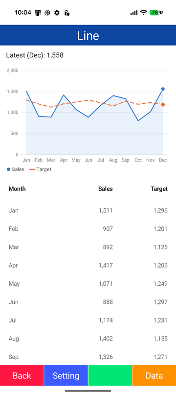 | 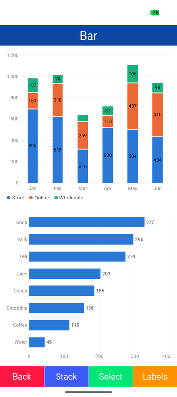 | 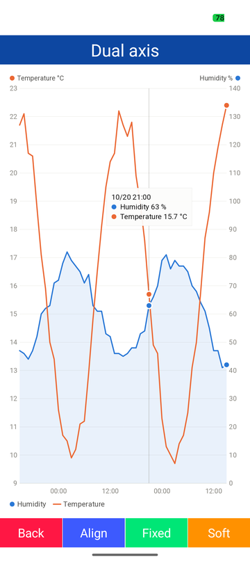 |

| 🍩 Donut and selection | ✨ Sparklines in a list | 📐 Sizes and density |
|:-:|:-:|:-:|
| 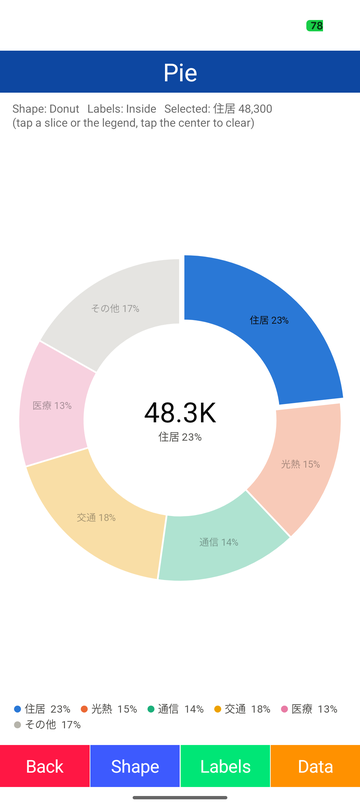 | 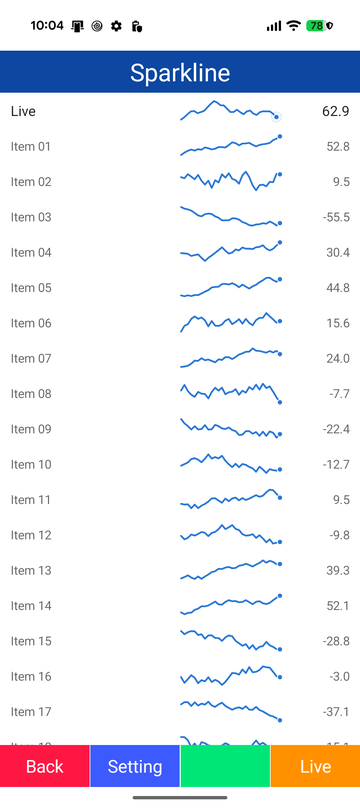 | 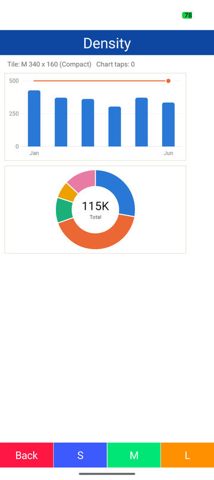 |

| 🔢 KPI tiles | 📶 Bar gauges | ⭕ Radial bars |
|:-:|:-:|:-:|
| 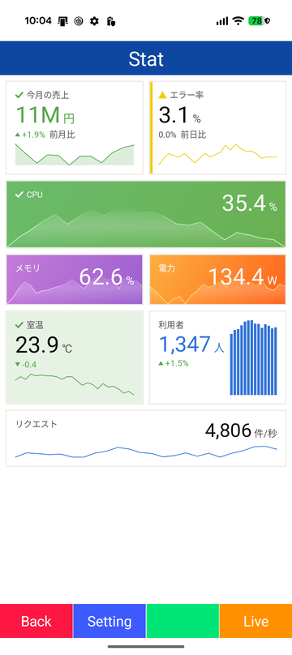 | 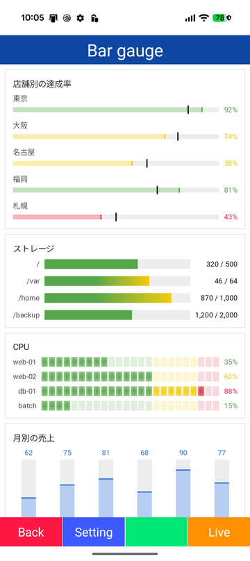 | 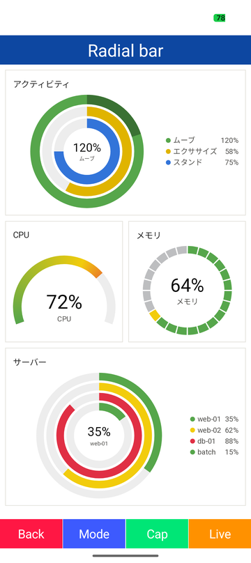 |

| 🖥️ Monitoring panels | 🧭 Dashboard | 🪟 Overlays and effects |
|:-:|:-:|:-:|
| 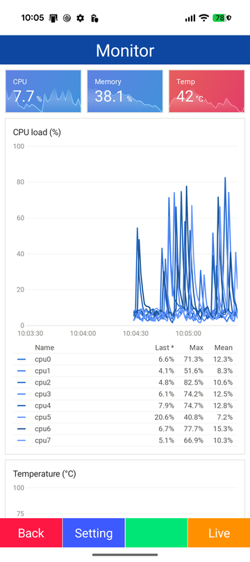 | 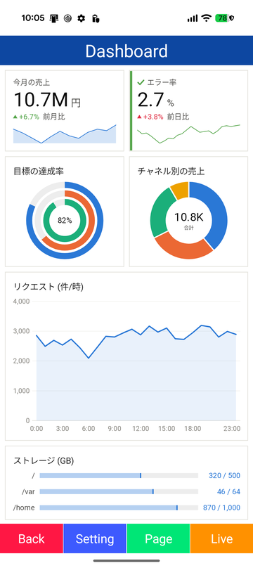 | 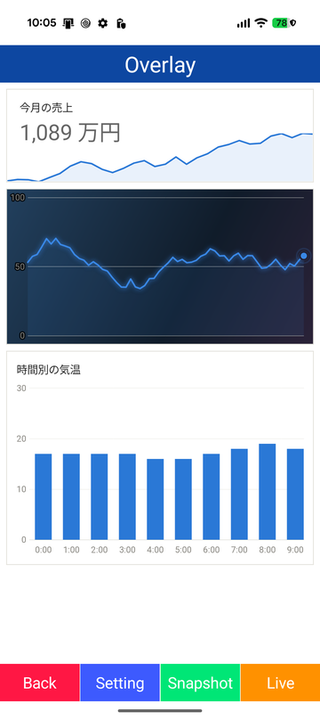 |

## 🚀 Quick Start

Call `UseSkiaSharp()` when building the application.  

```csharp
var builder = MauiApp.CreateBuilder()
    .UseMauiApp<App>()
    .UseSkiaSharp();
```

Map `clr-namespace:ClamChart;assembly=ClamChart` to a prefix, give a chart a size and add series.  
A typed accessor collection reads the values of your own model without reflection.  

```csharp
public sealed class MonthlySales
{
    public static ChartAccessorCollection<MonthlySales> Accessors { get; } = new()
    {
        { "month", static x => x.Month },
        { "sales", static x => x.Sales },
        { "target", static x => x.Target }
    };

    public required string Month { get; init; }

    public double Sales { get; init; }

    public double Target { get; init; }
}
```

```xml
<clam:ClamChartView HeightRequest="240"
                    ValueAccessors="{x:Static models:MonthlySales.Accessors}"
                    XKey="month"
                    TrackballMode="LongPress">
    <clam:AreaSeries ItemsSource="{Binding Sales}" Title="Sales" YKey="sales" />
    <clam:LineSeries ItemsSource="{Binding Sales}" Title="Target" YKey="target" DashPattern="4,3" />
</clam:ClamChartView>
```

A pie takes `ChartEntry` items without keys and a sparkline takes a list of numbers.  

```xml
<clam:ClamPieChartView HeightRequest="240"
                       ItemsSource="{Binding Expenses}"
                       CenterLabel="Total"
                       SelectionMode="Item" />

<clam:ClamSparklineView HeightRequest="28"
                        Values="{Binding Trend}" />
```

The first data plays an entrance animation and later changes move from the old values to the new ones over `AnimationDuration` milliseconds.  

Text is drawn with the `sans-serif` system font; characters it lacks are resolved per character through `FallbackFonts` of [SkiaExtension](https://github.com/usausa/skia-extension).  
Set a bundled font as a fallback at startup when the device fonts do not cover the language.  
The language hints follow the UI language of the device unless `Languages` is set.  

```csharp
FallbackFonts.Languages = ["ja"];
FallbackFonts.Typefaces = [SKTypeface.FromStream(await FileSystem.OpenAppPackageFileAsync("NotoSansJP-Regular.ttf"))];
```

## 🎨 Look

| Part | Properties |
|---|---|
| Theme | `ChartStyle` with the `ChartStyles.Light` and `ChartStyles.Dark` presets, `OverlayLight` and `OverlayDark` for photos and maps, or a style of your own made with `with` |
| Colors | `Palette` of eight colors in a fixed order, the Grafana palettes and shades of one hue, `Color` of a series, `ColorKey` of a slice |
| Lines | `Thickness`, `Interpolation` (`Linear`, `Smooth`, `Step`, `StepBefore`), `DashPattern`, `MarkerMode`, `MarkerShape`, `GlowRadius`, `LiveIndicatorVisible` for a pulsing last point |
| Areas | `FillOpacity`, `FillMode` with a gradient, `BaselineValue`, `StackGroup` |
| Bars | `CornerRadius`, `MaxBarWidth`, `BarWidthRatio`, `NegativeColor`, `StackGroup`, `FillMode` with a gradient, `TrackVisible` for a progress track, `Orientation` for horizontal bars, `RangeBarSeries` from a low to a high value |
| Points | `ScatterSeries` with `MarkerShape` and `FillOpacity`, `BubbleSeries` sized by a value between `MinBubbleSize` and `MaxBubbleSize`, from 0 or from the smallest value (`SizeIncludesZero`) |
| Pies | `InnerRadius`, `StartAngle` and `SweepAngle` for half donuts, `SliceGap`, `MaxSlices` with a merged slice, labels inside or outside with leader lines, and the center value |
| Radars | `ClamRadarChartView` with `GridShape` (polygon or circle), `LevelCount`, `Minimum` and `Maximum`, and `RadarSeries` with `Thickness` and `FillOpacity` |
| Heatmaps | `ClamHeatmapView` as a matrix or a calendar, the Grafana Oranges scale or a `ColorScale` of your own, `CellGap` and a color scale legend |
| State timelines | `ClamStateTimelineView` with Grafana value mappings (`ValueMappings`) and `Thresholds`, and the panel options of Grafana: `MergeValues`, `ShowValue`, `AlignValue`, `RowHeight`, `FillOpacity` and `LineWidth` |
| Thresholds | `Thresholds` with `ThresholdsMode` lines, bands or colored series, reference lines and bands as annotations |
| Tiles and gauges | `ColorMode` of a KPI tile from a quiet value to a Grafana gradient background, basic, gradient and segmented gauges, values in the bar color or the text color, threshold markers around radial bars, `BarGlow` for glowing rings, `AlertAnimationEnabled` for a critical value |
| Labels | Legend as a list or a table with last, minimum, maximum and mean, data labels, tooltip and axis labels, with a format, a converter or a delegate |
| Size | `Density` thins the axes, the legend and the labels as the chart gets smaller |

The default look is quiet: a transparent background, hairline grids, thin lines, light fills and gaps between segments that are really transparent, so a chart can sit on a card, a photo or a map.  
Sizes are DIP and angles are degrees clockwise from 12 o'clock.  

An implicit style on the base class switches every chart with the app theme.  

```xml
<Style TargetType="clam:ChartViewBase" ApplyToDerivedTypes="True">
    <Setter Property="ChartStyle" Value="{AppThemeBinding Light={x:Static clam:ChartStyles.Light}, Dark={x:Static clam:ChartStyles.Dark}}" />
</Style>
```

## 🔗 Binding and MVVM

Every property except the delegates (`ValueSelector`, `LabelSelector`, `XxxFormatter`, `TooltipFormatter`) and the read-only `EffectiveDensity` is a bindable property.  
An `ObservableCollection` animates its changes: `Add` and `RemoveAt(0)` in a row make the line flow, and an item that raises `PropertyChanged` moves its point.  
`SelectedItem` and `SelectedIndex` are TwoWay, `TrackedItem` and `TrackedIndex` report the point under the trackball to the view model, and `ChartSeries.IsVisible` follows the legend.  
Each event has a matching command: `ItemTappedCommand`, `ChartTappedCommand`, `SelectionChangedCommand`, `TrackingChangedCommand` and `LegendItemTappedCommand`.  
`Example/Modules/Chart` contains screens for the chart types (lines, bars, a pie, sparklines, KPI tiles, bar gauges, radial bars, scatter plots, range bars, bubbles, a radar, heatmaps and a state timeline), the features (a time series, two value axes, thresholds, palettes, overlays and drawing without a view), combined pages (monitoring panels, a live stream and dashboards) and checks (the density and the drawing time); the menu colors them by group.  

```csharp
public sealed class TrafficViewModel : ObservableObject
{
    public ObservableCollection<ChartTimePoint> Requests { get; } = [];

    public ChartTimePoint? TrackedRequest
    {
        get;
        set
        {
            field = value;
            OnPropertyChanged();
            OnPropertyChanged(nameof(Header));
        }
    }

    public string Header => (TrackedRequest ?? Requests.LastOrDefault()) is { } point ? $"{point.X:HH:mm:ss}  {point.Y:N0} req/s" : String.Empty;

    public void Append(double value)
    {
        Requests.Add(new ChartTimePoint(DateTime.Now, value));
        if (Requests.Count > 60)
        {
            Requests.RemoveAt(0);
        }

        OnPropertyChanged(nameof(Header));
    }
}
```

```xml
<Label Text="{Binding Header}" />
<clam:ClamChartView HeightRequest="200"
                    TrackballMode="LongPress"
                    TooltipVisible="False"
                    TrackedItem="{Binding TrackedRequest}">
    <clam:AreaSeries ItemsSource="{Binding Requests}" />
</clam:ClamChartView>
```

The label follows the finger while the trackball is held and shows the latest value after it is released.  
Bind `Minimum` and `Maximum` of a `DateTimeAxis` to switch between a day, a week and a month; the axes move to the new range and the value axis fits the points in view.  

```xml
<clam:ClamChartView.XAxis>
    <clam:DateTimeAxis Minimum="{Binding RangeStart}" Maximum="{Binding RangeEnd}" />
</clam:ClamChartView.XAxis>
```

## ✅ Supported features

| Category | Detail |
|---|---|
| **Charts** | Line, area, bar, range bar, scatter and bubble series mixed in one chart, grouped, stacked and 100% stacked bars, horizontal bars, pie, donut and half donut, radar with polygon or circle grids, matrix and calendar heatmaps, state timelines, line, area, bar and win-loss sparklines, KPI tiles, bar gauges and radial bars |
| **Axes** | Category, numeric and date and time axes, a second value axis with aligned or independent ticks, fixed and soft ranges, a sliding time window, label thinning, a length limit for category labels, turned titles of vertical axes, categories wide enough to scroll |
| **Data** | Lists of numbers, chart models or items of any type through typed accessors, collection and item changes, missing values, dense lines thinned for drawing (LTTB) |
| **Interaction** | Taps, selection that dims the other elements, a long-press or touch trackball with a tooltip that snaps to the points or follows the finger, a crosshair or a tooltip shared by a group of charts, legend toggles for series and pie slices, legend tables sorted by a header tap, haptic feedback, touch pass-through for overlays |
| **Animation** | Entrance, updates, streaming, selection and legend toggles, a loading shimmer, a pulsing live point and a critical alert, switchable per chart, for the whole app and by the system animation scale |
| **Widgets** | Edge-to-edge sparklines for cards, overlay styles, a placeholder while loading, images of a chart (`RenderToImage`, `SaveAsPngAsync`), sparklines, radial bars and bar gauges drawn on any canvas and on any thread (`ChartDrawing`) and summaries for screen readers |
| **Size** | Full, compact and minimal density chosen from the size; sparklines in lists, gauges and tiles draw without allocations of their own |
| **Look** | Light, dark and overlay styles, Grafana and shade palettes, thresholds and annotations, transparent background and gaps, data labels and legend tables |
| **Fonts** | Per character fallback to the `FallbackFonts` typefaces of SkiaExtension and system fonts, emoji sequences included |

## 📖 API

See the [API reference](Document/API.md).  

## 🌊 Clam family

- [ClamCalendar](https://github.com/usausa/clam-calendar) - Calendar view
- [ClamChart](https://github.com/usausa/clam-chart) - Charts
- [ClamGauge](https://github.com/usausa/clam-gauge) - Circular gauge
- [ClamGrid](https://github.com/usausa/clam-grid) - Grid view
